# Wie die Aufgaben gelöst werden

Überblick über die 6 Wettbewerbsaufgaben (URMC 2026). Je Aufgabe steht hier, mit welchem Sensor
der Bot sie löst, welche Rechenschritte es gibt, was er am Ende tut und welche Nodes beteiligt sind.
Details stehen in den Konzept-Dokumenten (Links am Ende) und in den Kommentaren im Code.
Stand: 15.11.2026, Branch `Integration`. English version: [Tasks.md](Tasks.md).

| # | Aufgabe | Sensor | Kern der Lösung |
|---|---------|--------|-----------------|
| 1 | Spurfolge | Kamera | Gelb- und Weißmaske in der Vogelperspektive → Spurmitte → PID |
| 2 | Schranke | Kamera | blaue Pixel in einem festen Bildausschnitt zählen → Stop |
| 3 | Kreuzung (rechts vor links) | Kamera, Odometrie | Ecken der Linien → Haltelinie; YOLO-Box „tb“ rechts → warten |
| 4 | Hindernisse | LiDAR, Kamera | Spurlinien + Hindernisse als Karte → Nav2 plant drum herum |
| 5 | Tunnel | LiDAR | Tür im Scan finden, Ausgang an der Wandhülle suchen, Nav2 |
| 6 | Storage (Palette) | Kamera, Odometrie | Zonen aus Querlinien, Schild lesen, andocken, Magnet |

Außerdem: Start-/Ziellinie (YOLO-Klasse `start_line`) beendet den Lauf.

## Grundgerüst

Alle Aufgaben laufen in einer Pipeline. **Nur `switch_control` entscheidet**, welcher Modus
gerade gilt (`/control/mode`: Lane, Stop, Intersection, Obstacle, Align, TunnelEntry, Tunnel,
Maneuver). **Nur `control_driving` sendet Fahrbefehle**: Je nach Modus nimmt es den PID, Nav2 oder
eine Grundbewegung. Bei einem fremden Modus oder veralteten Daten sendet es Null. Alle anderen Nodes
liefern nur Daten. Der Not-Aus (`notaus`) gibt die Befehle erst nach Freigabe an den Bot weiter.

```
Kamera --> ingress_node_nav2 --> detect_lane_nav2 --> /detect/... --> switch_control --> /control/mode
  (entzerren, Vogelperspektive)    (Masken, YOLO, Schranke)                                    |
LiDAR  --> scan_correct --> Costmaps / Nav2 / tunnel_explorer                                v
                                                     control_driving --> notaus --> /cmd_vel
```

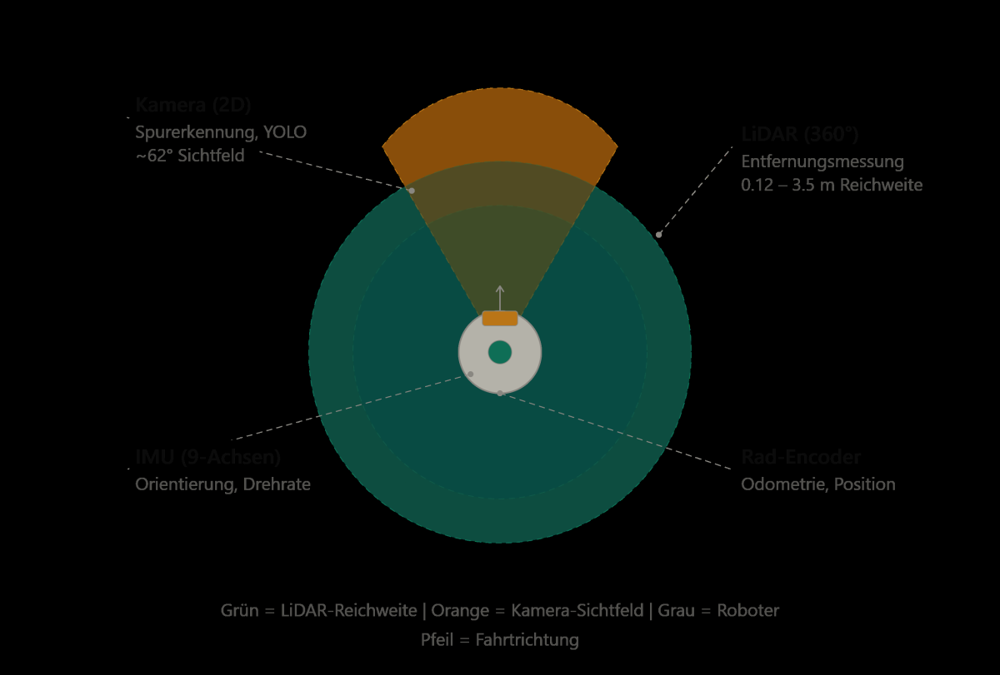
*Sensoren: Kamera vorn (~62° Sichtfeld) für Spur, Schranke und YOLO; LiDAR rundum (0,12–3,5 m)
für Hindernisse und Tunnel; Rad-Encoder und IMU für die Odometrie.*

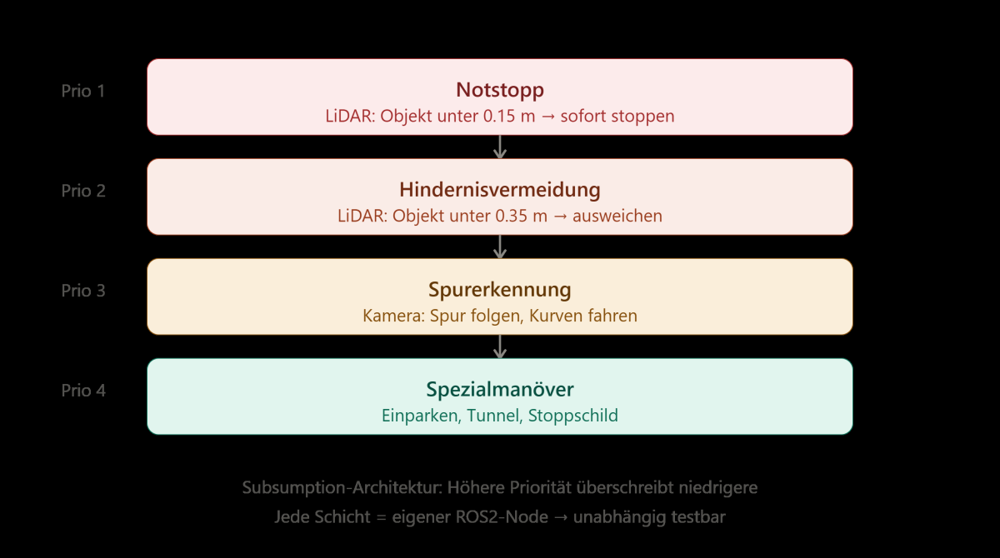
*Ursprüngliches Konzept: Höhere Priorität überschreibt niedrigere. Umgesetzt ist das heute als
Modusentscheidung in `switch_control`; die Abstände im Bild sind die Konzeptwerte, die aktuellen
stehen bei den Aufgaben unten (z. B. Hindernis-Auslöser 0,30 m).*

Kamerabild: 800x600, Weitwinkel. `ingress_node_nav2` entzerrt es (`/lokal/raw_image`). Daraus
berechnet er die **Vogelperspektive (BEV)** mit festem Maßstab in cm (`/lokal/bev`, Bereich in
`Parameter/bev.yaml`). Dafür sind Höhe, Neigung und Lage der Kamera vermessen
(`docs/bev-tests/README.md`).

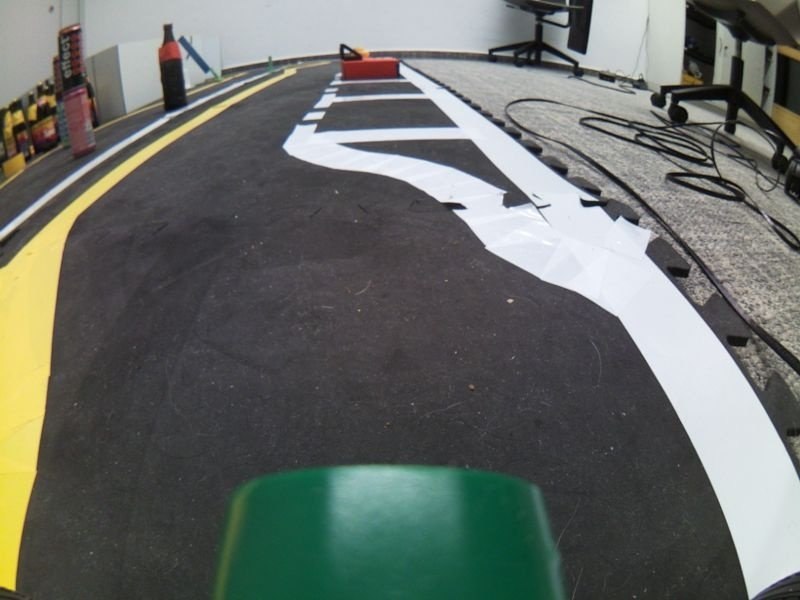
*Rohbild der Bot-Kamera (verzeichnet). Unten im Bild der eigene Magnet.*

---

## 1. Spurfolge (Lane)

**Ziel:** zwischen gelber (links) und weißer Linie (rechts) fahren.

1. **Vogelperspektive:** Die Linien sind darin parallel und überall gleich breit, Abstände sind in cm messbar.
2. **CLAHE:** Kontrastausgleich auf dem Helligkeitskanal, damit Licht und Schatten die festen
   Farbschwellen nicht verschieben.
3. **Farbmasken in LAB** (nicht HSV): Gelb erkennt man am hohen B-Wert, Weiß am hohen L-Wert
   bei A und B nahe 128. Die Schwellen stehen in `Lab_Farben.yaml`. Danach entfernt
   eine Erosion Rauschen, und der eigene Magnet wird ausgeblendet.
4. **Linienkante suchen:** In einem Band um die Suchzeile (`detection_row_factor`, 85 % der
   Bildhöhe) sucht ein Sobel-Filter die zur Spur zeigende Kante. Bei Gelb ist das die rechte Kante, bei
   Weiß die linke. Der Median über die Zeilen ergibt den Punkt. Weiß wird nur rechts von Gelb +
   `min_lane_width` gesucht.
5. **Verfolgung:** Gesucht wird nahe der letzten Position, damit der Bot nicht auf eine andere
   Linie springt. Große Sprünge werden begrenzt. Fehlt eine Linie, gilt kurz die letzte Position,
   danach eine Ersatzspalte.
6. **Spurfehler:** Die Mitte zwischen beiden Punkten wird mit der Bildmitte verglichen.
   Das ergibt `lane_error` (-1 … 1, > 0 = Spur liegt links).
7. **PID** (`control_driving`, `Control_driving_PID_Wide.yaml`: kp 8,0 / ki 0,15 / kd 1,7): Er gibt die
   Lenkung vor. In Kurven fährt der Bot langsamer (`speed_curve_factor`), höchstens `MAX_VEL` 0,15 m/s,
   und die Radgrenze wird eingehalten.

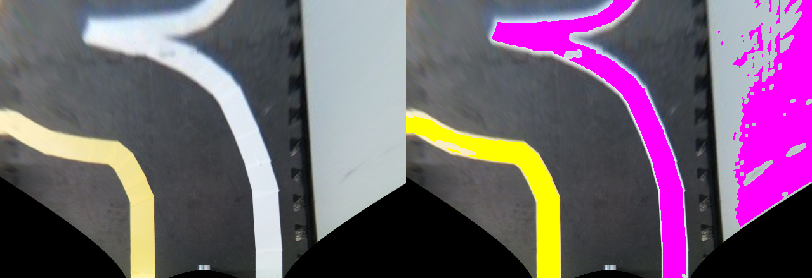
*Links die Vogelperspektive, rechts die Masken: gelb = Gelbmaske, pink = Weißmaske. Die helle Wand
rechts landet teilweise auch in der Weißmaske. Deshalb wird nur nahe der verfolgten Kante gesucht.*

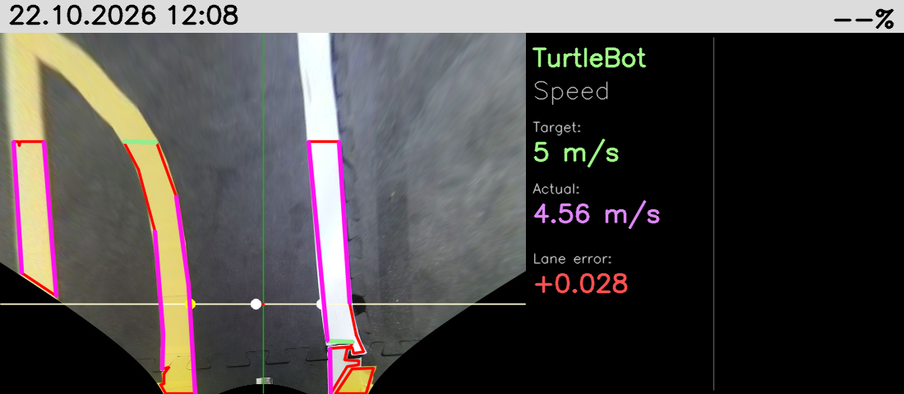
*Debugbild: weiße Querlinie = Suchzeile, Punkte = gefundene Linienkanten und Spurmitte, grüne
Senkrechte = Bildmitte, rechts der Spurfehler.*

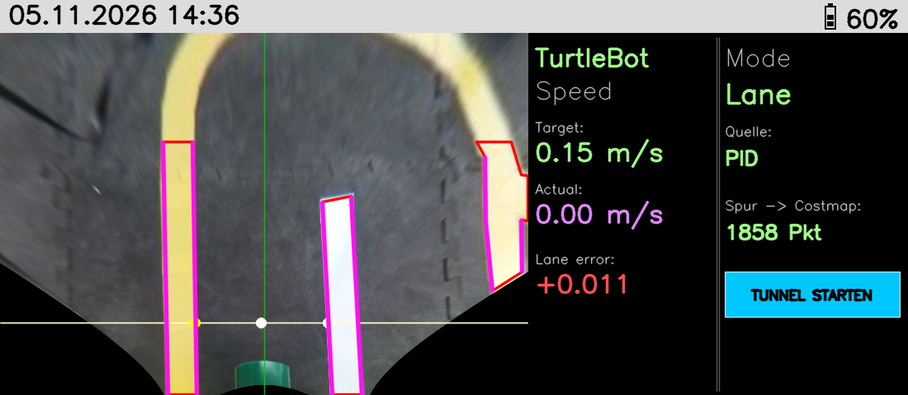
*Aktuelle Debug View im Lane-Modus: Vogelperspektive mit umrandeten Linien (pink) und Suchzeile,
rechts Soll-/Istgeschwindigkeit, Spurfehler, Modus, Quelle des Fahrbefehls und der Tunnel-Button.*
**Nodes:** `ingress_node_nav2` → `detect_lane_nav2` (`/detect/lane`) → `control_driving`.
Kalibrierung: `docs/Kalibrierung_Checkliste.md`.

---

## 2. Schranke

**Ziel:** vor der geschlossenen (blauen) Schranke halten, nach dem Öffnen weiterfahren.

1. **Ausschnitt im entzerrten Rohbild** (nicht in der BEV, die Schranke steht ja in der Luft):
   mittleres Drittel der Breite, 10–40 % der Bildhöhe.
2. **Blaumaske:** CLAHE, dann LAB-Schwellen für Blau (`lab_*_blue_*` in `Lab_Farben.yaml`).
3. **Pixel zählen:** ab `thresh_blue_pixel` (15000) gilt die Schranke als da (`/detect/barrier`).
4. **Entprellen in `switch_control`:** Nach 3 Meldungen in Folge schaltet Lane → **Stop**. Ist die
   Schranke 1 s lang weg, geht es zurück zu **Lane**.

Einstellen: Das Debugbild `/detect/barrier_debug` zeigt den Ausschnitt, die Blaumaske und die aktuelle
Pixelzahl. Den Schwellwert danach in der YAML setzen.

Während Storage zählt die Schranke nicht: Die Zonenschilder sind ebenfalls blau.

*Bild: noch keins vorhanden. Am besten ein Bild von `/detect/barrier_debug` an der Schranke
aufnehmen.*

**Nodes:** `detect_lane_nav2` (`detectBarrier`) → `switch_control` → `control_driving` (Null in Stop).

---

## 3. Kreuzung – rechts vor links

**Ziel:** an der Haltelinie halten, warten, solange ein Bot von rechts kommt, dann geradeaus queren.

**Kreuzung erkennen** (`detect_lane_nav2`, Vogelperspektive):
1. Gelb- und Weißmaske zusammenlegen, mit einem Formfilter nur linienförmige Teile behalten.
2. Gelb und Weiß werden ab der vom PID verfolgten Stelle als Kontur nach vorn abgelaufen.
   Knickt die Linie nach außen ab (Querkante, ~90°), dann ist der Schnittpunkt der beiden
   verlängerten Kanten eine **Ecke** der Kreuzung. Abgerundete Ecken ändern daran nichts.
3. Liegen beide Ecken etwa gleich weit voraus, ist das eine Kreuzung. Die Verbindung der Ecken ist die
   **Haltelinie**. Gemeldet wird erst nach mehreren Bildern in Folge (`/detect/intersection`).

**Ablauf** (`intersection_node`):
1. **Anfahrt:** Der PID fährt weiter. Die Haltelinie wird in Odometrie-Koordinaten gemerkt. Der Abstand
   stimmt also auch dann noch, wenn sie schon unter dem Bot verschwunden ist.
2. **Halt** bei `stop_distance` (15 cm) vor der Linie, mindestens `min_stop_time` (1 s).
3. **Vorfahrt prüfen:** Die YOLO-Boxen der Klasse `tb` (anderer TurtleBot) werden mit ihrer
   **Unterkante** (dort steht der Bot auf dem Boden) in Bodenkoordinaten umgerechnet. Liegt ein Fußpunkt
   in der Zone „rechts“ oder „mitte“ (Kreuzungsfeld), wartet der Bot. Er fährt erst los, wenn eine
   Weile kein Bot dort war.
4. **Queren:** geradeaus mit `cross_speed` (0,1 m/s), Kurs senkrecht zur Haltelinie. Sobald
   hinter der Kreuzung ein Spurpaar sicher zu sehen ist, regelt er darauf. Danach übernimmt
   wieder der normale PID.

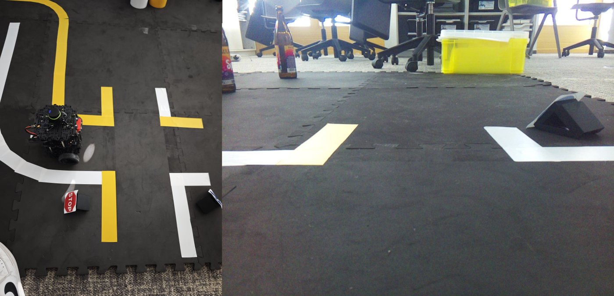
*Links die Kreuzung von oben, rechts ungefähr der Blick der Bot-Kamera. Die Ecken, an denen
die Linien rechtwinklig abknicken, ergeben die Haltelinie.*

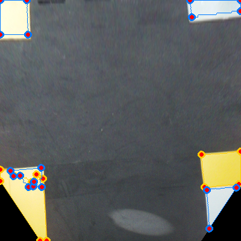
*Versuch zur Eckensuche: Konturen der Linienmasken in der Vogelperspektive mit ihren Eckpunkten
(rot/blau). Unten die beiden Ecken an der Haltelinie, oben die Linien hinter der Kreuzung.*

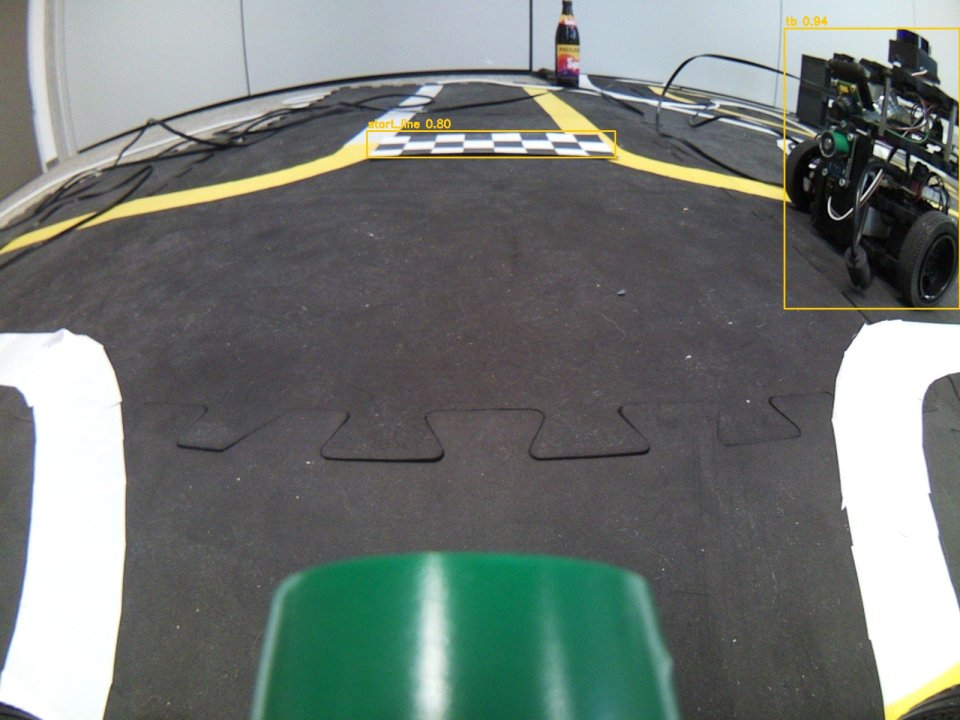
*YOLO auf einem Kamerabild: `tb` = anderer TurtleBot (für die Vorfahrt zählt die Unterkante
der Box), `start_line` = Start-/Ziellinie.*

**Objekterkennung (YOLO / RF-DETR):** Sie läuft als TensorRT-Engine auf der GPU des Laptops auf dem
Rohbild (`/detect/objects`). Die Klassen sind: tb, park, tunnel, stop, left, right, work, start_line,
no_entry. Das Modell und die Rate stellt man mit `detector` und `detector_rate_hz` in
`Follow_Lane_ROI_LAB.yaml` ein, Bedienung siehe `docs/Befehle.md`.

**Start-/Ziellinie:** `start_line`-Boxen, die die Bildmitte überdecken und nah genug am unteren
Bildrand sind (`finish_stop_px`), zählen als Ziellinie. Nach 3 Erkennungen in Folge schaltet
switch_control auf **Stop**, der Lauf ist beendet.

**Nodes:** `detect_lane_nav2` (Haltelinie, YOLO) → `intersection_node` → `switch_control`
(Lane ↔ Intersection) → `control_driving` (`/intersection/cmd_vel`).

---

## 4. Hindernisse (Obstacle)

**Ziel:** Hindernissen auf der Spur ausweichen, ohne die Spur zu verlassen.

1. **Auslöser** (`switch_control`): Ein LiDAR-Punkt liegt im Kegel ±45° voraus näher als
   `obstacle_trigger_distance` (0,30 m), **und keine Spurlinie liegt dazwischen**. Ein Objekt hinter
   einer Linie gehört nicht zur eigenen Fahrbahn. Lane → **Obstacle**.
2. **Spurgedächtnis** (`lane_costmap_node`): Er merkt sich die gelbe und die weiße Linie aus der Kamera
   als **virtuelle Wände** in Odometrie-Koordinaten, auch neben und hinter dem Bot. Die
   Spurmitte wird als Pfad gemerkt.
3. **Karte** (Nav2-Costmaps): Darin liegen die LiDAR-Hindernisse (`scan_correct` korrigiert vorher
   den Messfehler des LiDAR), die Spurwände und eine Sperre hinter dem Startpunkt (`keepout_zone_node`).
4. **Planen und Fahren:** `nav2_goal_publisher` setzt ein Ziel auf der Spurmitte voraus. NavFn
   plant den Weg zwischen den Wänden, durch die Mitte der Lücken. **Regulated Pure Pursuit (RPP)**
   fährt ihn ab.
5. **Sicherheit:**
   - Jeder neue Pfad wird vor der Fahrt mit dem echten Umriss des Bots 1 m voraus geprüft.
   - Bei Engstellen dreht sich der Bot auf die günstigste Gerade und fährt langsam gerade hindurch. Passt
     er nicht hindurch, wird die Stelle gesperrt und neu geplant.
   - Der **Wächter** in `control_driving` prüft jeden Befehl 0,6 s voraus gegen die Karte und
     sendet Null, bevor der Bot irgendwo anstößt.
   - Steckt der Bot fest, fährt er sich mit kleinen Bewegungen frei.
6. **Ende:** 1 s lang nichts näher als 0,40 m → Lane. Steht der Bot dann mehr als 15° schräg,
   dreht er erst auf der Stelle (**Align**).

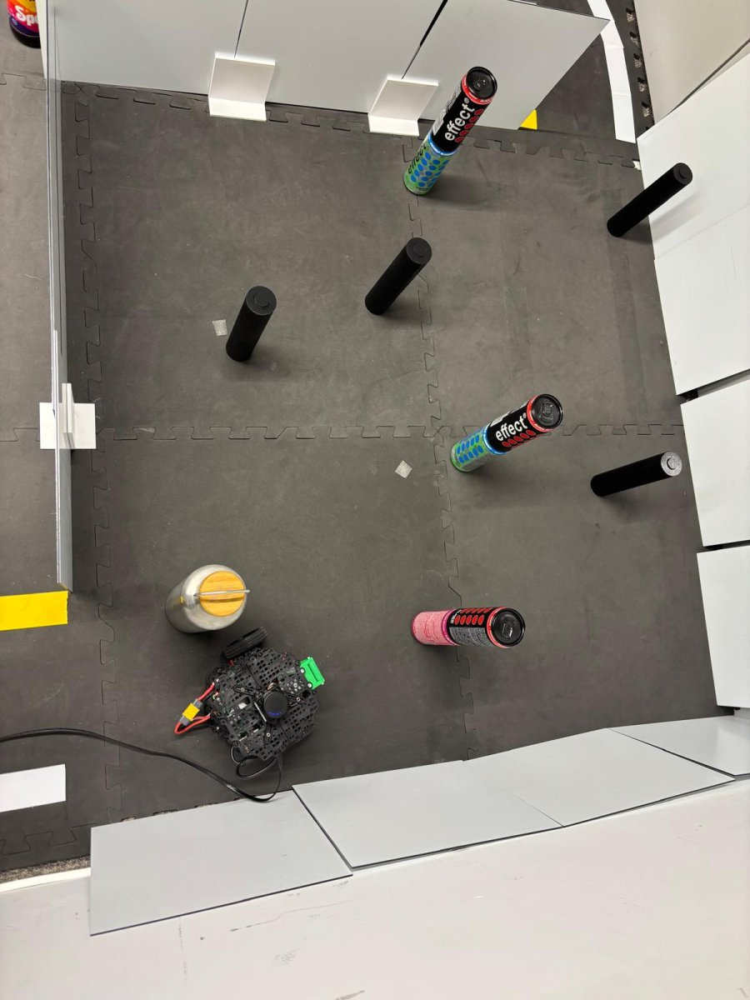
*Testaufbau von oben: Dosen und Rohre als Hindernisse, unten links der Bot.*

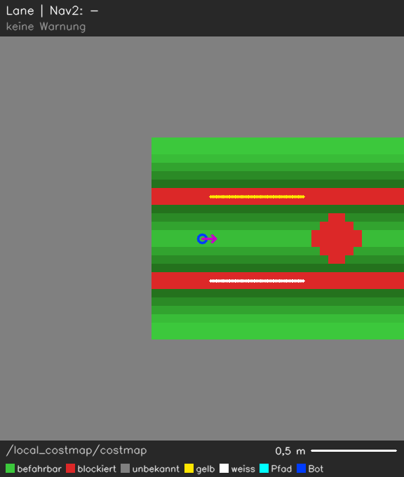
*Karte (`nav2_view`): Gelbe und weiße Linie als Wände mit Sicherheitsabstand (rot), ein Hindernis
in der Spur, grün = befahrbar.*

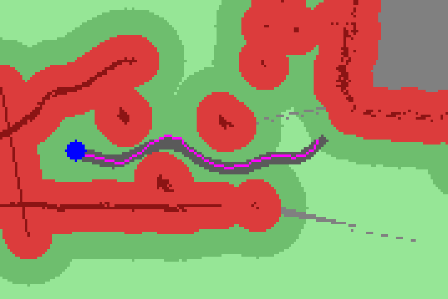
*Geplanter Weg (lila) vom Bot (blau) durch die Lücken zwischen Hindernissen. Rot = gesperrt
(Hindernis plus Abstand), grün = befahrbar, dunkler = näher an einem Hindernis.*

**Nodes:** `switch_control`, `lane_costmap_node`, `scan_correct`, `keepout_zone_node`,
`nav2_goal_publisher`, Nav2 (`planner_server`, `controller_server`), `control_driving`.
Details: `docs/Nav2LocalCoastmap_Doku.md`, `docs/Nav2_Costmap_Werte.md`.

---

## 5. Tunnel

**Ziel:** in den Tunnel hinein, den Ausgang finden und wieder hinaus. **Die Kamera ist im
Tunnel laut Reglement verboten.**

1. **Einfahrt (TunnelEntry):** Ausgelöst wird sie aktuell über den Button im Debugbild. Den
   Eingang `/detect/sign` für ein Tunnelschild gibt es schon, er hat aber noch keinen Sender. Bis zur
   Öffnung fährt der PID mit Kamera, denn auf der 20-cm-Spur passt der Bot für Nav2 nicht zwischen die
   Spurwände.
2. **Wechsel auf LiDAR (Tunnel):** Wenn beide Spurlinien kurz vor dem Bot enden, ist die Öffnung erreicht.
   Ab dann ist die Kamera aus (auch die Bildverarbeitung in `detect_lane` pausiert).
3. **Tür finden** (`tunnel_explorer_node`): Er sucht die Öffnung im Scan und fährt mit Nav2 hindurch.
   Danach wird die Tür gesperrt (`keepout_zone_node`), damit der Bot nicht wieder hinausfährt.
4. **Ausgang suchen:** Die Wände bilden eine **Hülle** (konvexe Hülle der Wandpunkte). Ein
   Ausgang kann dort sein, wo Unbekanntes direkt an der Wand liegt. Grau tiefer in der Hülle ist nur
   Schatten hinter Hindernissen. Ziele werden mit Nav2 angefahren (wie bei Obstacle: Pfadprüfung,
   Engstellen, Freifahren). Ab 40 s zählt bei der Zielwahl nur noch die Nähe.
5. **Draußen:** Hat der Bot die Hülle ganz verlassen, geht es zurück in den Modus von vorher.
   Das alles braucht keine Maße des Tunnels.

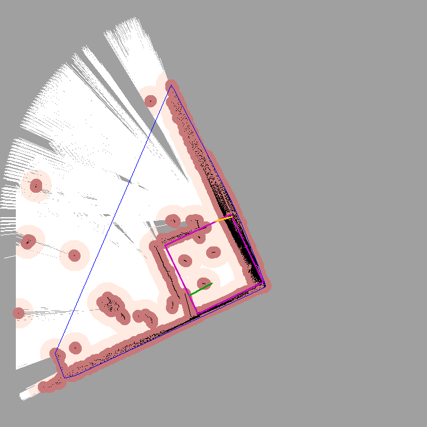
*Protokollbild einer Tunnelfahrt (`logs/tunnel/<Zeit>/map.png`): schwarz = Wände/Hindernisse,
rötlich = Sicherheitsabstand, weiß = frei, grau = unbekannt. Blau = Wandhülle, lila =
erkannter Tunnelkasten, grün = Tür, orange = Ausgang.*

Offener Punkt (13.11.): Steht der Bot schon schräg im Eingang, wählt die Türsuche manchmal
eine falsche Strecke (`docs/Obstacle_Tunnel_Offene_Punkte.md`, Punkt 8).

**Nodes:** `switch_control` (TunnelEntry/Tunnel), `detect_lane_nav2` (`/detect/lines_lost`),
`tunnel_explorer_node`, `keepout_zone_node`, `nav2_goal_publisher`, Nav2, `control_driving`.

---

## 6. Storage – Palette umsetzen

**Ziel:** Die Palette aus ihrer Zone holen und in die Zielzone (gibt die Jury vor) legen, ohne eine
andere Zone zu überqueren. Palette, Stütze und Schilder liegen **unter der LiDAR-Ebene**, deshalb
gibt es **nur Kamera und Odometrie**.

1. **Start** per Button STORAGE STARTEN im Debugbild. Den Ablauf steuert `storage_sequence`
   (Teil von `switch_control`).
2. **Erkunden:** Spurfolge entlang der Zonen (sie liegen rechts der Spur). `storage_zone_node`
   findet in der Vogelperspektive die **weißen Querlinien** neben der Spur, also die Zonengrenzen.
   Daraus entsteht das **Zonenmodell** (Lage und Breite jeder Zone, in Odometrie-Koordinaten).
3. **Vor jeder Zone:** zur Zonenmitte fahren, zur Zone drehen und lesen:
   - **Schild** (`storage_sign_node`): blauer Kreis mit weißer Ziffer 1–3, Vorlagenvergleich.
   - **Füllung:** Ist zwischen den Zonenlinien genug, was weder dunkler Boden noch weiße Linie ist?
     Dann steht dort die Palette. Den Boden lernt der Node selbst aus der Spurmitte, einen festen
     Schwellwert gibt es nicht.
4. **Ausrichten** (Maneuver): Die Vorderkante der Palette in der BEV ergibt Abstand und seitliche
   Lage. Bei Versatz fährt er parallel zur Spur nach und dreht wieder zur Zone.
5. **Andocken:** geradeaus, zuletzt mit 3 cm/s. Kontakt erkennt `pallet_node` daran, dass **das Bild
   über dem Magneten stillsteht**, obwohl der Bot vorfährt.
6. **Greifen:** Magnet an, 3 cm zurück. Bleibt das Bild über dem Magneten gleich (Korrelation
   ≥ 0,8), hängt die Palette.
7. **Transport:** rückwärts auf die Spur, entlang der Spur zur Zielzone, hineindrehen.
8. **Ablegen:** genauso tief hinein wie beim Aufnehmen, Magnet aus. **Verlassen:** zurück
   auf die Spur, weiter mit Spurfolge.

*Bild: noch keins vorhanden. Gut wären ein Bild von `/detect/zone_debug` (Palette rot getönt,
Zonengrenzen gelb) und eins von `/detect/storage_sign_debug`.*

**Nodes:** `switch_control` + `storage_sequence`, `storage_zone_node`, `storage_sign_node`,
`pallet_node`, `control_driving` (Maneuver), Magnet über `/lokal/magnet_control`.
Ausführlich: `docs/Storage_Retrieval_Konzept.md`.

---

## Starten

```bash
bash scripts/tb/launchers/komplett.sh       # alles: Spur, Schranke, Kreuzung, Nav2, Tunnel, Storage
bash scripts/tb/launchers/follow_lane.sh    # nur Spurfolge (+ Schranke, Kreuzung), ohne Nav2
```

Weitere Befehle: `docs/Befehle.md`.

## Weiterführend

| Datei | Inhalt |
|-------|--------|
| `docs/Konzept_Nav2.md` | Architektur, Modi, Obstacle und Tunnel im Detail |
| `docs/Nav2LocalCoastmap_Doku.md` | Nodes, Parameter, Abläufe Obstacle/Tunnel |
| `docs/Storage_Retrieval_Konzept.md` | Storage: Zustände, Topics, Entscheidungen |
| `docs/Kalibrierung_Checkliste.md` | Kamera, Vogelperspektive, Farbschwellen |
| `docs/bev-tests/README.md` | Vermessung der Kamera, Schärfe der Vogelperspektive |
| `docs/Obstacle_Tunnel_Offene_Punkte.md` | Testbeobachtungen, offene Punkte |
