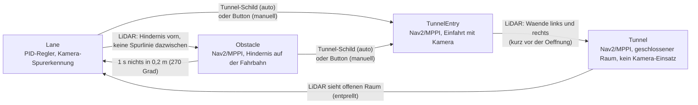
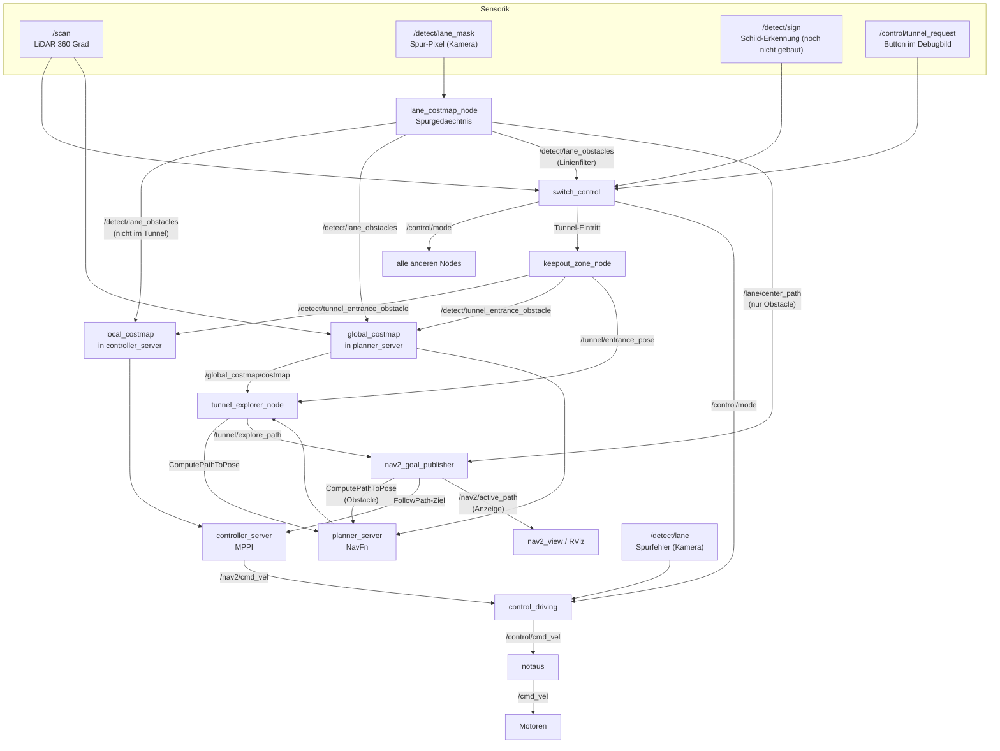
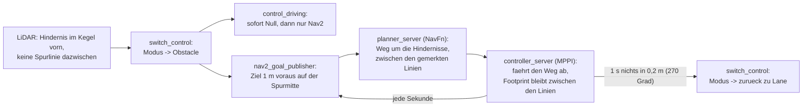
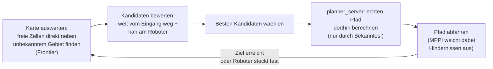

# Nav2-Fahrmodi: Hindernisvermeidung & Tunnel-Navigation

Dokumentation für alle, die nicht direkt am Code gearbeitet haben, aber verstehen wollen/müssen, wie die Nav2-Fahrmodi funktionieren und welche Werte am Wettbewerbstag ggf. angepasst werden müssen.

---

## 1. Worum geht's

Neben der PID-Spurregelung (`Lane`-Modus) haben wir eine zweite, parallele Fahr-Pipeline auf Basis von **Nav2** (dem Standard-Navigationsframework von ROS2) gebaut. Diese eine Pipeline deckt **zwei unterschiedliche Situationen** ab, die sich beide Infrastruktur teilen (dieselbe Costmap, derselbe MPPI-Regler, derselbe Übergabe-Node), sich aber in ihrem Zweck unterscheiden:

- **Obstacle-Modus:** liegt im Hindernisbereich außerhalb des Tunnels ein Hindernis in der per Kamera erkannten Fahrbahn, übernimmt Nav2 kurzzeitig, weicht aus und bleibt dabei zwischen den Spurlinien. Läuft automatisch, ohne Zeitdruck, mitten im normalen Rennen.
- **Tunnel-Modus:** eigener Streckenabschnitt (im Reglement „Enclosure“), ausgelöst per Schild oder per Button im Debugbild: der Roboter fährt in einen geschlossenen Raum mit Hindernissen, muss ihnen ausweichen und **innerhalb eines Zeitlimits** einen Ausgang finden — aber nicht den, durch den er reingefahren ist. **Die Kamera ist dort laut Reglement verboten**, es zählt nur der LiDAR.

Beide Modi laufen über dieselben Nodes, aktivieren sich aber unabhängig voneinander und nutzen teils unterschiedliche Zusatz-Nodes (siehe Abschnitt 3/4). Die Pipeline läuft die ganze Zeit mit, wird aber nur aktiv, wenn der Roboter tatsächlich im Obstacle- oder Tunnel-Modus ist.

---

## 2. Die drei Fahrmodi

Ein einziger Node (`switch_control`) entscheidet, welcher der folgenden Modi gerade aktiv ist, und alle anderen Nodes richten sich danach:

- **Lane**: der normale Betrieb, PID-Regler folgt der Spur.
- **Obstacle**: sobald der LiDAR etwas direkt vor dem Roboter erkennt und zwischen Roboter und Objekt keine Spurlinie liegt, übernimmt Nav2, plant einen Weg darum herum und fährt ihn ab — automatisch, ohne Schild. Objekte auf der anderen Seite einer Spurlinie (z. B. Hindernisse neben dem Rückweg) lösen nichts aus. Zurück zu Lane geht es, wenn 1 s lang im Umkreis von 0,2 m nichts liegt, gemessen nach vorn, zur Seite und schräg nach hinten (270°). Der Keil direkt hinter dem Bot zählt nicht, von dort kam er gerade.
- **TunnelEntry**: Einfahrt. Der Bot steht vor dem Tunnel; wie im Obstacle-Modus plant NavFn einen Weg 1 m voraus entlang der Spurmitte, also durch die Öffnung. Die Kamera ist hier noch erlaubt. Sieht der LiDAR links und rechts voraus die Tunnelwände näher als `tunnel_side_distance`, schaltet `switch_control` auf `Tunnel` — beim 0,5 m breiten Testtunnel ~20 cm vor der Öffnung, also bevor der Bot drin ist. Sicherheitsnetz: nach `tunnel_entry_max_distance` gefahrener Strecke ebenfalls.
- **Tunnel**: eigener Modus für den geschlossenen Raum, ohne Kamera. Beim Umschalten werden Spurgedächtnis und beide Karten geleert und die Eingangssperre an die Öffnung gesetzt; die Tunnelkarte bleibt bis zum Austritt. Erst jetzt ist die Austrittsprüfung aktiv. Ausgelöst wird der Tunnel auf zwei Wegen:
  - **Schild:** ein Erkennungsmodell sendet `6` (`std_msgs/UInt8`) auf `/detect/sign`. Das Modell ist noch nicht gebaut. Die Schildnummern stehen in `SignType` (`common.py`), getrennt von den Modusnummern; welcher Modus aus einem Schild folgt, entscheidet `switch_control`.
  - **Button „TUNNEL STARTEN“ im Debugbild:** Jede Challenge läuft einzeln, vor Ort gibt es also keinen Auslöser für die Zustandsmaschine. Der Bot steht dabei vor der Öffnung. In TunnelEntry und Tunnel wird daraus „TUNNEL ABBRECHEN“. Nach dem automatischen Austritt springt der Button von selbst zurück.

  Wer ausgelöst hat, steht im Debugbild unter dem Modus: „(manuell)“ oder „(auto)“, auch auf `/control/tunnel_source`.

`switch_control` merkt sich beim Eintritt in den Tunnel, welcher Modus vorher aktiv war, und stellt genau den beim Verlassen wieder her (nicht stur "zurück zu Lane"). Jeder Moduswechsel wird sofort auf `/control/mode` gesendet, zusätzlich alle 0,5 s.

Die Werte `Stop`, `Intersection` und `Align` gibt es im Enum schon, sie haben aber noch keinen Auslöser (vorgesehen für Schranke und Kreuzung an Tag 1). In diesen Modi sendet `control_driving` Null.

### Wer fährt, wer nutzt die Kamera?

Fahrbefehle erzeugt nur `control_driving`. Er wählt je nach Modus die Quelle und sendet auf `/control/cmd_vel`; der Not-Aus (`notaus`) reicht das nach Freigabe an `/cmd_vel` durch.

| | **Lane-Modus** | **Obstacle-Modus** | **Tunnel-Modus** |
|---|---|---|---|
| Quelle in `control_driving` | PID auf `/detect/lane` | `/nav2/cmd_vel` (MPPI), unverändert | `/nav2/cmd_vel` (MPPI), unverändert |
| Wer nutzt die Kamera? | `control_driving` über `/detect/lane`; `lane_costmap_node` für die Spurwände | `lane_costmap_node` für die Spurwände | niemand: `ingress_node` und `detect_lane` pausieren (Reglement) |
| Was steht in local_ und global_costmap? | LiDAR + Spurgedächtnis | LiDAR + Spurgedächtnis | LiDAR + Eingangssperre |
| Wird geplant? | nein, nichts geplant und nichts angezeigt | ja: NavFn plant ~1×/s einen Weg um die Hindernisse, MPPI fährt ihn ab | ja: Explorer + NavFn |

**Wie die Spurwände ohne bekannte Breite funktionieren:** Die Breite des Hindernisbereichs kennen wir erst am Wettbewerbstag. Deshalb hängt kein Wert davon ab. MPPI prüft Kollisionen mit dem echten Umriss des Burger (138 × 178 mm, `footprint` in `nav2_params.yaml`). Eine Fahrbewegung ist verboten, sobald der Umriss eine Linie oder ein Hindernis berührt, und erlaubt, wenn er dazwischen passt. Die Inflation um die Linien ist nur ein Kostengefälle, das zur Mitte zieht. Details: `docs/Nav2_Costmap_Werte.md`, Abschnitt 3.

Weil nur `control_driving` auf `/control/cmd_vel` sendet, konkurrieren nie zwei Regler. Ist die aktive Quelle veraltet (PID: 0,3 s ohne `/detect/lane`, Nav2: 0,25 s ohne `/nav2/cmd_vel`) oder kommt 1,5 s kein `/control/mode`, sendet er Null. Bei jedem Moduswechsel sendet er sofort Null und nimmt nur Befehle an, die danach eintreffen. Nach dem Wechsel in den Tunnel ignoriert er Nav2 zusätzlich 0,3 s lang, bis das alte Obstacle-Ziel (Spurmitte, also Kameradaten) abgebrochen ist.

---

## 3. Gesamtarchitektur

Wichtig zum Verständnis: **`lane_costmap_node` sendet die Spurwände in jedem Modus außer Tunnel, die Spurmitte nur in Obstacle und TunnelEntry, und leert beim Wechsel auf Tunnel Gedächtnis und local_costmap. `nav2_goal_publisher` plant nur in Obstacle, TunnelEntry und Tunnel. `keepout_zone_node` und `tunnel_explorer_node` arbeiten nur im Tunnel-Modus.** Außerhalb ihres jeweiligen Modus veröffentlichen sie nichts.

---

## 4. Die Nodes im Einzelnen

### `switch_control` — die Zustandsmaschine
Entscheidet, welcher Modus aktiv ist (siehe Abschnitt 2), und veröffentlicht das laufend auf `/control/mode`. Alle anderen Nodes lesen nur mit, niemand sonst darf diesen Wert verändern. Für Eintritt und Austritt des Obstacle-Modus prüft er jeden LiDAR-Punkt gegen das Spurgedächtnis (`/detect/lane_obstacles`): Liegt auf der Strecke Bot → Punkt eine Spurlinie, gehört der Punkt nicht zur eigenen Fahrbahn und zählt nicht. Ist das Gedächtnis älter als `lane_max_age`, zählt jeder Punkt. Den Tunnel-Wunsch des Buttons bekommt er auf `/control/tunnel_request` (`True` = Start, `False` = Abbruch), den Auslöser meldet er auf `/control/tunnel_source` (`Hand`, `Schild` oder leer).

### `control_driving` — die einzige Quelle für Fahrbefehle
Wählt je nach `/control/mode` den PID (Lane) oder reicht `/nav2/cmd_vel` unverändert durch (Obstacle, Tunnel); in jedem anderen Modus Null. Die MPPI-Grenzen (`vx_max`, `wz_max`) stehen nur in `nav2_params.yaml`. Zeitgrenzen und Verhalten beim Moduswechsel siehe Abschnitt 2.

### `notaus` — die Fahrfreigabe
Letzte Stufe zwischen `/control/cmd_vel` und `/cmd_vel`. Erzeugt keine Bewegung, reicht nur nach Freigabe (Leertaste, rqt `drive`, `/notaus/set`) durch oder sendet Null, auch wenn 0,5 s (`cmd_timeout_s`) nichts kommt.

### `debug_view` — das Debugbild mit Tunnel-Button
Zeichnet das Debugbild auf `/lokal/debug_view`, angezeigt in `rqt_image_view`. Im Tunnel steht statt des Kamerabilds ein Platzhalter. Unten im Mode-Panel liegt der Tunnel-Button. Ein Klick darauf kommt als Klickposition von `rqt_image_view` auf `/lokal/debug_view_mouse_left` an. Dafür muss in `rqt_image_view` einmal die Checkbox **„Publish click location“** angehakt sein.

### `lane_costmap_node` — das Spurgedächtnis (nicht im Tunnel)
Wandelt die von der Kamera erkannten Spurlinien-Pixel aus der metrischen Vogelperspektive `/lokal/bev` über `Parameter/bev.yaml` in Meter um und merkt sie sich in einem ortsfesten Raster (odom-Frame, 2,5 cm). Eine Zelle wird erst nach `line_confirm_frames` (3) Bildern in Folge zur Linie und erst nach `free_confirm_frames` (10) Bildern in Folge ohne Linie wieder frei. Abgestimmt wird nur, was die Kamera gerade sieht (Sichtmaske `/lokal/bev_view` von `ingress_node`); Zellen im Sichtschatten eines LiDAR-Hindernisses bekommen keine „frei“-Stimme, weil das Hindernis die Linie dort nur verdeckt. So kennt Nav2 auch Linien neben und hinter dem Bot, die die Kamera (5–60 cm voraus) nicht mehr sieht.

Gesendet wird jedes Mal das ganze Gedächtnis im Umkreis von 2 m auf `/detect/lane_obstacles` — an die `lane_layer` beider Costmaps und an `switch_control`. Sendet auch im Lane-Modus, damit der Korridor beim Umschalten schon in der Karte steht. Die Spurmitte (`/lane/center_path`, mit laufend gemessener Spurbreite) sendet er nur im Obstacle-Modus. Im Tunnel sendet er nichts und verwirft beim Eintritt das Gedächtnis und leert die local_costmap.

### `nav2_view` — die Draufsicht mit Statuszeile
Zeichnet auf `/nav2/view` ein Bild davon, was Nav2 sieht und plant: im Tunnel die `global_costmap`, sonst die `local_costmap` mit den Spurwänden. Grün ist befahrbar (dunkler = nah am Hindernis), rot blockiert, grau unbekannt, gelb/weiß die erkannten Spurlinien (`/detect/lane_mask`). Blau der Umriss des Bots (`/local_costmap/published_footprint`) mit Fahrtrichtung (magenta), cyan der Pfad, dem Nav2 gerade folgt (`/nav2/active_path`), mit Ziel (X) — nur während einer Fahrt, im Lane-Modus nie, orange die Eingangssperre, hellblau die LiDAR-Punkte. Unten eine Legende. Die Ausrichtung ist fest (odom-X nach rechts), sodass Wände stillstehen und nur der Bot sich bewegt.

Oben steht die Statuszeile: Modus und Auslöser, was `nav2_goal_publisher` gerade tut (`/nav2/status`, z. B. „faehrt: Bahnplaner (Spurmitte)“ oder „kein Weg gefunden“), und darunter die letzte Warnung bzw. der letzte Fehler der Nav2-Knoten aus `/rosout`, zum Beispiel „controller_server: Failed to make progress“. Das ist der Abbruchgrund: Das FollowPath-Ergebnis meldet in Humble nur „abgebrochen“, den Grund schreibt `controller_server` nur ins Log. Rot heißt jünger als 10 s.

Gezeigt wird ein Ausschnitt: außerhalb des Tunnels ein Quadrat von `local_view_size_m` (2,4 m) um den Bot. Das deckt die MPPI-Vorausschau (~1 m) mit Rand ab. Im Tunnel werden keine Spurlinien gezeichnet. Es ist zentriert, damit das Bild beim Lenken nicht springt. Im Tunnel ist es nur die schon gesehene Fläche plus `tunnel_view_margin_m` (0,3 m), sodass das Bild mit der Karte herauszoomt.

`nav2_obstacle` öffnet dafür ein zweites `rqt_image_view`-Fenster.

### `keepout_zone_node` — die Eingangs-Sperrzone (nur Tunnel-Modus)
Merkt sich beim Wechsel auf `Tunnel` einmalig die Roboterpose, um `entrance_wall_offset` (0,2 m) nach vorn an die Öffnung geschoben, und blockiert diese Stelle dauerhaft als virtuelle Wand — damit der Roboter nicht durch den Eingang wieder rausfährt. Die Wand bleibt an dieser Stelle, wird aber erst gesendet, wenn der Bot `entrance_wall_delay` weit davon weggefahren ist. Vorher stünde er selbst in ihr. Die Wand nach hinten zu verschieben wäre keine Lösung, weil dann eine Lücke zum Eingang entstünde. Setzt außerdem beim Wechsel auf `Tunnel` die Karte des Bahnplaners (`global_costmap`) zurück: Danach zeigt sie nur noch den Tunnel (LiDAR + Eingangssperre), und das bleibt so bis zum Austritt.

### `tunnel_explorer_node` — die Ausgangssuche (nur Tunnel-Modus)
Der "Kopf" der Exploration: sucht auf der Tunnelkarte nach unerkundeten Bereichen, wählt den vielversprechendsten aus (weit weg vom Eingang, aber noch schnell erreichbar) und lässt dorthin einen echten Pfad berechnen. Nur Bereiche **jenseits der Eingangslinie** in Einfahrtrichtung kommen in Frage: Beim Umschalten steht der Bot noch vor der Öffnung und sieht auch den freien Raum hinter sich, „weit weg vom Eingang“ würde sonst genau dorthin ziehen. Details siehe Abschnitt 7.

### `nav2_goal_publisher` — der Übergeber
Schickt das eigentliche Fahrkommando an Nav2. Im Obstacle-Modus setzt er ein Ziel `goal_distance` (1 m) voraus auf der Spurmitte von `lane_costmap_node` (über ihr Ende hinaus in ihrer Richtung verlängert; ohne aktuelle Spurmitte geradeaus), lässt `planner_server` einen Weg dorthin um die Hindernisse rechnen und gibt ihn `controller_server`. Alle `replan_period` (1 s) wird neu geplant. Im Tunnel-Modus nimmt er den Pfad, den `tunnel_explorer_node` geliefert hat. Den Pfad, dem Nav2 gerade folgt, veröffentlicht er auf `/nav2/active_path`; beim Verlassen des Modus leert er ihn. Im Lane-Modus ruht er.

### `controller_server` (Nav2, MPPI) — die eigentliche Fahrsteuerung
Nav2-Standardkomponente, nicht selbst geschrieben. Nimmt den Pfad entgegen und berechnet daraus in Echtzeit die tatsächlichen Fahrbefehle (auf `/nav2/cmd_vel`), wobei er mit dem echten Umriss des Bots gegen die `local_costmap` prüft und lokal abweicht, wo der Pfad zu eng ist.

### `planner_server` (Nav2, NavFn) — der Bahnplaner (Obstacle und Tunnel)
Nav2-Standardkomponente. Berechnet auf der `global_costmap` (LiDAR + Spurgedächtnis, im Tunnel LiDAR + Eingangssperre) einen Weg zu einem Zielpunkt: im Obstacle-Modus auf Anfrage von `nav2_goal_publisher` um die Hindernisse herum, im Tunnel auf Anfrage von `tunnel_explorer_node`. Immer **nur durch bereits bekanntes, freies Gebiet** (siehe Abschnitt 7). NavFn plant für einen Kreis mit `robot_radius` 0,105 m, nicht für den echten Umriss.

---

## 5. Parameter-Referenz — was anpassen, was bedeutet es

### 5.1 `switch_control.py` → Datei `Switch_Control.yaml`

| Parameter | Wert (YAML) | Bedeutung | Auswirkung |
|---|---|---|---|
| `obstacle_check_angle_deg` | 20.0° | **Halb**winkel des Prüfkegels nach vorne (Gesamtkegel 40°), in dem nach Hindernissen gesucht wird | Größer = reagiert auch auf Hindernisse seitlich vor dem Roboter; kleiner = nur was direkt vor der Nase liegt |
| `obstacle_trigger_distance` | 0.20 m | Ab welcher Nähe (ab LiDAR) gilt "da ist ein Hindernis" | Größer = reagiert früher, Nav2 hat mehr Platz zum Ausweichen; kleiner = fährt näher ran. Wird vor Ort abgestimmt |
| `obstacle_clear_angle_deg` | 135° | **Halb**winkel des Austrittsbereichs (270°, ohne den Keil direkt hinten) | Kleiner = Hindernisse schräg hinten halten den Obstacle-Modus nicht mehr |
| `obstacle_clear_distance` | 0.20 m | In diesem Umkreis darf nichts mehr liegen, damit es zurück zu Lane geht | Größer = bleibt länger im Obstacle-Modus |
| `obstacle_clear_debounce` | 1.0 s | Wie lange der Austrittsbereich durchgehend frei sein muss | Größer = stabiler, aber langsamer zurück in den Lane-Modus; kleiner = kann bei flackernden Messwerten hin- und herspringen |
| `line_block_tolerance` | 0.02 m | So nah muss ein Linienpunkt an der Strecke Bot → Hindernis liegen, damit er sie trennt | Größer = filtert großzügiger |
| `line_obstacle_margin` | 0.05 m | Linienpunkte so dicht vor dem Hindernis zählen nicht (Hindernis steht auf der Linie, ragt also in die Fahrbahn) | Größer = Hindernisse nahe der Linie lösen eher aus |
| `lane_max_age` | 0.5 s | Ist das Spurgedächtnis älter, wird nicht gefiltert | — |
| `tunnel_side_distance` | 0.35 m | Einfahrt: links und rechts voraus muss eine Wand näher als das sein, damit auf `Tunnel` umgeschaltet wird (Kamera aus). Hängt an der Tunnelbreite: halbe Breite (0,25 m beim Testtunnel) + Reserve | Kleiner = schaltet näher an der Öffnung um; größer = früher, aber Gefahr durch andere Wände neben der Strecke |
| `tunnel_side_angle_min_deg` / `_max_deg` | 30° / 100° | Sektoren links und rechts, in denen die Tunnelwände gesucht werden | — |
| `tunnel_entry_debounce` | 0.2 s | So lange müssen die Wände gesehen werden | Größer = robuster, schaltet aber später um |
| `tunnel_entry_max_distance` | 0.8 m | Sicherheitsnetz: nach so viel Strecke ab dem Umschalten gilt der Bot als drin | Etwas mehr als der Abstand, mit dem der Bot vor dem Tunnel steht |
| `tunnel_exit_open_distance` | 1.5 m | Ab welcher Distanz ein einzelner LiDAR-Strahl als "offen/frei" zählt | Größer = strengere Anforderung an "offener Raum" |
| `tunnel_exit_open_ratio` | 0.8 | Welcher Anteil aller LiDAR-Strahlen offen sein muss, damit "offener Raum" erkannt wird | Größer = strenger (fast alles muss frei sein); kleiner = reicht schon, wenn ein Teil frei ist |
| `tunnel_exit_debounce` | 1.0 s | Wie lange der LiDAR durchgehend offenen Raum sehen muss | Wie oben: Stabilität vs. Reaktionsgeschwindigkeit |

Die Tunnelausfahrt läuft bewusst nur über den LiDAR — die Kamera ist in der Enclosure verboten.

**Muss angepasst werden:** wahrscheinlich `obstacle_trigger_distance` und `tunnel_exit_open_distance`, je nachdem wie schnell der Roboter fährt und wie das Streckenlayout aussieht. Am besten mit `ros2 topic echo /control/mode` live beobachten und nachjustieren.

### 5.2 `lane_costmap_node.py` → Block `/lane_costmap_node` in `Lane_Costmap.yaml`

| Parameter | Wert | Bedeutung | Auswirkung |
|---|---|---|---|
| `pixel_stride` | 2 | Wie stark die Maskenpunkte ausgedünnt werden, bevor sie ins Gedächtnis gehen | Größer = weniger Punkte, spart Rechenzeit, aber gröbere Wand |
| `line_confirm_frames` | 3 | So viele Bilder in Folge mit Linie, bis eine Zelle als Linie gilt | Größer = robuster gegen Fehldetektionen, Linien erscheinen später |
| `free_confirm_frames` | 10 | So viele Bilder in Folge ohne Linie (sichtbar, nicht verdeckt), bis eine Linie vergessen wird | Größer = Linien halten länger, falsche bleiben aber auch länger |
| `memory_radius` | 2.0 m | Weiter entfernte Zellen werden vergessen | Nicht größer als die Reichweite der `lane_layer` (2,0 m) |
| `memory_resolution` | 0.025 m | Zellgröße des Gedächtnisses | = `resolution` der Costmaps |
| `shadow_radius` / `shadow_margin` | 0.03 / 0.05 m | Sichtschatten eines LiDAR-Punkts für die Kamera | Größer = verdeckte Linien werden sicherer behalten |

Sendet in jedem Modus außer Tunnel. Pixel → Meter und Reichweite (bis 0,60 m) kommen aus `Parameter/bev.yaml`, nicht aus dieser Datei. Details: `docs/Nav2_Costmap_Werte.md`, Abschnitt 4.

### 5.3 `keepout_zone_node.py` → Block `/keepout_zone_node` in `Lane_Costmap.yaml`

| Parameter | Standard | Bedeutung | Auswirkung |
|---|---|---|---|
| `entrance_wall_width` | 0.6 m | Wie breit die virtuelle Sperrwand am Tunneleingang ist | **An die reale Breite der Tunnelöffnung anpassen** — zu schmal = Roboter kann seitlich noch vorbei; zu breit = blockiert unnötig viel vom Raum |
| `entrance_wall_points` | 9 | Wie viele Einzelpunkte die Wand hat | Mehr = dichtere, lückenlosere Wand; braucht kaum mehr Rechenzeit |
| `publish_rate` | 5.0 Hz | Wie oft die Wand neu veröffentlicht wird | Niedriger reicht meist (die Wand bewegt sich ja nicht), höher schadet aber auch nicht |
| `entrance_wall_offset` | 0.2 m | So weit vor die Pose beim Umschalten wird die Sperre gesetzt — an die Öffnung, weil `switch_control` ~20 cm davor umschaltet | An `tunnel_side_distance` und die Tunnelbreite anpassen |
| `entrance_wall_delay` | 0.16 m | Wie weit der Bot von der Eintrittslinie weg sein muss, bevor die Wand erscheint. Abgeleitet: Heck 0,101 m (Footprint) + `footprint_padding` 0,01 m + 0,05 m Reserve | Kleiner = Bot steht im ersten Moment in der Wand und MPPI blockiert |

### 5.4 `tunnel_explorer_node.py` → Block `/tunnel_explorer_node` in `Lane_Costmap.yaml`

| Parameter | Standard | Bedeutung | Auswirkung |
|---|---|---|---|
| `arrival_radius` | 0.3 m | Ab welcher Nähe zum aktuellen Etappenziel ein neues gesucht wird | Kleiner = fährt genauer bis zum Zielpunkt; größer = wechselt früher zum nächsten Ziel |
| `stall_timeout` | 10.0 s | Nach wie vielen Sekunden ohne Fortschritt ein neues Ziel gesucht wird (Notausgang, falls der Roboter feststeckt) | Kleiner = gibt schneller auf und probiert was anderes; größer = mehr Geduld, bevor umgeplant wird |
| `entrance_weight` | 1.0 | Wie stark "weit weg vom Eingang" bei der Zielwahl zählt | Größer = strebt konsequenter vom Eingang weg |
| `robot_distance_weight` | 0.3 | Wie stark "nah am Roboter, also schnell erreichbar" bei der Zielwahl zählt | Größer = bevorzugt nahe, schnell erreichbare Ziele stärker gegenüber weit entfernten |
| `free_cost_threshold` | 50 | Ab welchem Kostenwert eine Kartenzelle noch als "frei" gilt | Höher = großzügiger, was noch als befahrbar gilt |
| `min_frontier_cluster_cells` | 12 | Wie groß ein unerkundeter Randbereich mindestens sein muss, um als Ziel infrage zu kommen. In Zellen der global_costmap (2,5 cm), also 30 cm | Größer = ignoriert kleine Lücken/Messrauschen, sucht nur "echte" offene Bereiche |
| `recompute_rate` | 1.0 Hz | Wie oft geprüft wird, ob ein neues Ziel nötig ist | Höher = reagiert schneller auf Erreichen/Feststecken |

**Am wichtigsten zum Tunen bei echten Tests:** `entrance_weight`/`robot_distance_weight` (bestimmen, wie "mutig" die Exploration in Richtung Ausgang vorgeht) und `stall_timeout` (wie geduldig, bevor aufgegeben und neu geplant wird).

### 5.5 `nav2_goal_publisher.py` → Block `/nav2_goal_publisher` in `Lane_Costmap.yaml`

| Parameter | Standard | Bedeutung | Auswirkung |
|---|---|---|---|
| `goal_distance` | 1.0 m | Obstacle-Modus: wie weit voraus das Planziel auf der (verlängerten) Spurmitte liegt | Muss hinter dem Hindernis liegen; größer = plant weiter voraus, aber jenseits von ~0,6 m kennt das Spurgedächtnis nur, was die Kamera auf dem Weg dorthin gesehen hat |
| `center_path_max_age` | 1.0 s | bis zu welchem Alter die Spurmitte die Richtung des Ziels vorgibt; sonst geradeaus | Größer = folgt länger einer alten Spurmitte, wenn die Linien verdeckt sind |
| `replan_period` | 1.0 s | wie oft der Weg neu geplant wird | Kleiner = reagiert schneller auf neue Hindernisse/Linien, kostet Rechenzeit |

Die übrigen Parameter (`robot_frame`, `odom_frame`, `watchdog_rate`) sind technische Details, an denen normalerweise nichts verändert werden muss.

### 5.6 `control_driving.py` → Code-Defaults (rqt)

PID-Werte stehen in `Control_driving_PID.yaml`. Die Zeitgrenzen haben nur Code-Defaults:

| Parameter | Standard | Bedeutung |
|---|---|---|
| `lane_cmd_timeout` | 0.3 s | So lange ohne `/detect/lane` im Lane-Modus, dann Null |
| `nav2_cmd_timeout` | 0.25 s | So lange ohne `/nav2/cmd_vel` im Obstacle-/Tunnel-Modus, dann Null (5 Perioden à 20 Hz) |
| `mode_timeout` | 1.5 s | So lange ohne `/control/mode`, dann Null (switch_control sendet mit 2 Hz) |
| `mode_switch_hold` | 0.3 s | Nach dem Wechsel in den Tunnel wird Nav2 so lange ignoriert |

### 5.7 `nav2_params.yaml` — Nav2-Kernkonfiguration

Alle Costmap- und Reglerwerte mit Herkunft, Abhängigkeiten und Fehlerbildern stehen in **`docs/Nav2_Costmap_Werte.md`**. Hier nur der eine Wert, der dort nicht vorkommt:

| Parameter | Ort | Wert | Bedeutung | Auswirkung |
|---|---|---|---|---|
| `allow_unknown` | `planner_server` | false | Ob der Wegplaner auch durch unbekanntes Gebiet planen darf | **Nicht auf true stellen** — sonst könnte ein Pfad durch eine (noch nicht gesehene) Wand geplant werden |
| `track_unknown_space` | `global_costmap` | true | Nie gesehene Zellen bleiben „unbekannt“ statt „frei“ | **Nicht auf false stellen** — ohne „unbekannt“ findet der Tunnel-Explorer keine Grenze zum Unerkundeten und der Bot steht |

Beide Costmaps fahren mit dem Roboter mit (`rolling_window: true`), ein Odometrie-Reset vor der Fahrt ist nicht nötig. Ein kompletter Tunnel-Durchlauf auf echter Hardware steht noch aus — vor dem Wettkampf unbedingt einplanen.

---

## 6. Wie die Hindernisvermeidung im Obstacle-Modus genau funktioniert

Beim Umschalten hält der Bot sofort an, bis Nav2 den ersten Befehl schickt. `nav2_goal_publisher` setzt ein Ziel 1 m voraus auf der Spurmitte, also hinter das Hindernis. `planner_server` rechnet auf der `global_costmap` einen Weg dorthin, der um die LiDAR-Hindernisse herum und zwischen den Spurlinien aus dem Spurgedächtnis verläuft. MPPI fährt diesen Weg ab, prüft dabei den echten Umriss gegen die `local_costmap` und weicht lokal ab, wo der Weg zu eng ist (Details zu den „Critics“ siehe Kommentare im `FollowPath`-Block von `nav2_params.yaml`). Jede Sekunde wird mit dem neuesten Stand neu geplant.

Hindernisse auf der anderen Seite einer Spurlinie werden ignoriert, beim Eintritt wie beim Austritt. Das Spurgedächtnis kennt auch Linien neben und hinter dem Bot, deshalb funktioniert der Filter auch für seitliche Hindernisse.

Sobald im 270°-Bereich (vorn, seitlich, schräg hinten) für `obstacle_clear_debounce` Sekunden nichts näher als 0,2 m liegt, schaltet `switch_control` zurück zu `Lane`, und der PID übernimmt wieder.

**Bekannte Grenze:** Auf der normalen Spur (20 cm zwischen den Linien, Burger 17,8 cm) ist neben einem Hindernis kein Platz. NavFn findet dort keinen Weg (Status „kein Weg gefunden“), der Bot bleibt stehen, statt die Spur zu verlassen. Abgeleitet, nicht auf dem Bot beobachtet.

**Bekannte Grenze:** Die Kamera sieht nur 5–60 cm voraus. Weiter vorn kennt das Spurgedächtnis nur, was sie auf dem Weg dorthin schon gesehen hat. Das Planziel 1 m voraus liegt deshalb anfangs teils hinter dem bekannten Korridor; der Weg wird mit jeder Neuplanung genauer.

**Bekannte Grenze:** NavFn plant für einen Kreis (`robot_radius` 0,105 m) und hält Abstand nach `inflation_radius`. Ist eine Lücke für den Kreis zu eng, für den echten Umriss aber breit genug, findet NavFn keinen Weg, obwohl MPPI durchpassen würde.

---

## 7. Wie die Tunnel-Exploration genau funktioniert

Der Roboter hat **keine vorab gespeicherte Karte** des Tunnels — er baut sich beim Reinfahren selbst eine, rein aus dem, was der LiDAR seit dem Betreten des Tunnels gesehen hat. Diese Karte kennt für jede Stelle drei Zustände: **frei**, **belegt** oder **unbekannt** (noch nicht gesehen).

Der entscheidende Punkt: der Wegplaner (`planner_server`) plant **niemals durch unerkundetes Gebiet** — er kann es gar nicht, weil er nicht weiß, was dort ist. Die gewählten Zielpunkte ("Frontier-Punkte") liegen deshalb immer genau am **Rand** zwischen dem, was der Roboter schon kennt, und dem, was er noch nicht kennt. Sobald der Roboter dort ankommt, sieht der LiDAR ein Stück weiter, die Karte wächst, und die Suche beginnt von vorn — bis (hoffentlich) der Ausgang gefunden ist.

Das ist bewusst **kein SLAM** (keine Positions-Korrektur, keine "Loop Closure") — der Roboter vertraut die ganze Zeit einfach seiner Odometrie (Radencoder). Für die kurze Strecke innerhalb eines einzelnen Tunnels reicht das aus; SLAM wäre mehr Rechenlast und Komplexität, als für dieses begrenzte Problem nötig ist.

**Bekannte Grenze:** Das ist eine Heuristik, keine Garantie. Bei einem sehr verwinkelten Raum mit mehreren ähnlich aussehenden Sackgassen kann die Suche theoretisch trotzdem Zeit in einer Richtung verlieren, die sich später als Sackgasse herausstellt. Eine hundertprozentige Garantie bräuchte eine vollständige, systematische Kartierung — das war hier bewusst nicht der Ansatz, um die Komplexität (und das Risiko für den Wettkampftag) begrenzt zu halten.

---

## 8. Checkliste vor dem Wettkampf

**Obstacle-Modus:**
- [ ] In RViz prüfen, ob `/detect/lane_obstacles` auf den echten Linien liegt (BEV/Extrinsik)
- [ ] In RViz prüfen, ob die Spurwände beim Ausweichen stehen bleiben (Spurgedächtnis) und ob der „Aktive Pfad (Nav2)“ um die Hindernisse herum zwischen den Linien liegt
- [ ] Rückweg neben dem Hindernisbereich (Hindernisse hinter der Linie): Modus muss `Lane` bleiben
- [ ] `line_confirm_frames`/`free_confirm_frames` prüfen: erscheinen Linien schnell genug, verschwinden Fehldetektionen?
- [ ] Prüfen, ob MPPI mit `consider_footprint: true` die 20 Hz hält (Rechenlast)
- [ ] `inflation_radius` im Hindernisbereich testen (Zug zur Mitte vs. enge Durchfahrten)
- [ ] `obstacle_check_angle_deg`/`obstacle_trigger_distance`/`obstacle_clear_distance`/`obstacle_clear_debounce` mit dem echten Roboter/der echten Strecke testen (löst zu früh/zu spät aus? schaltet zu oft hin und her?)
- [ ] Kompletten Ausweich-Durchlauf auf echter Hardware testen (ein Hindernis in die Fahrbahn stellen, beobachten ob sauber ausgewichen und zurückgeschaltet wird)

**Tunnel-Modus:**
- [ ] `entrance_wall_width` an die reale Tunnelöffnung anpassen
- [ ] `inflation_radius` der local_costmap in der Enclosure testen (Abstand zu Wänden vs. enge Durchfahrten)
- [ ] Einfahrt: schaltet `TunnelEntry` → `Tunnel` vor der Öffnung um (`tunnel_side_distance`)? Liegt die orange Eingangssperre an der Öffnung (`entrance_wall_offset`)?
- [ ] `tunnel_exit_open_distance`/`tunnel_exit_open_ratio` mit dem echten Roboter/der echten Strecke testen
- [ ] Kompletten Tunnel-Durchlauf auf echter Hardware testen (bisher nur am Schreibtisch entworfen, nicht gelaufen)
- [ ] In `rqt_image_view` „Publish click location“ anhaken und prüfen, ob der Tunnel-Button umschaltet
- [ ] Draufsicht `nav2_view` prüfen: Erscheint der Umriss (`published_footprint`), und taucht ein Abbruchgrund von `controller_server` in der Statuszeile auf?
- [ ] Schild-Erkennung bauen, sobald klar ist, wie die Schilder aussehen (aktuell manuell testbar per `ros2 topic pub /detect/sign std_msgs/msg/UInt8 "{data: 6}"`)

**Allgemein:**
- [ ] `visualize: true` bei MPPI vor dem Wettkampf ggf. wieder auf `false` (spart Rechenleistung)
