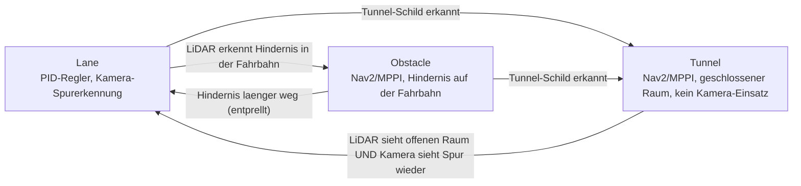
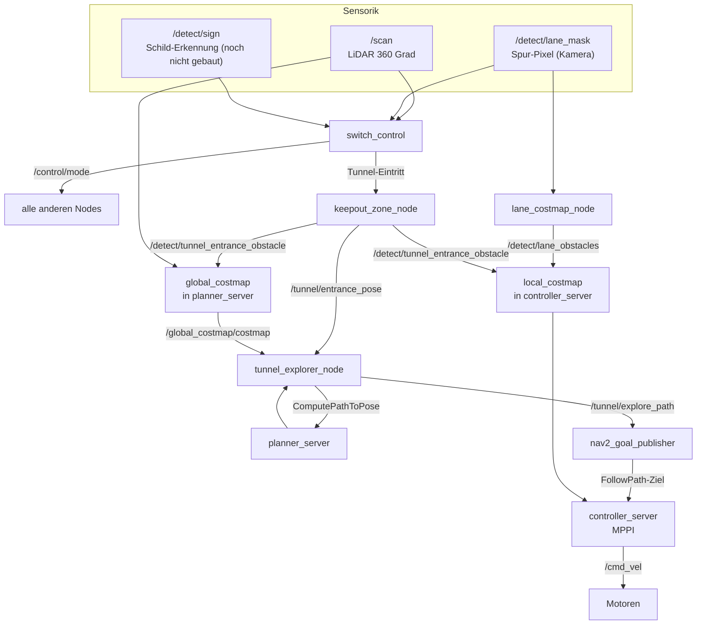
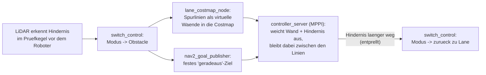
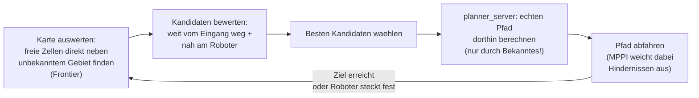

# Nav2-Fahrmodi: Hindernisvermeidung & Tunnel-Navigation (Ansatz 3)

Dokumentation für alle, die nicht direkt am Code gearbeitet haben, aber verstehen wollen/müssen, wie die Nav2-Fahrmodi funktionieren und welche Werte am Wettbewerbstag ggf. angepasst werden müssen.

---

## 1. Worum geht's

Neben der bestehenden PID-Spurregelung (`Lane`-Modus, unverändert) haben wir eine zweite, parallele Fahr-Pipeline auf Basis von **Nav2** (dem Standard-Navigationsframework von ROS2) gebaut. Diese eine Pipeline deckt **zwei unterschiedliche Situationen** ab, die sich beide Infrastruktur teilen (dieselbe Costmap, derselbe MPPI-Regler, derselbe Übergabe-Node), sich aber in ihrem Zweck unterscheiden:

- **Obstacle-Modus:** liegt ein Hindernis in der eigentlich per Kamera erkannten Fahrbahn, übernimmt Nav2 kurzzeitig, weicht aus und hält sich dabei weiterhin (indirekt) an die Spurlinien. Läuft automatisch, ohne Zeitdruck, mitten im normalen Rennen.
- **Tunnel-Modus:** eigener, per Schild ausgelöster Streckenabschnitt, in dem die Kamera-Spurerkennung gar nicht mehr gilt: der Roboter fährt in einen geschlossenen Raum mit Hindernissen, muss ihnen ausweichen und **innerhalb eines Zeitlimits** einen Ausgang finden — aber nicht den, durch den er reingefahren ist.

Beide Modi laufen über dieselben Nodes, aktivieren sich aber unabhängig voneinander und nutzen teils unterschiedliche Zusatz-Nodes (siehe Abschnitt 3/4). Die Pipeline läuft die ganze Zeit mit, wird aber nur aktiv, wenn der Roboter tatsächlich im Obstacle- oder Tunnel-Modus ist.

---

## 2. Die drei Fahrmodi

Ein einziger Node (`switch_control`) entscheidet, welcher der folgenden Modi gerade aktiv ist, und alle anderen Nodes richten sich danach:

- **Lane**: der normale Betrieb, PID-Regler folgt der Spur (unverändert, wie bisher).
- **Obstacle**: sobald der LiDAR etwas direkt vor dem Roboter erkennt, übernimmt Nav2 kurzzeitig und weicht aus — automatisch, ohne Schild.
- **Tunnel**: eigener Modus für den geschlossenen Raum, ausgelöst durch ein erkanntes Schild (Erkennung selbst folgt später, sobald klar ist, wie die Schilder aussehen).

`switch_control` merkt sich beim Eintritt in den Tunnel, welcher Modus vorher aktiv war, und stellt genau den beim Verlassen wieder her (nicht stur "zurück zu Lane").

### Wie die Spurhaltung im Obstacle-Modus funktioniert (anders als im Lane-Modus!)

Wichtig zum Verständnis, weil es nicht offensichtlich ist: **`detect_lane` (die Kamera-Spurerkennung) läuft die ganze Zeit weiter, unabhängig vom aktuellen Modus** — sie kennt `/control/mode` gar nicht und schaltet sich nie ab. Was sich unterscheidet, ist, **wer ihre Ausgabe benutzt und wie**:

| | **Lane-Modus** | **Obstacle-Modus** |
|---|---|---|
| Wer nutzt die Kamera-Spurerkennung? | `control_driving` (PID-Regler) | `lane_costmap_node` |
| Welche Information? | `/detect/lane` — **ein einzelner Fehlerwert** ("wie weit von der Mitte weg") | `/detect/lane_mask` — **alle Spurpixel einzeln** als Koordinaten |
| Was passiert damit? | PID lenkt aktiv **auf die Spurmitte zu** | Pixel werden zu virtuellen Wänden links und rechts der Fahrbahn in der Costmap |
| Wie wird gefahren? | Klassische Regelung: Fehler → Lenkausschlag | MPPI bekommt kein "fahr zur Mitte"-Signal, sondern nur "fahr geradeaus" (von `nav2_goal_publisher`) — und weicht dabei den virtuellen Wänden aus |
| Kann LiDAR-Hindernissen ausweichen? | Nein | Ja, gleichzeitig — dieselbe Costmap enthält auch die echten LiDAR-Hindernisse |

Der Effekt: Im Lane-Modus **zielt** der Roboter aktiv auf die Spurmitte. Im Obstacle-Modus hält er sich stattdessen **irgendwo zwischen zwei Wänden mit Sicherheitsabstand** — das kann etwas mehr schwanken als die PID-Regelung, dafür kann der Roboter dabei zusätzlich echten Hindernissen ausweichen, was die reine PID-Regelung gar nicht könnte. `control_driving` reagiert im Obstacle-Modus übrigens gar nicht mehr auf `/detect/lane` (es prüft selbst den aktuellen Modus und ignoriert alles außer Lane) — es gibt also nie zwei Regler gleichzeitig, die um `/cmd_vel` konkurrieren.

---

## 3. Gesamtarchitektur

Wichtig zum Verständnis: **`lane_costmap_node` läuft nur im Obstacle-Modus, `keepout_zone_node` und `tunnel_explorer_node` nur im Tunnel-Modus.** Außerhalb ihres jeweiligen Modus veröffentlichen sie schlicht nichts — kein Sonderfall-Code nötig, die Costmaps bleiben dann einfach leer.

---

## 4. Die Nodes im Einzelnen

### `switch_control` — die Zustandsmaschine
Entscheidet, welcher Modus aktiv ist (siehe Abschnitt 2), und veröffentlicht das laufend auf `/control/mode`. Alle anderen Nodes lesen nur mit, niemand sonst darf diesen Wert verändern.

### `lane_costmap_node` — Spurlinien als virtuelle Wände (nur Obstacle-Modus)
Wandelt die von der Kamera erkannten Spurlinien-Pixel in Meter-Koordinaten um und speist sie als virtuelle Hindernisse in die Costmap ein, damit Nav2 nicht über die Spurlinien fährt. Ersetzt im Obstacle-Modus die PID-Spurhaltung — Details und Vergleich siehe Abschnitt 2.

### `keepout_zone_node` — die Eingangs-Sperrzone (nur Tunnel-Modus)
Merkt sich einmalig, wo der Roboter in den Tunnel eingefahren ist, und blockiert diese Stelle dauerhaft als virtuelle Wand — damit der Roboter nicht durch den Eingang wieder rausfährt. Setzt außerdem bei jedem neuen Tunnel-Eintritt die Explorationskarte (`global_costmap`) zurück, damit sich mehrere Tunnel auf derselben Strecke nicht gegenseitig stören.

### `tunnel_explorer_node` — die Ausgangssuche (nur Tunnel-Modus)
Der "Kopf" der Exploration: sucht auf der Explorationskarte nach unerkundeten Bereichen, wählt den vielversprechendsten aus (weit weg vom Eingang, aber noch schnell erreichbar) und lässt dorthin einen echten Pfad berechnen. Details siehe Abschnitt 7.

### `nav2_goal_publisher` — der Übergeber
Schickt das eigentliche Fahrkommando an Nav2. Im Obstacle-Modus baut er sich selbst ein einfaches "geradeaus"-Ziel, im Tunnel-Modus nimmt er stattdessen den Pfad, den `tunnel_explorer_node` geliefert hat.

### `controller_server` (Nav2, MPPI) — die eigentliche Fahrsteuerung
Nav2-Standardkomponente, nicht selbst geschrieben. Nimmt das Ziel/den Pfad entgegen und berechnet daraus in Echtzeit die tatsächlichen Fahrbefehle, wobei er ständig Hindernissen in der `local_costmap` ausweicht.

### `planner_server` (Nav2, NavFn) — der Wegplaner (nur für Tunnel-Exploration)
Nav2-Standardkomponente. Berechnet auf Anfrage von `tunnel_explorer_node` einen konkreten Weg zu einem Zielpunkt, aber **nur durch bereits bekanntes, freies Gebiet** — nie durch unerkundetes Gebiet (das wäre auch unmöglich, siehe Abschnitt 7).

---

## 5. Parameter-Referenz — was anpassen, was bedeutet es

### 5.1 `switch_control.py` → Datei `Switch_Control.yaml`

| Parameter | Standard | Bedeutung | Auswirkung |
|---|---|---|---|
| `obstacle_check_angle_deg` | 30.0° | Öffnungswinkel des Prüfkegels nach vorne, in dem nach Hindernissen gesucht wird | Größer = reagiert auch auf Hindernisse seitlich vor dem Roboter; kleiner = nur was direkt vor der Nase liegt |
| `obstacle_trigger_distance` | 0.4 m | Ab welcher Nähe gilt "da ist ein Hindernis" | Größer = reagiert früher/vorsichtiger; kleiner = fährt näher ran, bevor ausgewichen wird |
| `obstacle_clear_debounce` | 1.0 s | Wie lange der Kegel durchgehend frei sein muss, bevor zurück zu Lane geschaltet wird | Größer = stabiler, aber langsamer zurück in den Lane-Modus; kleiner = kann bei flackernden Messwerten hin- und herspringen |
| `tunnel_exit_open_distance` | 1.5 m | Ab welcher Distanz ein einzelner LiDAR-Strahl als "offen/frei" zählt | Größer = strengere Anforderung an "offener Raum" |
| `tunnel_exit_open_ratio` | 0.8 | Welcher Anteil aller LiDAR-Strahlen offen sein muss, damit "offener Raum" erkannt wird | Größer = strenger (fast alles muss frei sein); kleiner = reicht schon, wenn ein Teil frei ist |
| `tunnel_exit_min_lane_pixels` | 20 | Wie viele Spur-Pixel die Kamera mindestens wieder sehen muss | Größer = sicherer gegen Fehlerkennung durch einzelne Störpixel, aber erkennt die Spur ggf. später |
| `tunnel_exit_debounce` | 1.0 s | Wie lange beide Austritts-Bedingungen gleichzeitig gelten müssen | Wie oben: Stabilität vs. Reaktionsgeschwindigkeit |

**Muss angepasst werden:** wahrscheinlich `obstacle_trigger_distance` und `tunnel_exit_open_distance`, je nachdem wie schnell der Roboter fährt und wie das Streckenlayout aussieht. Am besten mit `ros2 topic echo /control/mode` live beobachten und nachjustieren.

### 5.2 `lane_costmap_node.py` → Block `/lane_costmap_node` in `Lane_Costmap.yaml`

| Parameter | Standard | Bedeutung | Auswirkung |
|---|---|---|---|
| `x_near` / `x_far` | 0.15 / 0.60 m | Wie weit die untere/obere Kante des Kamera-Bird's-Eye-Bildes real vom Roboter entfernt ist | **Muss per Maßband kalibriert werden**, sonst landen die virtuellen Spurlinien-Wände an der falschen Stelle |
| `y_left` / `y_right` | 0.35 / -0.35 m | Seitlicher Versatz der linken/rechten Bildkante | Ebenfalls kalibrierpflichtig, siehe oben |
| `pixel_stride` | 2 | Wie stark die Maskenpunkte ausgedünnt werden, bevor sie in die Costmap gehen | Größer = weniger Punkte, spart Rechenzeit, aber gröbere Wand |

Betrifft **nicht** den Tunnel-Modus (nur Obstacle) — für den Tunnel irrelevant.

### 5.3 `keepout_zone_node.py` → Block `/keepout_zone_node` in `Lane_Costmap.yaml`

| Parameter | Standard | Bedeutung | Auswirkung |
|---|---|---|---|
| `entrance_wall_width` | 0.6 m | Wie breit die virtuelle Sperrwand am Tunneleingang ist | **An die reale Breite der Tunnelöffnung anpassen** — zu schmal = Roboter kann seitlich noch vorbei; zu breit = blockiert unnötig viel vom Raum |
| `entrance_wall_points` | 9 | Wie viele Einzelpunkte die Wand hat | Mehr = dichtere, lückenlosere Wand; braucht kaum mehr Rechenzeit |
| `publish_rate` | 5.0 Hz | Wie oft die Wand neu veröffentlicht wird | Niedriger reicht meist (die Wand bewegt sich ja nicht), höher schadet aber auch nicht |

### 5.4 `tunnel_explorer_node.py` → Block `/tunnel_explorer_node` in `Lane_Costmap.yaml`

| Parameter | Standard | Bedeutung | Auswirkung |
|---|---|---|---|
| `arrival_radius` | 0.3 m | Ab welcher Nähe zum aktuellen Etappenziel ein neues gesucht wird | Kleiner = fährt genauer bis zum Zielpunkt; größer = wechselt früher zum nächsten Ziel |
| `stall_timeout` | 10.0 s | Nach wie vielen Sekunden ohne Fortschritt ein neues Ziel gesucht wird (Notausgang, falls der Roboter feststeckt) | Kleiner = gibt schneller auf und probiert was anderes; größer = mehr Geduld, bevor umgeplant wird |
| `entrance_weight` | 1.0 | Wie stark "weit weg vom Eingang" bei der Zielwahl zählt | Größer = strebt konsequenter vom Eingang weg |
| `robot_distance_weight` | 0.3 | Wie stark "nah am Roboter, also schnell erreichbar" bei der Zielwahl zählt | Größer = bevorzugt nahe, schnell erreichbare Ziele stärker gegenüber weit entfernten |
| `free_cost_threshold` | 50 | Ab welchem Kostenwert eine Kartenzelle noch als "frei" gilt | Höher = großzügiger, was noch als befahrbar gilt |
| `min_frontier_cluster_cells` | 6 | Wie groß ein unerkundeter Randbereich mindestens sein muss, um als Ziel infrage zu kommen | Größer = ignoriert kleine Lücken/Messrauschen, sucht nur "echte" offene Bereiche |
| `recompute_rate` | 1.0 Hz | Wie oft geprüft wird, ob ein neues Ziel nötig ist | Höher = reagiert schneller auf Erreichen/Feststecken |

**Am wichtigsten zum Tunen bei echten Tests:** `entrance_weight`/`robot_distance_weight` (bestimmen, wie "mutig" die Exploration in Richtung Ausgang vorgeht) und `stall_timeout` (wie geduldig, bevor aufgegeben und neu geplant wird).

### 5.5 `nav2_goal_publisher.py` → Block `/nav2_goal_publisher` in `Lane_Costmap.yaml`

| Parameter | Standard | Bedeutung | Auswirkung |
|---|---|---|---|
| `goal_distance` | 1.0 m | Nur für Obstacle-Modus: wie weit "geradeaus" vorgegeben wird | Größer = weitsichtiger, aber reagiert langsamer auf plötzliche Hindernisse |

Die übrigen Parameter (`goal_frame_id`, `num_waypoints`, `watchdog_rate`) sind technische Details, an denen normalerweise nichts verändert werden muss.

### 5.6 `nav2_params.yaml` — Nav2-Kernkonfiguration

**Diese Werte unbedingt vor dem Wettkampf mit der echten Strecke abgleichen:**

| Parameter | Ort | Standard | Bedeutung | Auswirkung |
|---|---|---|---|---|
| `width` / `height` | `global_costmap` | 20 / 20 m | Wie groß der Bereich ist, den sich die Tunnel-Explorationskarte merken kann | **Muss den Bereich abdecken, in dem der Tunnel relativ zum Startpunkt der Odometrie liegt** — siehe Warnung unten! |
| `origin_x` / `origin_y` | `global_costmap` | -10 / -10 m | Wo dieser Bereich beginnt (relativ zum Odometrie-Nullpunkt = Einschaltposition des Roboters) | Legt fest, welcher Ausschnitt der Strecke abgedeckt ist |
| `allow_unknown` | `planner_server` | false | Ob der Wegplaner auch durch unbekanntes Gebiet planen darf | **Nicht auf true stellen** — sonst könnte ein Pfad durch eine (noch nicht gesehene) Wand geplant werden |
| `robot_radius` | `local_costmap` / `global_costmap` | 0.105 m | Wie groß der Roboter für die Kollisionsprüfung angenommen wird | An die tatsächliche Burger-Größe angepasst, i.d.R. nicht ändern |
| `vx_max` / `wz_max` | `controller_server` (MPPI) | 0.22 m/s / 1.9 rad/s | Maximale Geschwindigkeit/Drehrate | Höher = schneller, aber weniger Reaktionszeit zum Ausweichen |

> **⚠️ Wichtige Einschränkung, unbedingt vor dem Wettkampf prüfen:**
> Die Tunnel-Explorationskarte (`global_costmap`) ist — anders als die normale, mitfahrende `local_costmap` — an einer **festen Stelle relativ zum Einschaltpunkt des Roboters** verankert und kann nicht nachträglich neu zentriert werden (nur geleert, das passiert automatisch bei jedem Tunnel-Eintritt). Mit den Standardwerten deckt sie einen 20×20m-Bereich um den Startpunkt ab. **Liegt der Tunnel weiter als ~10m vom Einschaltpunkt entfernt, muss `width`/`height`/`origin_x`/`origin_y` vorher an die echte Streckenlänge angepasst werden**, sonst "sieht" die Exploration den Tunnel gar nicht richtig. Das Gesamtsystem wurde bisher nicht auf echter Hardware getestet — vor dem Wettkampf unbedingt einen kompletten Tunnel-Durchlauf zum Testen einplanen.

---

## 6. Wie die Hindernisvermeidung im Obstacle-Modus genau funktioniert

Anders als der Tunnel-Modus (Abschnitt 7) braucht der Obstacle-Modus **keine Exploration und keinen Wegplaner** — er ist bewusst einfach gehalten, weil er mitten im normalen Rennbetrieb reagieren muss, ohne die Fahrt spürbar zu unterbrechen:

Der Trick: es wird **kein** neues Ziel berechnet, das um das Hindernis "herumführt" — stattdessen bekommt der Regler weiterhin nur "fahr geradeaus" vorgegeben (dasselbe simple Ziel wie immer im Obstacle-Modus, siehe Abschnitt 2), und die Local Costmap enthält gleichzeitig sowohl das echte LiDAR-Hindernis als auch die virtuellen Spurlinien-Wände. Der MPPI-Regler weicht dann von sich aus lokal aus, ohne dass irgendein Node "berechnet", wo genau vorbeigefahren werden soll — das ist der ganze Witz an MPPI (Details zu den einzelnen Bewertungskriterien/"Critics" siehe Kommentare im `FollowPath`-Block von `nav2_params.yaml`).

Sobald der Prüfkegel vor dem Roboter wieder für `obstacle_clear_debounce` Sekunden durchgehend frei ist, schaltet `switch_control` automatisch zurück zu `Lane`, und die PID-Regelung übernimmt wieder die Spurmitte-Steuerung (siehe Vergleichstabelle in Abschnitt 2).

**Bekannte Grenze:** Die Erkennung ist bewusst simpel (ein Prüfkegel + eine feste Distanzschwelle) und kennt weder die Form noch die Bewegung des Hindernisses — bei mehreren Hindernissen kurz hintereinander oder einem sich bewegenden Hindernis kann der Roboter dadurch mehrfach zwischen den Modi hin- und herschalten. Das ist so beabsichtigt (Einfachheit vor Perfektion für diesen Fall), sollte aber beim Testen im Blick behalten werden.

---

## 7. Wie die Tunnel-Exploration genau funktioniert

Der Roboter hat **keine vorab gespeicherte Karte** des Tunnels — er baut sich beim Reinfahren selbst eine, rein aus dem, was der LiDAR seit dem Betreten des Tunnels gesehen hat. Diese Karte kennt für jede Stelle drei Zustände: **frei**, **belegt** oder **unbekannt** (noch nicht gesehen).

Der entscheidende Punkt: der Wegplaner (`planner_server`) plant **niemals durch unerkundetes Gebiet** — er kann es gar nicht, weil er nicht weiß, was dort ist. Die gewählten Zielpunkte ("Frontier-Punkte") liegen deshalb immer genau am **Rand** zwischen dem, was der Roboter schon kennt, und dem, was er noch nicht kennt. Sobald der Roboter dort ankommt, sieht der LiDAR ein Stück weiter, die Karte wächst, und die Suche beginnt von vorn — bis (hoffentlich) der Ausgang gefunden ist.

Das ist bewusst **kein SLAM** (keine Positions-Korrektur, keine "Loop Closure") — der Roboter vertraut die ganze Zeit einfach seiner Odometrie (Radencoder). Für die kurze Strecke innerhalb eines einzelnen Tunnels reicht das aus; SLAM wäre mehr Rechenlast und Komplexität, als für dieses begrenzte Problem nötig ist.

**Bekannte Grenze:** Das ist eine Heuristik, keine Garantie. Bei einem sehr verwinkelten Raum mit mehreren ähnlich aussehenden Sackgassen kann die Suche theoretisch trotzdem Zeit in einer Richtung verlieren, die sich später als Sackgasse herausstellt. Eine hundertprozentige Garantie bräuchte eine vollständige, systematische Kartierung — das war hier bewusst nicht der Ansatz, um die Komplexität (und das Risiko für den Wettkampftag) begrenzt zu halten.

---

## 8. Checkliste vor dem Wettkampf

**Obstacle-Modus:**
- [ ] `x_near`/`x_far`/`y_left`/`y_right` (Kamera-Kalibrierung) mit Maßband einmessen
- [ ] `obstacle_check_angle_deg`/`obstacle_trigger_distance`/`obstacle_clear_debounce` mit dem echten Roboter/der echten Strecke testen (löst zu früh/zu spät aus? schaltet zu oft hin und her?)
- [ ] Kompletten Ausweich-Durchlauf auf echter Hardware testen (ein Hindernis in die Fahrbahn stellen, beobachten ob sauber ausgewichen und zurückgeschaltet wird)

**Tunnel-Modus:**
- [ ] `entrance_wall_width` an die reale Tunnelöffnung anpassen
- [ ] `global_costmap`: `width`/`height`/`origin_x`/`origin_y` an die echte Streckenlänge bis zum Tunnel anpassen
- [ ] `tunnel_exit_open_distance`/`tunnel_exit_open_ratio`/`tunnel_exit_min_lane_pixels` mit dem echten Roboter/der echten Strecke testen
- [ ] Kompletten Tunnel-Durchlauf auf echter Hardware testen (bisher nur am Schreibtisch entworfen, nicht gelaufen)
- [ ] Schild-Erkennung bauen, sobald klar ist, wie die Schilder aussehen (aktuell manuell testbar per `ros2 topic pub /detect/sign std_msgs/msg/UInt8 "{data: 6}"`)

**Allgemein:**
- [ ] `visualize: true` bei MPPI vor dem Wettkampf ggf. wieder auf `false` (spart Rechenleistung)
