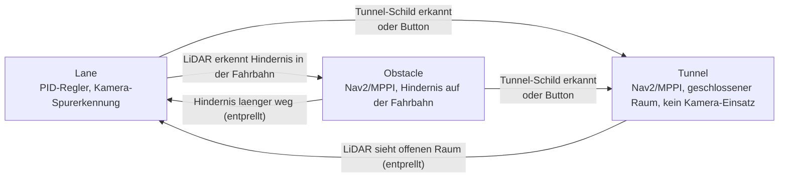
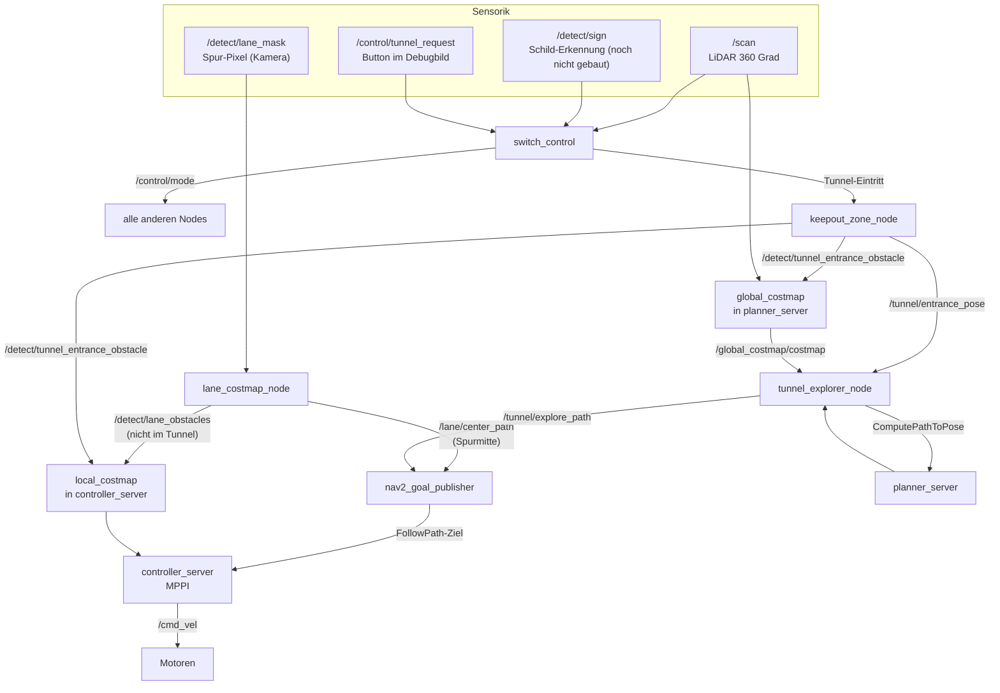
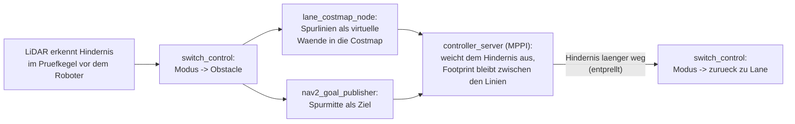
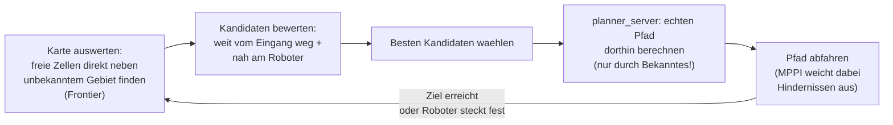

# Nav2-Fahrmodi: Hindernisvermeidung & Tunnel-Navigation (Ansatz 3)

Dokumentation für alle, die nicht direkt am Code gearbeitet haben, aber verstehen wollen/müssen, wie die Nav2-Fahrmodi funktionieren und welche Werte am Wettbewerbstag ggf. angepasst werden müssen.

---

## 1. Worum geht's

Neben der bestehenden PID-Spurregelung (`Lane`-Modus, unverändert) haben wir eine zweite, parallele Fahr-Pipeline auf Basis von **Nav2** (dem Standard-Navigationsframework von ROS2) gebaut. Diese eine Pipeline deckt **zwei unterschiedliche Situationen** ab, die sich beide Infrastruktur teilen (dieselbe Costmap, derselbe MPPI-Regler, derselbe Übergabe-Node), sich aber in ihrem Zweck unterscheiden:

- **Obstacle-Modus:** liegt im Hindernisbereich außerhalb des Tunnels ein Hindernis in der per Kamera erkannten Fahrbahn, übernimmt Nav2 kurzzeitig, weicht aus und bleibt dabei zwischen den Spurlinien. Läuft automatisch, ohne Zeitdruck, mitten im normalen Rennen.
- **Tunnel-Modus:** eigener Streckenabschnitt (im Reglement „Enclosure“), ausgelöst per Schild oder per Button im Debugbild: der Roboter fährt in einen geschlossenen Raum mit Hindernissen, muss ihnen ausweichen und **innerhalb eines Zeitlimits** einen Ausgang finden — aber nicht den, durch den er reingefahren ist. **Die Kamera ist dort laut Reglement verboten**, es zählt nur der LiDAR.

Beide Modi laufen über dieselben Nodes, aktivieren sich aber unabhängig voneinander und nutzen teils unterschiedliche Zusatz-Nodes (siehe Abschnitt 3/4). Die Pipeline läuft die ganze Zeit mit, wird aber nur aktiv, wenn der Roboter tatsächlich im Obstacle- oder Tunnel-Modus ist.

---

## 2. Die drei Fahrmodi

Ein einziger Node (`switch_control`) entscheidet, welcher der folgenden Modi gerade aktiv ist, und alle anderen Nodes richten sich danach:

- **Lane**: der normale Betrieb, PID-Regler folgt der Spur (unverändert, wie bisher).
- **Obstacle**: sobald der LiDAR etwas direkt vor dem Roboter erkennt, übernimmt Nav2 kurzzeitig und weicht aus — automatisch, ohne Schild.
- **Tunnel**: eigener Modus für den geschlossenen Raum. Ausgelöst wird er auf zwei Wegen:
  - **Schild:** ein Erkennungsmodell sendet `6` (`std_msgs/UInt8`) auf `/detect/sign`. Das Modell ist noch nicht gebaut.
  - **Button „TUNNEL STARTEN“ im Debugbild:** Jede Challenge läuft einzeln, vor Ort gibt es also keinen Auslöser für die Zustandsmaschine. Der Bot steht dabei direkt vor oder in der Öffnung. Im Tunnel wird daraus „TUNNEL ABBRECHEN“. Nach dem automatischen Austritt springt der Button von selbst zurück.

  Wer ausgelöst hat, steht im Debugbild unter dem Modus: „(von Hand)“ oder „(Schild)“.

`switch_control` merkt sich beim Eintritt in den Tunnel, welcher Modus vorher aktiv war, und stellt genau den beim Verlassen wieder her (nicht stur "zurück zu Lane").

### Wer nutzt die Kamera in welchem Modus?

`detect_lane` (die Kamera-Spurerkennung) läuft die ganze Zeit weiter, unabhängig vom aktuellen Modus. Was sich unterscheidet, ist, **wer ihre Ausgabe benutzt**:

| | **Lane-Modus** | **Obstacle-Modus** | **Tunnel-Modus** |
|---|---|---|---|
| Wer fährt? | `control_driving` (PID) | Nav2/MPPI | Nav2/MPPI |
| Wer nutzt die Kamera? | `control_driving` über `/detect/lane`; `lane_costmap_node` für die Spurwände | `lane_costmap_node` für die Spurwände | niemand (Reglement) |
| Was steht in der local_costmap? | LiDAR + Spurwände | LiDAR + Spurwände | LiDAR + Eingangssperre |

**Wie die Spurwände ohne bekannte Breite funktionieren:** Die Breite des Hindernisbereichs kennen wir erst am Wettbewerbstag. Deshalb hängt kein Wert davon ab. MPPI prüft Kollisionen mit dem echten Umriss des Burger (138 × 178 mm, `footprint` in `nav2_params.yaml`). Eine Fahrbewegung ist verboten, sobald der Umriss eine Linie oder ein Hindernis berührt, und erlaubt, wenn er dazwischen passt. Die Inflation um die Linien ist nur ein Kostengefälle, das zur Mitte zieht. Details: `docs/Nav2_Costmap_Werte.md`, Abschnitt 3.

`control_driving` reagiert außerhalb des Lane-Modus nicht auf `/detect/lane` (es prüft selbst den aktuellen Modus) — es gibt also nie zwei Regler gleichzeitig, die um `/cmd_vel` konkurrieren.

---

## 3. Gesamtarchitektur

Wichtig zum Verständnis: **`lane_costmap_node` sendet in jedem Modus außer Tunnel und leert beim Tunnel-Eintritt die local_costmap; `keepout_zone_node` und `tunnel_explorer_node` arbeiten nur im Tunnel-Modus.** Außerhalb ihres jeweiligen Modus veröffentlichen sie nichts.

---

## 4. Die Nodes im Einzelnen

### `switch_control` — die Zustandsmaschine
Entscheidet, welcher Modus aktiv ist (siehe Abschnitt 2), und veröffentlicht das laufend auf `/control/mode`. Alle anderen Nodes lesen nur mit, niemand sonst darf diesen Wert verändern. Den Tunnel-Wunsch des Buttons bekommt er auf `/control/tunnel_request` (`True` = Start, `False` = Abbruch), den Auslöser meldet er auf `/control/tunnel_source` (`Hand`, `Schild` oder leer).

### `debug_view` — das Debugbild mit Tunnel-Button
Zeichnet das Debugbild auf `/lokal/debug_view`, angezeigt in `rqt_image_view`. Unten im Mode-Panel liegt der Tunnel-Button. Ein Klick darauf kommt als Klickposition von `rqt_image_view` auf `/lokal/debug_view_mouse_left` an. Dafür muss in `rqt_image_view` einmal die Checkbox **„Publish click location“** angehakt sein.

### `lane_costmap_node` — Spurlinien als virtuelle Wände (nicht im Tunnel)
Wandelt die von der Kamera erkannten Spurlinien-Pixel aus der metrischen Vogelperspektive `/lokal/bev` über `Parameter/bev.yaml` in Meter um und speist sie als virtuelle Wände in den `lane_layer` der local_costmap ein, damit Nav2 beim Ausweichen nicht über die Linien fährt. Außerdem berechnet er die Spurmitte und sendet sie als Pfad (`/lane/center_path`), mit laufend gemessener Spurbreite. Sendet auch im Lane-Modus, damit der Korridor beim Umschalten schon in der Karte steht. Im Tunnel sendet er nichts und leert beim Eintritt die local_costmap.

### `nav2_view` — die Draufsicht mit Statuszeile
Zeichnet auf `/nav2/view` ein Bild davon, was Nav2 sieht und plant: im Tunnel die `global_costmap`, sonst die `local_costmap` mit den Spurwänden. Grün ist befahrbar (dunkler = nah am Hindernis), rot blockiert, grau unbekannt, gelb/weiß die erkannten Spurlinien (`/detect/lane_mask`). Blau der Umriss des Bots (`/local_costmap/published_footprint`) mit Fahrtrichtung (magenta), cyan der Pfad mit Ziel (X), orange die Eingangssperre, hellblau die LiDAR-Punkte. Unten eine Legende. Die Ausrichtung ist fest (odom-X nach rechts), sodass Wände stillstehen und nur der Bot sich bewegt.

Oben steht die Statuszeile: Modus und Auslöser, was `nav2_goal_publisher` gerade tut (`/nav2/status`, z. B. „faehrt: Spurmitte“), und darunter die letzte Warnung bzw. der letzte Fehler der Nav2-Knoten aus `/rosout`, zum Beispiel „controller_server: Failed to make progress“. Das ist der Abbruchgrund: Das FollowPath-Ergebnis meldet in Humble nur „abgebrochen“, den Grund schreibt `controller_server` nur ins Log. Rot heißt jünger als 10 s.

Gezeigt wird ein Ausschnitt: außerhalb des Tunnels ein Quadrat von `local_view_size_m` (2,4 m) um den Bot. Das deckt den Obstacle-Auslöser (1,0 m voraus) und die MPPI-Vorausschau (~1 m) mit Rand ab. Es ist zentriert, damit das Bild beim Lenken nicht springt. Im Tunnel ist es nur die schon gesehene Fläche plus `tunnel_view_margin_m` (0,3 m), sodass das Bild mit der Karte herauszoomt.

`nav2_obstacle` öffnet dafür ein zweites `rqt_image_view`-Fenster.

### `keepout_zone_node` — die Eingangs-Sperrzone (nur Tunnel-Modus)
Merkt sich einmalig, wo der Roboter in den Tunnel eingefahren ist, und blockiert diese Stelle dauerhaft als virtuelle Wand — damit der Roboter nicht durch den Eingang wieder rausfährt. Die Wand bleibt an dieser Stelle, wird aber erst gesendet, wenn der Bot `entrance_wall_delay` weit davon weggefahren ist. Vorher stünde er selbst in ihr. Die Wand nach hinten zu verschieben wäre keine Lösung, weil dann eine Lücke zum Eingang entstünde. Setzt außerdem bei jedem neuen Tunnel-Eintritt die Explorationskarte (`global_costmap`) zurück, damit sich mehrere Tunnel auf derselben Strecke nicht gegenseitig stören.

### `tunnel_explorer_node` — die Ausgangssuche (nur Tunnel-Modus)
Der "Kopf" der Exploration: sucht auf der Explorationskarte nach unerkundeten Bereichen, wählt den vielversprechendsten aus (weit weg vom Eingang, aber noch schnell erreichbar) und lässt dorthin einen echten Pfad berechnen. Details siehe Abschnitt 7.

### `nav2_goal_publisher` — der Übergeber
Schickt das eigentliche Fahrkommando an Nav2. Im Obstacle-Modus nimmt er die Spurmitte von `lane_costmap_node`; ist sie veraltet, ein einfaches "geradeaus"-Ziel. Im Tunnel-Modus nimmt er stattdessen den Pfad, den `tunnel_explorer_node` geliefert hat.

### `controller_server` (Nav2, MPPI) — die eigentliche Fahrsteuerung
Nav2-Standardkomponente, nicht selbst geschrieben. Nimmt das Ziel/den Pfad entgegen und berechnet daraus in Echtzeit die tatsächlichen Fahrbefehle, wobei er ständig Hindernissen in der `local_costmap` ausweicht.

### `planner_server` (Nav2, NavFn) — der Wegplaner (nur für Tunnel-Exploration)
Nav2-Standardkomponente. Berechnet auf Anfrage von `tunnel_explorer_node` einen konkreten Weg zu einem Zielpunkt, aber **nur durch bereits bekanntes, freies Gebiet** — nie durch unerkundetes Gebiet (das wäre auch unmöglich, siehe Abschnitt 7).

---

## 5. Parameter-Referenz — was anpassen, was bedeutet es

### 5.1 `switch_control.py` → Datei `Switch_Control.yaml`

| Parameter | Wert (YAML) | Bedeutung | Auswirkung |
|---|---|---|---|
| `obstacle_check_angle_deg` | 20.0° | **Halb**winkel des Prüfkegels nach vorne (Gesamtkegel 40°), in dem nach Hindernissen gesucht wird | Größer = reagiert auch auf Hindernisse seitlich vor dem Roboter; kleiner = nur was direkt vor der Nase liegt |
| `obstacle_trigger_distance` | 1.0 m | Ab welcher Nähe gilt "da ist ein Hindernis" | Größer = reagiert früher/vorsichtiger; kleiner = fährt näher ran, bevor ausgewichen wird |
| `obstacle_clear_debounce` | 1.0 s | Wie lange der Kegel durchgehend frei sein muss, bevor zurück zu Lane geschaltet wird | Größer = stabiler, aber langsamer zurück in den Lane-Modus; kleiner = kann bei flackernden Messwerten hin- und herspringen |
| `tunnel_exit_open_distance` | 1.5 m | Ab welcher Distanz ein einzelner LiDAR-Strahl als "offen/frei" zählt | Größer = strengere Anforderung an "offener Raum" |
| `tunnel_exit_open_ratio` | 0.8 | Welcher Anteil aller LiDAR-Strahlen offen sein muss, damit "offener Raum" erkannt wird | Größer = strenger (fast alles muss frei sein); kleiner = reicht schon, wenn ein Teil frei ist |
| `tunnel_exit_debounce` | 1.0 s | Wie lange der LiDAR durchgehend offenen Raum sehen muss | Wie oben: Stabilität vs. Reaktionsgeschwindigkeit |

Die Tunnelausfahrt läuft bewusst nur über den LiDAR — die Kamera ist in der Enclosure verboten.

**Muss angepasst werden:** wahrscheinlich `obstacle_trigger_distance` und `tunnel_exit_open_distance`, je nachdem wie schnell der Roboter fährt und wie das Streckenlayout aussieht. Am besten mit `ros2 topic echo /control/mode` live beobachten und nachjustieren.

### 5.2 `lane_costmap_node.py` → Block `/lane_costmap_node` in `Lane_Costmap.yaml`

| Parameter | Wert | Bedeutung | Auswirkung |
|---|---|---|---|
| `pixel_stride` | 2 | Wie stark die Maskenpunkte ausgedünnt werden, bevor sie in die Costmap gehen | Größer = weniger Punkte, spart Rechenzeit, aber gröbere Wand |

Sendet in jedem Modus außer Tunnel. Pixel → Meter und Reichweite (bis 0,60 m) kommen aus `Parameter/bev.yaml`, nicht aus dieser Datei. Details: `docs/Nav2_Costmap_Werte.md`, Abschnitt 4.

### 5.3 `keepout_zone_node.py` → Block `/keepout_zone_node` in `Lane_Costmap.yaml`

| Parameter | Standard | Bedeutung | Auswirkung |
|---|---|---|---|
| `entrance_wall_width` | 0.6 m | Wie breit die virtuelle Sperrwand am Tunneleingang ist | **An die reale Breite der Tunnelöffnung anpassen** — zu schmal = Roboter kann seitlich noch vorbei; zu breit = blockiert unnötig viel vom Raum |
| `entrance_wall_points` | 9 | Wie viele Einzelpunkte die Wand hat | Mehr = dichtere, lückenlosere Wand; braucht kaum mehr Rechenzeit |
| `publish_rate` | 5.0 Hz | Wie oft die Wand neu veröffentlicht wird | Niedriger reicht meist (die Wand bewegt sich ja nicht), höher schadet aber auch nicht |
| `entrance_wall_delay` | 0.16 m | Wie weit der Bot von der Eintrittslinie weg sein muss, bevor die Wand erscheint. Abgeleitet: Heck 0,101 m (Footprint) + `footprint_padding` 0,01 m + eine Zelle 0,05 m | Kleiner = Bot steht im ersten Moment in der Wand und MPPI blockiert |

### 5.4 `tunnel_explorer_node.py` → Block `/tunnel_explorer_node` in `Lane_Costmap.yaml`

| Parameter | Standard | Bedeutung | Auswirkung |
|---|---|---|---|
| `arrival_radius` | 0.3 m | Ab welcher Nähe zum aktuellen Etappenziel ein neues gesucht wird | Kleiner = fährt genauer bis zum Zielpunkt; größer = wechselt früher zum nächsten Ziel |
| `stall_timeout` | 10.0 s | Nach wie vielen Sekunden ohne Fortschritt ein neues Ziel gesucht wird (Notausgang, falls der Roboter feststeckt) | Kleiner = gibt schneller auf und probiert was anderes; größer = mehr Geduld, bevor umgeplant wird |
| `entrance_weight` | 1.0 | Wie stark "weit weg vom Eingang" bei der Zielwahl zählt | Größer = strebt konsequenter vom Eingang weg |
| `robot_distance_weight` | 0.3 | Wie stark "nah am Roboter, also schnell erreichbar" bei der Zielwahl zählt | Größer = bevorzugt nahe, schnell erreichbare Ziele stärker gegenüber weit entfernten |
| `free_cost_threshold` | 50 | Ab welchem Kostenwert eine Kartenzelle noch als "frei" gilt | Höher = großzügiger, was noch als befahrbar gilt |
| `min_frontier_cluster_cells` | 6 | Wie groß ein unerkundeter Randbereich mindestens sein muss, um als Ziel infrage zu kommen | Größer = ignoriert kleine Lücken/Messrauschen, sucht nur "echte" offene Bereiche |
| `recompute_rate` | 1.0 Hz | Wie oft geprüft wird, ob ein neues Ziel nötig ist | Höher = reagiert schneller auf Erreichen/Feststecken |

**Am wichtigsten zum Tunen bei echten Tests:** `entrance_weight`/`robot_distance_weight` (bestimmen, wie "mutig" die Exploration in Richtung Ausgang vorgeht) und `stall_timeout` (wie geduldig, bevor aufgegeben und neu geplant wird).

### 5.5 `nav2_goal_publisher.py` → Block `/nav2_goal_publisher` in `Lane_Costmap.yaml`

| Parameter | Standard | Bedeutung | Auswirkung |
|---|---|---|---|
| `center_path_max_age` | 1.0 s | Obstacle-Modus: bis zu welchem Alter die Spurmitte als Ziel gilt | Größer = fährt länger nach einer alten Spurmitte, wenn die Linien verdeckt sind |
| `goal_distance` | 1.0 m | Obstacle-Modus, nur wenn keine aktuelle Spurmitte da ist: wie weit "geradeaus" vorgegeben wird | Größer = weitsichtiger, aber reagiert langsamer auf plötzliche Hindernisse |

Die übrigen Parameter (`goal_frame_id`, `num_waypoints`, `watchdog_rate`) sind technische Details, an denen normalerweise nichts verändert werden muss.

### 5.6 `nav2_params.yaml` — Nav2-Kernkonfiguration

Alle Costmap- und Reglerwerte mit Herkunft, Abhängigkeiten und Fehlerbildern stehen in **`docs/Nav2_Costmap_Werte.md`**. Hier nur der eine Wert, der dort nicht vorkommt:

| Parameter | Ort | Wert | Bedeutung | Auswirkung |
|---|---|---|---|---|
| `allow_unknown` | `planner_server` | false | Ob der Wegplaner auch durch unbekanntes Gebiet planen darf | **Nicht auf true stellen** — sonst könnte ein Pfad durch eine (noch nicht gesehene) Wand geplant werden |

Beide Costmaps fahren mit dem Roboter mit (`rolling_window: true`), ein Odometrie-Reset vor der Fahrt ist nicht nötig. Das Gesamtsystem wurde bisher nicht auf echter Hardware getestet — vor dem Wettkampf unbedingt einen kompletten Tunnel-Durchlauf zum Testen einplanen.

---

## 6. Wie die Hindernisvermeidung im Obstacle-Modus genau funktioniert

Anders als der Tunnel-Modus (Abschnitt 7) braucht der Obstacle-Modus **keine Exploration und keinen Wegplaner** — er ist bewusst einfach gehalten, weil er mitten im normalen Rennbetrieb reagieren muss, ohne die Fahrt spürbar zu unterbrechen:

Der Trick: es wird **kein** neues Ziel berechnet, das um das Hindernis "herumführt" — stattdessen bekommt der Regler die Spurmitte vorgegeben, die mitten durch das Hindernis führt, und die Local Costmap enthält gleichzeitig das echte LiDAR-Hindernis und die Spurlinien. Der MPPI-Regler weicht dann von sich aus lokal aus, ohne dass irgendein Node "berechnet", wo genau vorbeigefahren werden soll — das ist der ganze Witz an MPPI (Details zu den einzelnen Bewertungskriterien/"Critics" siehe Kommentare im `FollowPath`-Block von `nav2_params.yaml`).

Sobald der Prüfkegel vor dem Roboter wieder für `obstacle_clear_debounce` Sekunden durchgehend frei ist, schaltet `switch_control` automatisch zurück zu `Lane`, und die PID-Regelung übernimmt wieder die Spurmitte-Steuerung (siehe Vergleichstabelle in Abschnitt 2).

**Bekannte Grenze:** Auf der normalen Spur (20 cm zwischen den Linien, Burger 17,8 cm) ist neben einem Hindernis kein Platz. Löst der Obstacle-Modus dort aus, findet MPPI erwartbar keine kollisionsfreie Bewegung und bleibt stehen, statt die Spur zu verlassen. Abgeleitet, nicht auf dem Bot beobachtet.

**Bekannte Grenze:** Die Spurmitte reicht nur so weit, wie die Kamera sieht (~0,8 m). In engen Kurven liegt die innere Linie außerhalb des Bildes; dann gilt die zuletzt gemessene Spurbreite. Details: `docs/Nav2_Costmap_Werte.md`, Abschnitt 4.

**Bekannte Grenze:** Die Erkennung ist bewusst simpel (ein Prüfkegel + eine feste Distanzschwelle) und kennt weder die Form noch die Bewegung des Hindernisses — bei mehreren Hindernissen kurz hintereinander oder einem sich bewegenden Hindernis kann der Roboter dadurch mehrfach zwischen den Modi hin- und herschalten. Das ist so beabsichtigt (Einfachheit vor Perfektion für diesen Fall), sollte aber beim Testen im Blick behalten werden.

---

## 7. Wie die Tunnel-Exploration genau funktioniert

Der Roboter hat **keine vorab gespeicherte Karte** des Tunnels — er baut sich beim Reinfahren selbst eine, rein aus dem, was der LiDAR seit dem Betreten des Tunnels gesehen hat. Diese Karte kennt für jede Stelle drei Zustände: **frei**, **belegt** oder **unbekannt** (noch nicht gesehen).

Der entscheidende Punkt: der Wegplaner (`planner_server`) plant **niemals durch unerkundetes Gebiet** — er kann es gar nicht, weil er nicht weiß, was dort ist. Die gewählten Zielpunkte ("Frontier-Punkte") liegen deshalb immer genau am **Rand** zwischen dem, was der Roboter schon kennt, und dem, was er noch nicht kennt. Sobald der Roboter dort ankommt, sieht der LiDAR ein Stück weiter, die Karte wächst, und die Suche beginnt von vorn — bis (hoffentlich) der Ausgang gefunden ist.

Das ist bewusst **kein SLAM** (keine Positions-Korrektur, keine "Loop Closure") — der Roboter vertraut die ganze Zeit einfach seiner Odometrie (Radencoder). Für die kurze Strecke innerhalb eines einzelnen Tunnels reicht das aus; SLAM wäre mehr Rechenlast und Komplexität, als für dieses begrenzte Problem nötig ist.

**Bekannte Grenze:** Das ist eine Heuristik, keine Garantie. Bei einem sehr verwinkelten Raum mit mehreren ähnlich aussehenden Sackgassen kann die Suche theoretisch trotzdem Zeit in einer Richtung verlieren, die sich später als Sackgasse herausstellt. Eine hundertprozentige Garantie bräuchte eine vollständige, systematische Kartierung — das war hier bewusst nicht der Ansatz, um die Komplexität (und das Risiko für den Wettkampftag) begrenzt zu halten.

---

## 8. Checkliste vor dem Wettkampf

**Obstacle-Modus:**
- [ ] In RViz prüfen, ob `/detect/lane_obstacles` auf den echten Linien liegt (BEV/Extrinsik)
- [ ] In RViz prüfen, ob „Spurmitte“ (`/lane/center_path`) in Kurven und im Hindernisbereich mittig liegt
- [ ] Prüfen, ob MPPI mit `consider_footprint: true` die 20 Hz hält (Rechenlast)
- [ ] `inflation_radius` im Hindernisbereich testen (Zug zur Mitte vs. enge Durchfahrten)
- [ ] `obstacle_check_angle_deg`/`obstacle_trigger_distance`/`obstacle_clear_debounce` mit dem echten Roboter/der echten Strecke testen (löst zu früh/zu spät aus? schaltet zu oft hin und her?)
- [ ] Kompletten Ausweich-Durchlauf auf echter Hardware testen (ein Hindernis in die Fahrbahn stellen, beobachten ob sauber ausgewichen und zurückgeschaltet wird)

**Tunnel-Modus:**
- [ ] `entrance_wall_width` an die reale Tunnelöffnung anpassen
- [ ] `inflation_radius` der local_costmap in der Enclosure testen (Abstand zu Wänden vs. enge Durchfahrten)
- [ ] `tunnel_exit_open_distance`/`tunnel_exit_open_ratio` mit dem echten Roboter/der echten Strecke testen
- [ ] Kompletten Tunnel-Durchlauf auf echter Hardware testen (bisher nur am Schreibtisch entworfen, nicht gelaufen)
- [ ] In `rqt_image_view` „Publish click location“ anhaken und prüfen, ob der Tunnel-Button umschaltet
- [ ] Draufsicht `nav2_view` prüfen: Erscheint der Umriss (`published_footprint`), und taucht ein Abbruchgrund von `controller_server` in der Statuszeile auf?
- [ ] Schild-Erkennung bauen, sobald klar ist, wie die Schilder aussehen (aktuell manuell testbar per `ros2 topic pub /detect/sign std_msgs/msg/UInt8 "{data: 6}"`)

**Allgemein:**
- [ ] `visualize: true` bei MPPI vor dem Wettkampf ggf. wieder auf `false` (spart Rechenleistung)
