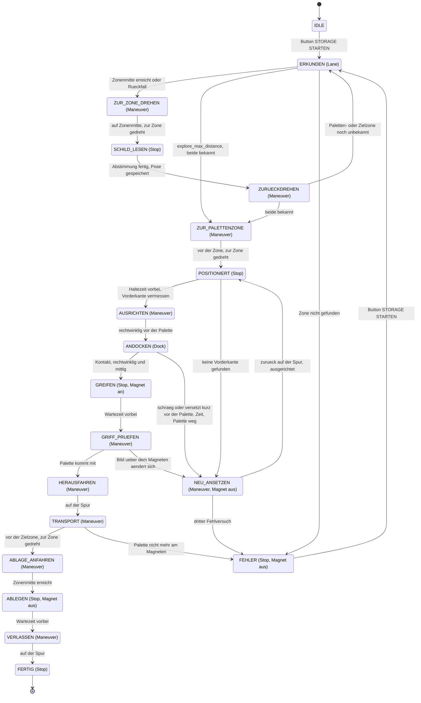

# Konzept Storage and Retrieval Maneuver (URMRC 2026, Abschnitt 4.2.2)

Branch `Storage-Retrieval`. **[V]** = Vermutung, am Bot oder bei der Orga zu klaeren.

## Ziel und Randbedingungen

Die Palette aus ihrer Zone in die Zielzone bringen, dort in der Zonenmitte ablegen und die
Zone verlassen. Palettenzone und Zielzone bestimmt die Jury vor der Challenge.

**Aus dem Reglement 2026** (`R_glement_Robohub_v_2026.pdf`, 4.2.2, Figure 5, Table 1):

- Drei Zonen ① bis ③, je ein Schild hinter der Zone.
- Die Zonen liegen rechts der Spur (in Fahrtrichtung des Bots in Figure 5), direkt
  nebeneinander und gleich breit, mit gemeinsamen weissen Trennlinien. Zur Spur hin sind sie
  offen: Dort ersetzt eine gestrichelte weisse Linie die rechte Spurlinie, genau entlang der
  drei Zonen.
- Transport ohne andere Zonen zu ueberqueren und mit der urspruenglichen Ausrichtung der Palette.
- Vier Landmarken an den Ecken des Bereichs duerfen zur Lokalisierung genutzt werden.
- Der Bot darf nicht umgebaut werden; der Grove-Elektromagnet gehoert zur Ausstattung.

**Antworten der Organisatoren (Mails):**

- Palette: gruener Rahmen auf einem grauen Kasten (Stuetze), vorne senkrecht ein
  Metallstreifen 15 x 5 cm fuer den Magneten. Keine Markierung; die Orga schlaegt vor, sie als
  Hindernis zu erkennen. In der Zielzone steht keine Stuetze.
- Schilder: blauer Kreis mit weisser Ziffer 1–3, unterhalb der LiDAR-Ebene.
- Zonen in aufsteigender Reihenfolge, angenommen in Fahrtrichtung (wie Figure 5) **[V]**.
- Start per ROS-Befehl von Hand; am Ende stoppt die Orga den Bot von Hand.

**Folgerungen:**

- Palette, Stuetze und Schilder liegen unter der LiDAR-Ebene (ca. 18 cm, Burger-URDF). Die
  Aufgabe wird **nur mit Kamera und Odometrie** geloest.
- Die Magnethoehe ist fest, der Magnet kann nur an oder aus. Ohne Stuetze in der Zielzone
  faellt die Palette beim Ablegen von Stuetzenhoehe auf den Boden; ob sie dabei gerade
  bleibt **[V]**.
- Die Kamera sieht den Magneten. Der Magnet haelt nur, wenn der Bot rechtwinklig auf den
  Streifen trifft. Magnetmitte 7,5 cm ueber dem Boden.
- Die Palette wird von Hand platziert: weder mittig noch sicher gerade in ihrer Zone.
- Der Boden ist schwarz (Teppich). In einer leeren Zone ist zwischen den weissen Raendern alles
  schwarz.

### Punkte (Table 1, Mission 5)

| Teil | Punkte | Bonus | Strafe | Zustand im Ablauf |
|------|--------|-------|--------|-------------------|
| Zone mit Palette erkennen, Bot positionieren | – | +2 | −1, wenn der Bot nicht anhaelt | Erkundung, `POSITIONIERT` |
| Palette aufnehmen | 1 | | | `AUSRICHTEN` bis `GRIFF_PRUEFEN` |
| Transport | 3 | | −1, wenn eine andere Zone ueberquert wird | `HERAUSFAHREN` bis `ABLAGE_ANFAHREN` |
| Ablegen | 1 | +1, wenn der Bot die Zone verlaesst | | `ABLEGEN`, `VERLASSEN` |

Eine Zeitwertung gilt nur fuer die Team Challenge, nicht fuer die Palette.

### Was erst vor Ort bekannt ist

Groesse der Zonen, Groesse der Schilder, Aussehen der Landmarken, Palettenzone, Zielzone.

Das Konzept kommt ohne feste Streckenwerte aus:

- Die Lage jeder Zone misst der Bot selbst bei der Erkundung (Zonenmodell).
- Die Zonenmitte ergibt sich aus den Zonenlinien.
- Die Zielzone wird vor dem Start eingegeben.
- In den YAMLs stehen nur Werte, die vor Ort eingestellt werden: Ablauf in
  `Parameter/Switch_Control.yaml`, Detektoren in `Parameter/Storage.yaml`, Regler in
  `Parameter/Control_driving_PID_Wide.yaml`. Alles andere sind Konstanten im Code.

## Ablauf

1. **Start** mit `scripts/tb/launchers/storage.sh`, Fahrfreigabe per Leertaste, dann Button
   STORAGE STARTEN im Debugbild. Bis dahin steht der Bot (Modus `Stop`). Er steht auf der Spur
   vor dem Lagerbereich, die Zonen liegen rechts (Figure 5).
2. **Erkundung**: Spurfolge. `storage_zone_node` meldet Querlinien neben der Spur sowie Beginn
   und Ende der Strichelung; switch_control buendelt sie entlang der Spur zum **Zonenmodell**
   (siehe unten). Erreicht der Bot die Mitte einer Zone, faehrt er genau dorthin, dreht zur
   Zone, liest Schild, Fuellung und Zonentiefe (vordere und hintere Querlinie), speichert die Pose
   und dreht zurueck. Belegt ist die Zone, wenn genug Bilder zwischen ihren Linien genug
   Flaeche zeigen, die weder dunkler Boden noch weisse Linie ist: „Palette in Zone X gefunden“.
   Ohne Modell (weniger als zwei Linien) dreht er `fallback_step` hinter der letzten Querlinie
   zur Seite und liest nur das Schild; ohne lesbares Schild wird die Stelle verworfen.
   Die Erkundung endet, sobald Paletten- und Zielzone bekannt sind, nach drei Zonen oder nach
   `explore_max_distance`. Ohne Palette: „keine Palette gefunden“, dann gilt `pallet_zone`.
3. **Zur Palettenzone** per Odometrie auf die gespeicherte Pose (vor- oder rueckwaerts), zur
   Zone drehen, 1 s anhalten (Positionierung, Wertung). Dabei die **Vorderkante der Palette**
   vermessen: Abstand, seitliche Lage und Winkel (siehe unten).
4. **Ausrichten** (`Maneuver`): auf die Vor-Andock-Pose 10 cm vor dem Kontaktpunkt fahren und
   rechtwinklig zur Vorderkante drehen.
5. **Andocken** (`Dock`): gerade auf die Mitte der Vorderkante zu, mit Lenkkorrektur. Ab 3 cm vor
   dem Kontakt muss der Bot rechtwinklig (5 Grad) und mittig (4 cm) stehen, sonst setzt er neu
   an. Kontakt bei `contact_distance`.
6. **Greifen**: Magnet an, warten, 3 cm zuruecksetzen. Bleibt das Bild ueber dem Magneten gleich
   (Korrelation ab `grip_min`), haengt die Palette: „Palette erfolgreich aufgenommen“.
7. **Transport** („lege Palette in die Zone X“): rueckwaerts auf die gespeicherte Pose auf der
   Spur, zur Zielzone drehen, auf der Spur bis vor die Zielzone, zur Zone drehen. Fremde Zonen
   werden nie betreten, auch wenn eine dazwischen liegt.
8. **Ablegen**: vor bis die Palettenmitte auf der Zonenmitte liegt (Zonentiefe aus der
   Erkundung minus `pallet_center_offset`; ohne gemessene Tiefe so tief wie beim Aufnehmen),
   Magnet aus, warten: „Palette abgelegt“. Die Ausrichtung der Palette entspricht der beim
   Aufnehmen, weil der Bot wieder frontal in die Zone schaut.
9. **Verlassen**: rueckwaerts auf die Spur, anhalten.

Die Rueckmeldungen stehen im Log und im Debugbild (`/control/storage_info`).

### Palette in der Vogelperspektive

`storage_zone_node` sucht zwischen den Seitenlinien der Zone (aus dem Zonenmodell) alles, was
heller als `floor_l_max` und nicht weiss ist; die Farbe der Palette spielt keine Rolle.

- **Fuellung** (beim Lesen vor jeder Zone): Anteil davon zwischen Vorder- und Hinterkante der
  Zone. Ab 10 % zaehlt das Bild als belegt, ab der Haelfte der Bilder die Zone.
- **Vorderkante**: je Spalte die naechste solche Stelle. Das ist die Bodenkante der Stuetze,
  in der Vogelperspektive also unverzerrt und metrisch. Eine Gerade durch diese Punkte gibt
  Abstand, seitliche Lage und Winkel (`/detect/pallet`). Punkte an den Seiten der Stuetze
  fallen als Ausreisser heraus.
- Annahme: Der Metallstreifen liegt parallel zur Vorderkante der Stuetze **[V]**.
- Im Debugbild `/detect/zone_debug/compressed`: Palette rot getoent, Zonengrenzen gelb,
  Kantenpunkte lila und der Rahmen des Metallstreifens (15 cm) an der gemessenen Lage tuerkis,
  dazu Fuellung, Abstand, seitliche Lage und Winkel.

### Griff pruefen

`pallet_node` nimmt beim Greifen das Bild direkt ueber dem Magneten als Vorlage und vergleicht
danach jedes Bild damit (`/detect/pallet_grip`, Korrelation). Haengt die Palette, bewegt sie sich
mit dem Bot und das Bild bleibt gleich; bleibt sie liegen, wird sie beim Zuruecksetzen kleiner.
Ob es reicht, entscheidet switch_control mit `grip_min`, auch waehrend des Tragens.

### Zonenmodell

- Linien L0..L3 im gleichen Abstand; Zone k liegt zwischen L(k-1) und L(k).
- L0 ist der Beginn der Strichelung, sonst die erste Querlinie. Das Ende der Strichelung ist L3.
- Breite und Lage der Linien kommen aus allen bestaetigten Treffern (je drei Bilder). Eine
  fehlende Linie wird ergaenzt; Treffer vor oder hinter der Strichelung oder ausserhalb des
  Rasters (Schatten, Kasten der Palette) zaehlen nicht. Ein Raster, das Linien dort ergaenzen
  muesste, wo der Bot schon hingesehen hat, verliert gegen eines, das alle Treffer erklaert.
- Die Ziffer einer Zone kommt aus `zone_order` nach ihrem Platz (Standard `1,2,3` in
  Fahrtrichtung). Das Schild dient nur zur Kontrolle; ein Widerspruch steht als Warnung im Log.
  Mit leerem `zone_order` entscheidet das Schild.
- Gezeichnet im Debugbild `/detect/zone_debug/compressed`: gemessene Linien gruen, ergaenzte
  orange, Ziffer je Zone; dazu der Strichel-Streifen mit Beginn (tuerkis) und Ende (lila). Mit
  Zuschauer laeuft die Erkennung auch ohne Storage-Ablauf, damit sie sich einstellen laesst.

### Zustandsdiagramm

Unterzustaende (`StorageState` in `common.py`, Ablauf in `storage_sequence.py`); in Klammern
der `ControlType` (Fahrart), den switch_control dabei auf `/control/mode` sendet.



Nicht eingezeichnet:

- STORAGE ABBRECHEN fuehrt aus jedem Zustand zu IDLE (Magnet aus, Modus `initial_mode`).
- Jeder `Maneuver`-Zustand endet nach 30 s in FEHLER.
- „Palette nicht mehr am Magneten“ gilt auch in HERAUSFAHREN und ABLAGE_ANFAHREN.

## Nodes und Topics

| Node / Modul | neu/geaendert | Ein | Aus | Aufgabe |
|--------------|---------------|-----|-----|---------|
| `switch_control` + `storage_sequence.py` | geaendert / neu | `/control/storage_request`, `/detect/zone_boundaries`, `/detect/zone_dash_start`, `/detect/zone_dash_end`, `/detect/zone_cross_lines`, `/detect/storage_sign`, `/detect/pallet`, `/detect/pallet_grip`, `/control/maneuver_status`, TF | `/control/mode`, `/control/storage_state`, `/control/storage_info`, `/control/storage_zones`, `/control/maneuver`, `/lokal/magnet_control` | Einziger Entscheider: Unterzustand, Zonenmodell und Zonenposen in `odom`, Abstimmung ueber Schilder und Palette, Ziele fuer `Maneuver`, Magnet an/aus, Rueckmeldungen. Kein Obstacle und kein Tunnel waehrend Storage |
| `control_driving` | geaendert | `/control/mode`, `/detect/lane`, `/nav2/cmd_vel`, `/detect/pallet`, `/control/maneuver`, TF | `/control/cmd_vel`, `/control/maneuver_status` | Einzige Quelle fuer Fahrbefehle, neu: Regler fuer `Dock` und `Maneuver` |
| `storage_zone_node` | neu | `/lokal/bev`, `/control/storage_state`, `/control/storage_zones`, TF | `/detect/zone_boundaries`, `/detect/zone_dash_start`, `/detect/zone_dash_end`, `/detect/zone_cross_lines`, `/detect/pallet` | Weisse Querlinien per HoughLinesP: neben der Spur (ERKUNDEN) bzw. vor dem Bot (SCHILD_LESEN); Beginn und Ende der Strichelung; Fuellung der Zone und Vorderkante der Palette; zeichnet Zonenmodell und Palette ins Debugbild |
| `storage_sign_node` | neu | `/lokal/raw_image`, `/control/storage_state` | `/detect/storage_sign` | Blau-Maske (LAB), Ellipse und weisser Inhalt pruefen, Ziffer mit Vorlagen korrelieren |
| `storage_sign_model_node` | neu (Geruest) | `/lokal/raw_image`, `/control/storage_state` | `/detect/storage_sign` | YOLO (ultralytics), sobald `model_path` gesetzt ist |
| `pallet_node` | neu | `/lokal/raw_image`, `/control/storage_state` | `/detect/pallet_grip` | Griff pruefen: Bild ueber dem Magneten gegen die Vorlage vom Greifen |
| `magnet_controll` | registriert | `/lokal/magnet_control` | `/lokal/magnet_status` | GPIO 17, laeuft **auf dem Bot** (`ros2 run Follow_Lane magnet_controll`) |
| `debug_view` | geaendert | wie bisher, dazu `/control/storage_state`, `/control/storage_info` | `/control/storage_request` | Button STORAGE STARTEN/ABBRECHEN, Zustand, Zonen, Fehlergrund |

Die Detektoren arbeiten nur in den Zustaenden, die sie brauchen. `pallet_node` und
`storage_zone_node` arbeiten zusaetzlich, wenn jemand ihr Debugbild ansieht,
`storage_sign_node` mit `always_on`, damit sich Werte und Vorlagen einstellen lassen.

**Neue Nachrichten** in `follow_lane_msg`: `StorageSign` (Ziffer, Sicherheit, Lage im Bild,
Quelle), `PalletDetection` (Fuellung der Zone; Vorderkante: Abstand, seitlich, Winkel), `Maneuver`
(id, ROTATE/STRAIGHT/PATH, Zielwinkel, Strecke, Pfad, rueckwaerts, Hoechstgeschwindigkeit),
`StorageZones` (Zonenmodell fuer die Anzeige: Linien, gemessen/ergaenzt, Ziffern).
Zonenlinien und Strichel-Enden laufen als `geometry_msgs/PoseArray` in `odom`.

**Neue Fahrarten** in `common.py`:

| `ControlType` | Fahrbefehl (control_driving) |
|---------------|------------------------------|
| `Dock` (8) | Auf `/detect/pallet`: mit `dock_vel` auf die Mitte der Vorderkante zu, Lenkkorrektur mit `dock_k_ang`; liegt sie mehr als 0,15 rad daneben, nur drehen. Den Kontakt erkennt switch_control |
| `Maneuver` (9) | Grundbewegung aus `/control/maneuver` in `odom`: auf Winkel drehen, Strecke fahren, Punkte anfahren (vor- oder rueckwaerts). Meldet die id auf `/control/maneuver_status` |
| `Lane`, `Stop` (vorhanden) | Spurfolge bei der Erkundung, Nullbefehl beim Lesen, Greifen und Ablegen |

`Dock` und `Maneuver` laufen wie die Nav2-Befehle durch die Radgrenze (`MAX_WHEEL_VEL`).

```
storage_sign_node / storage_sign_model_node --/detect/storage_sign------------.
storage_zone_node --/detect/zone_boundaries, _dash_start/_end, _cross_lines,-+
                    /detect/pallet                                            |
pallet_node --/detect/pallet_grip---------------------------------------------+--> switch_control
debug_view --/control/storage_request-----------------------------------------'       |
                                                                     /control/mode,   |
                                                                  /control/maneuver   v
detect_lane_nav2 --/detect/lane--> control_driving <--/detect/pallet-- storage_zone_node
                                       |
                                       '--/control/cmd_vel--> notaus --/cmd_vel--> Bot
switch_control --/lokal/magnet_control--> magnet_controll (auf dem Bot, GPIO 17)
```

**Start:** `storage.launch.py` (ueber `storage.sh`) startet `follow_lane.launch.py` (mit
`odom_filter`, der die TF odom -> base_footprint liefert) mit `Parameter/Storage.yaml` und die vier
Storage-Nodes, ohne Nav2. `Storage.yaml` setzt `initial_mode: Stop` fuer switch_control und
ueberschreibt damit `initial_mode: Lane` aus `Switch_Control.yaml`. Kein Node hat Code-Defaults.
Die Werte von switch_control (auch die des Storage-Ablaufs) stehen in `Switch_Control.yaml`,
die von control_driving in `Control_driving_PID_Wide.yaml`, damit auch `follow_lane.launch.py`
und `nav2_obstacle.launch.py` ohne `Storage.yaml` starten.

## Entscheidungen

| Thema | Entscheidung | Begruendung |
|-------|--------------|-------------|
| Sensoren | Nur Kamera und Odometrie, kein LiDAR | Palette, Stuetze und Schilder liegen unter der LiDAR-Ebene |
| Zustaende | `ControlType` je Fahrart (`Dock`, `Maneuver`, dazu `Lane`, `Stop`); der Ablaufschritt ist ein Unterzustand nur in switch_control (Modul `storage_sequence.py`) | control_driving bleibt bei „Modus -> Regler“, nur zwei neue Werte, der Ablauf liegt an einer Stelle (Architekturregel) |
| Magnet | schaltet switch_control | An/aus ist eine Entscheidung, kein Fahrbefehl |
| Start | Button STORAGE STARTEN (sendet `/control/storage_request`) | Start per ROS-Befehl von Hand ist erlaubt; gleiches Muster wie beim Tunnel |
| Lagebild | Erst Erkundung, Posen in `odom` speichern, danach Palette holen | Liefert die Erkennung (Bonus) und die Ziele fuer den Transport; unabhaengig von der Zonengroesse |
| Zone erkennen | Zonenmodell aus Querlinien und Strichelung, Ziffer aus der Reihenfolge; Rueckfall ohne Modell: zur Seite drehen und Schild lesen | Keine festen Abstaende; eine uebersehene Linie verschiebt die Zaehlung nicht |
| Schilder | Blau-Maske (LAB) + Ellipse + Ziffern-Vorlagen; parallel ein trainiertes Modell | Aussehen bekannt; die Kreisform trennt das Schild von der blauen Schranke (Balken, auch beim Oeffnen) |
| Zusammenfuehrung | Beide Detektoren stimmen ueber mehrere Bilder ab, waehrend der Bot steht; jeder per Parameter abschaltbar | Robust; faellt einer aus, arbeitet der andere weiter |
| Manuelle Eingabe | `target_zone` (Jury), `zone_order` (Ziffern in Fahrtrichtung), `pallet_zone` (nur ohne gesehene Palette) | Die Jury bestimmt die Zielzone; die Palettenzone erkennt der Bot selbst (Wertung) |
| Zone leer? | Zwischen den Zonenlinien alles dunkel; sonst belegt | Palette hat keine Markierung; jede Farbe ist heller als der schwarze Boden |
| Andocken | Vorderkante der Stuetze in der Vogelperspektive vermessen, rechtwinklig davor ausrichten (`Maneuver`), dann gerade andocken (`Dock`); schraeg oder versetzt kurz davor -> neu ansetzen | Der Magnet haelt nur rechtwinklig; die Palette steht beliebig; die Bodenkante ist in der Vogelperspektive metrisch; ein Differentialantrieb kann auf wenigen cm seitlich kaum korrigieren |
| Griff pruefen | Kurz zuruecksetzen, Bild ueber dem Magneten mit der Vorlage vom Greifen vergleichen | Kein eigener Sensor, kein Motorstrom (`turtlebot3_node` liest ihn nicht aus) |
| Entscheiden | Detektoren liefern nur Messwerte (Fuellung, Vorderkante, Korrelation); belegt, Kontakt und Griff entscheidet switch_control | Architekturregel: ein Entscheider |
| Route | Rueckwaerts raus, zur Zielzone drehen, an der Spur entlang, zur Zielzone drehen | Fremde Zonen werden nie betreten |
| Ausrichtung | Muss nur beim Ablegen stimmen | Seitliches Versetzen ohne Drehen geht mit Differentialantrieb nicht |
| Maneuver | Eigener Regler in control_driving, kein Nav2 | Kurze, einfache Wege; exaktes Drehen auf der Stelle; Costmaps und LiDAR helfen hier nicht |
| Ablegen | Tiefe aus den Zonenlinien der Erkundung, Magnet aus | Magnethoehe fest, Magnet nur an/aus; mit Palette vor der Kamera sind die Linien der Zielzone womoeglich verdeckt |
| Verlassen | Rueckwaerts aus der Zielzone auf die Spur, anhalten | Kurz, ohne Drehung |
| Fehler | Andocken/Greifen bis zum dritten Versuch, danach FEHLER; Palette verloren -> FEHLER | Haengt nie in einer Schleife; eine Palette am Boden ist mit fester Magnethoehe nicht mehr greifbar |

## Vor Ort einstellen

1. **Boden** (`storage_zone_node`): `/detect/zone_debug/compressed` vor einer leeren Zone;
   `floor_l_max` so, dass der Teppich nicht rot getoent wird, ein Gegenstand in der Zone schon.
2. **Kontakt** (switch_control): Bot mit dem Magneten an den Metallstreifen stellen und den
   Abstand aus `/detect/pallet` als `contact_distance` eintragen.
3. **Magnet** (`pallet_node`): `/detect/pallet_debug/compressed` ansehen, `magnet_x` und
   `magnet_top` auf den Magneten im Bild setzen. `grip_min` (switch_control) zwischen die
   Korrelation mit haengender und mit liegen gebliebener Palette legen.
4. **Schilder** (`storage_sign_node`): Bot vor jedes Schild stellen, `always_on: true`,
   `/detect/storage_sign_debug/compressed` ansehen, Blau-Werte pruefen, dann je Schild
   `ros2 param set /storage_sign_node capture_digit <1-3>`. Die Vorlagen liegen in
   `~/.ros/urmc_storage_templates` und gelten auch nach einem Neustart.
5. **Zonenlinien** (`storage_zone_node`): `/detect/zone_debug/compressed` beim Vorbeifahren;
   `side_near_m` so, dass die gestrichelte Linie gerade nicht mehr im Streifen liegt;
   `solid_min_m` und `dash_gap_max_m` nach Strichlaenge und Luecke der Strichelung.
6. **Bot**: `pallet_center_offset` (Radachse bis Palettenmitte am Magneten) messen.
7. **Zielzone**: `ros2 param set /switch_control target_zone <1-3>` vor dem Start.

## Offene Punkte

- **Nachbau der Palette:** fehlt; ohne ihn lassen sich Andocken und Griff nicht pruefen.
- **Orga:** Groesse der Schilder; Aussehen der Landmarken; ob „exit the storage area“ mehr
  verlangt als die Zone zu verlassen.
- **Am Bot zu pruefen:** Magnetlage im Bild, Vorzeichen in `Dock`, Genauigkeit von `Maneuver`,
  Strichelung und Zonenmodell, ob die Vorderkante der Stuetze bis kurz vor dem Kontakt im
  Bild bleibt, ob der Streifen parallel zu ihr liegt.
- **Magnet auf dem Bot:** `magnet_controll` braucht das Paket `Follow_Lane` auf dem Bot
  (gebaut, mit `python3-gpiozero`). `scripts/tb/bot/magnet_node.py` hoert dagegen auf
  `/magnet/cmd`; sein Kommentar sagt, `bot-up.sh` starte ihn, `bot-up.sh` tut das nicht.
- **Ablegen ohne Stuetze:** Die Palette faellt von Stuetzenhoehe auf den Boden **[V]**.
- **BEV seitlich:** Reicht der Bereich der BEV nach rechts bis zu den Zonengrenzen? Die BEV
  reicht +-0,40 m, gesucht wird ab `side_near_m` 0,14 m.
- **Drehen auf der Spur mit Palette:** Das Heck schwenkt aus; es darf keine Zone streifen
  **[V]**. Am Bot messen.
- **Sicht beim Transport:** Die Palette verdeckt womoeglich die nahen Spurlinien **[V]**,
  deshalb faehrt der Transport per `Maneuver` statt `Lane`.
- **Spur-Tracking nach Drehungen:** `detect_lane_nav2` verfolgt die Linien mit Anker
  (`LINE_MAX_JUMP_CM`, `LINE_HOLD_TIME_S`) und laeuft auch in `Maneuver` weiter. Ob die Spurfolge
  nach `ZURUECKDREHEN` sofort wieder die richtigen Linien findet **[V]**, am Bot pruefen.
- **Geschwindigkeiten mit Last:** `carry_max_vel` 0,05 m/s, am Bot festlegen.
- **Odometrie:** Genauigkeit von Drehung und Strecke ueber ca. 1 m am Bot messen.
- **Trainiertes Modell:** Daten, Training, Rechner (Bot oder PC), Laufzeit; dann `model_path`.

## Testplan

Real auf dem nachgebauten Parcours. Dafuer wird der Lagerbereich ergaenzt: drei Zonen aus
Klebeband mit gestrichelter Linie zur Spur, drei Schilder (blauer Kreis, weisse Ziffer), ein
Nachbau der Palette (Rahmen mit Metallstreifen 15 x 5 cm auf einem Kasten). Zonen absichtlich
ungleich breit (z. B. 25 / 30 / 35 cm) und die Strichelung verschieden lang, damit nichts an
festen Massen haengt.

1. **Bauen:** `colcon build` fuer `follow_lane_msg` und `Follow_Lane` (neue Nachrichten).
2. **Magnet:** `ros2 run Follow_Lane magnet_controll` auf dem Bot,
   `ros2 topic pub --once /lokal/magnet_control std_msgs/msg/Bool '{data: true}'`. Haelt er den
   Streifen, haengt die Palette sauber, faellt sie beim Ausschalten ab?
3. **Einstellen** wie oben (Boden, Kontakt, Magnetlage, Vorlagen).
4. **Schilder:** Erkennung bei verschiedenen Abstaenden, Winkeln und Licht; die blaue Schranke
   daneben darf nicht als Schild gelten.
5. **Zonenlinien:** Werden Querlinien und Strichelung beim Fahren gefunden (Log
   „Zonengrenze bestaetigt“, „Beginn/Ende der Strichelung bestaetigt“)? Stimmt das Zonenmodell
   im Debugbild, auch wenn eine Trennlinie abgeklebt ist?
6. **Maneuver:** 90°-Drehungen, Strecken vor/zurueck und Punkte anfahren, mit und ohne Palette.
   Einzeln testbar: `/control/mode` und `/control/maneuver` von Hand senden, ohne switch_control.
7. **Andocken und Griff pruefen:** Palette versetzt und schraeg (bis 20 Grad) in die Zone
   stellen; der Bot muss rechtwinklig andocken. Fehlgriff (Magnet aus) muss NEU_ANSETZEN
   ausloesen.
8. **Gesamtablauf** mit der Palette in jeder Zone und jeder Zielzone, auch mit einer Zone
   zwischen Start und Ziel; Abbrechen per Button, Fehlerfaelle.

## Quellen

- Reglement 2026: `R_glement_Robohub_v_2026.pdf`, Abschnitt 3 und 4.2.2, Figure 5, Table 1.
- Antworten der Organisatoren: Mail an alle Teams (siehe `Reglement_Ergaenzungen_Orga.md` auf
  `main`) und Mail mit Fotos der Palette.
- GalapagosGang URMRC 2025: <https://github.com/scti1057/GalapagosGang_URRMC2025>
  (`src/galapagos_regelt/galapagos_regelt/paletting_node.py`, `challenge4_palleting.launch.py`,
  `src/galapagos_checked_yolo/`, `2025_URRMC_Reglement_En.pdf`). Uebernommen: Grundidee der Route
  (zuruecksetzen, 90° drehen, an der Spur entlang, zurueckdrehen). Nicht uebernommen: feste
  Ablaufkette, Pixel-Offsets, direktes `cmd_vel`, YOLO-Gewichte.
- ZoZo-Campo/URMC (2026): <https://github.com/ZoZo-Campo/URMC>, `src/urmc_mission_05/` —
  Zustandsliste mit Griff- und Ablagebestaetigung, Wahrnehmung dort noch nicht umgesetzt.
- Offizielle URMRC-Simulation: <https://github.com/URMRC/Turtlebot-simulation-Upper-Rhine-Robotic-Challenge-ROS2-humble-25>
  — kein Modell des Lagerbereichs.
- TurtleBot3 Burger URDF (`turtlebot3_burger.urdf`, `scan_joint` 0,172 m + `base_joint` 0,010 m):
  Hoehe der LiDAR-Ebene.
- `turtlebot3_node/src/sensors/joint_state.cpp`: Motorstrom auskommentiert, kein Effort.
- Seeed Grove Electromagnet: <https://wiki.seeedstudio.com/Grove-Electromagnet/> (5 V, 400 mA, bis 1 kg).
- Schilderkennung bei AutoRace (Vorlagenabgleich, YOLOv8 + SIFT):
  Twieg/Menghani, ICAIIT 2023, <https://repo.bibliothek.uni-halle.de/bitstream/1981185920/114950/1/2_3_ICAIIT_Paper_2023%282%29_Twieg_26.pdf>
