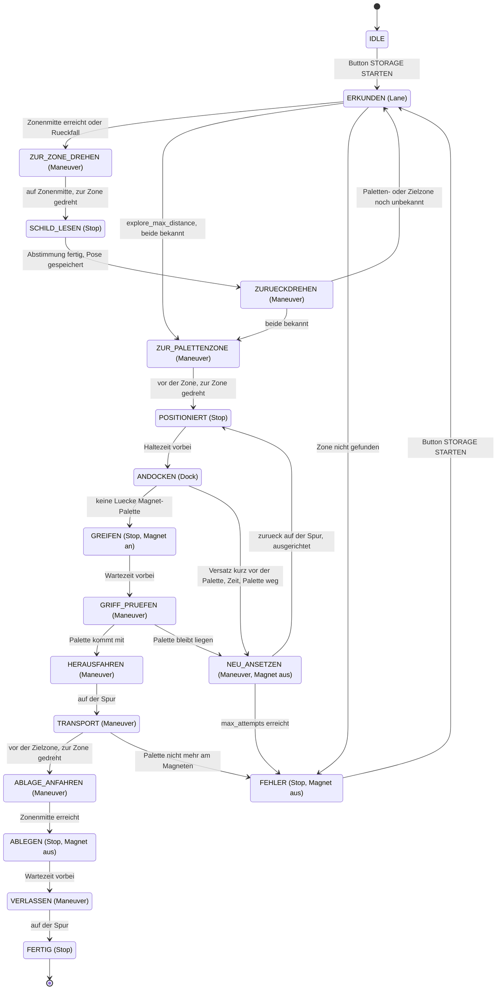

# Konzept Storage and Retrieval Maneuver (URMRC 2026, Abschnitt 4.2.2)

Abgestimmt am 25.10.2026. Branch `Storage-Retrieval`, abgezweigt von `Nav2-Costmap-Fix`
(`838ca32`). Umgesetzt am 25.10.2026, **am Bot noch nicht getestet**. Kennzeichnung:
**[V]** = Vermutung, am Bot oder bei der Orga zu pruefen.

## Ziel und Randbedingungen

Die Palette aus der Zone mit der Palette (laut Reglement ①) in die Zielzone (laut Reglement ②,
laut Orga „von der Jury bestimmt“) bringen, dort in der Zonenmitte ablegen und die Zone
verlassen.

**Aus dem Reglement 2026** (`R_glement_Robohub_v_2026.pdf`, 4.2.2, Figure 5, Table 1):

- Drei Zonen ① bis ③ in zufaelliger Reihenfolge, je ein Schild hinter der Zone.
- Die Zonen liegen rechts der Spur (in Fahrtrichtung des Bots in Figure 5) und sind zur
  Spur hin offen (gestrichelte weisse Linie), seitlich und hinten durch weisse Linien begrenzt.
- Transport ohne andere Zonen zu ueberqueren und mit der urspruenglichen Ausrichtung der Palette.
- Vier Landmarken an den Ecken des Bereichs duerfen zur Lokalisierung genutzt werden.
- Der Bot darf nicht umgebaut werden; der Grove-Elektromagnet gehoert zur Ausstattung.

**Antworten der Organisatoren (Mail, 25.10.):**

- Palette ca. 10 cm x 2 cm, ca. 3 cm tief, auf einer Stuetze ca. 5 cm ueber dem Boden,
  vorne ein Metallstreifen fuer den Magneten. Keine Markierung auf der Palette.
- Schilder: blauer Kreis mit weisser Ziffer 1–3.

**Folgerungen:**

- Palette und Stuetze liegen weit unter der LiDAR-Ebene (ca. 18 cm, Burger-URDF). Die
  Aufgabe wird **nur mit Kamera und Odometrie** geloest, der LiDAR spielt keine Rolle.
- Die Magnethoehe ist fest, der Magnet kann nur an oder aus. Die Palette haengt immer auf
  Magnethoehe; das Ablegen laeuft deshalb gleich ab, ob in der Zielzone eine Stuetze steht
  oder nicht.
- Die Kamera sieht den Magneten. Beim Andocken gibt es keinen toten Winkel.

### Punkte (Table 1, Mission 5)

| Teil | Punkte | Bonus | Strafe | Zustand im Ablauf |
|------|--------|-------|--------|-------------------|
| Zone mit Palette erkennen, Bot positionieren | – | +2 | −1, wenn der Bot nicht anhaelt | Erkundung, `POSITIONIERT` |
| Palette aufnehmen | 1 | | | `ANDOCKEN` bis `GRIFF_PRUEFEN` |
| Transport | 3 | | −1, wenn eine andere Zone ueberquert wird | `HERAUSFAHREN` bis `ABLAGE_ANFAHREN` |
| Ablegen | 1 | +1, wenn der Bot die Zone verlaesst | | `ABLEGEN`, `VERLASSEN` |

Eine Zeitwertung gilt nur fuer die Team Challenge, nicht fuer die Palette.

### Was erst vor Ort bekannt ist

Groesse der Zonen, Groesse und Hoehe der Schilder, Aussehen der Stuetze und der Landmarken,
Reihenfolge der Zonen, Zielzone, Einfahrtiefe.

Das Konzept kommt ohne feste Streckenwerte aus:

- Die Lage jeder Zone misst der Bot selbst bei der Erkundung.
- Die Zonenmitte ergibt sich aus den Zonenlinien.
- Die Zielzone wird vor dem Start eingegeben.
- Toleranzen, Geschwindigkeiten und Wiederholungen sind Parameter (rqt, `Parameter/Storage.yaml`).

## Ablauf

1. **Start** mit `scripts/tb/launchers/storage.sh`, Fahrfreigabe per Leertaste, dann Button
   STORAGE STARTEN im Debugbild. Bis dahin steht der Bot (Modus `Stop`). Er steht auf der Spur
   vor dem Lagerbereich, die Zonen liegen rechts (Figure 5).
2. **Erkundung**: Spurfolge. `storage_zone_node` meldet Querlinien neben der Spur, switch_control
   sammelt sie als Zonengrenzen in `odom`. Hat der Bot die Mitte zwischen zwei bestaetigten
   Grenzen erreicht, faehrt er genau dorthin, dreht zur Zone, liest Schild, Palette und
   Zonentiefe (vordere und hintere Querlinie), speichert die Pose und dreht zurueck.
   Rueckfall, wenn der Bot `fallback_step` hinter der letzten bestaetigten Grenze (bzw. dem
   Start oder dem letzten Halt) steht, ohne eine neue gesehen zu haben: an der Stelle zur Seite
   drehen und nur das Schild lesen; ohne lesbares Schild wird die Stelle verworfen.
   Die Erkundung endet, sobald Paletten- und Zielzone bekannt sind, nach `zone_count` Zonen
   oder nach `explore_max_distance`.
3. **Zur Palettenzone** per Odometrie auf die gespeicherte Pose (vor- oder rueckwaerts), zur
   Zone drehen, `position_hold_time` anhalten (Positionierung, Wertung).
4. **Andocken** (`Dock`): liegt die Palette seitlich mehr als `dock_align_tol` neben dem
   Magneten, dreht der Bot auf der Stelle; sonst faehrt er langsam vor und lenkt nach, bis keine
   Luecke mehr zwischen Magnet und Palette ist. Magnet an, warten, `grip_check_distance`
   zuruecksetzen; haengt die Palette noch am Magneten, ist sie gegriffen.
5. **Transport**: rueckwaerts auf die gespeicherte Pose auf der Spur, zur Zielzone drehen, auf
   der Spur bis vor die Zielzone, zur Zone drehen. Fremde Zonen werden nie betreten, auch wenn
   ③ zwischen Start- und Zielzone liegt.
6. **Ablegen**: vor bis die Palettenmitte auf der Zonenmitte liegt (Zonentiefe aus der
   Erkundung minus `pallet_center_offset`; ohne gemessene Tiefe so tief wie beim Aufnehmen),
   Magnet aus, warten. Die Ausrichtung der Palette entspricht der beim Aufnehmen, weil der Bot
   wieder frontal in die Zone schaut.
7. **Verlassen**: rueckwaerts auf die Spur, anhalten.

### Zustandsdiagramm

Unterzustaende (`StorageState` in `common.py`, Ablauf in `storage_sequence.py`); in Klammern
der `ControlType` (Fahrart), den switch_control dabei auf `/control/mode` sendet.



Nicht eingezeichnet:

- STORAGE ABBRECHEN fuehrt aus jedem Zustand zu IDLE (Magnet aus, Modus `initial_mode`).
- Jeder `Maneuver`-Zustand endet nach `step_timeout` in FEHLER.
- „Palette nicht mehr am Magneten“ gilt auch in HERAUSFAHREN und ABLAGE_ANFAHREN.
- Mit `zone_order` liefert die Eingabe die Ziffern; erkundet wird trotzdem, um die Posen
  der Zonen zu messen.

## Nodes und Topics

| Node / Modul | neu/geaendert | Ein | Aus | Aufgabe |
|--------------|---------------|-----|-----|---------|
| `switch_control` + `storage_sequence.py` | geaendert / neu | `/control/storage_request`, `/detect/zone_boundaries`, `/detect/zone_cross_lines`, `/detect/storage_sign`, `/detect/pallet`, `/control/maneuver_status`, TF | `/control/mode`, `/control/storage_state`, `/control/storage_info`, `/control/maneuver`, Magnet (`magnet_topic`) | Einziger Entscheider: Unterzustand, Zonengrenzen und Zonenposen in `odom`, Abstimmung ueber Schilder und Palette, Ziele fuer `Maneuver`, Magnet an/aus. Kein Obstacle und kein Tunnel waehrend Storage |
| `control_driving` | geaendert | `/control/mode`, `/detect/lane`, `/nav2/cmd_vel`, `/detect/pallet`, `/control/maneuver`, TF | `/control/cmd_vel`, `/control/maneuver_status` | Einzige Quelle fuer Fahrbefehle, neu: Regler fuer `Dock` und `Maneuver` |
| `storage_zone_node` | neu | `/lokal/bev`, `/control/storage_state`, TF | `/detect/zone_boundaries`, `/detect/zone_cross_lines` | Weisse Querlinien per HoughLinesP: neben der Spur (ERKUNDEN) bzw. vor dem Bot (SCHILD_LESEN) |
| `storage_sign_node` | neu | `/lokal/raw_image`, `/control/storage_state` | `/detect/storage_sign` | Blau-Maske (LAB), Ellipse und weisser Inhalt pruefen, Ziffer mit Vorlagen korrelieren |
| `storage_sign_model_node` | neu (Geruest) | `/lokal/raw_image`, `/control/storage_state` | `/detect/storage_sign` | YOLO (ultralytics), sobald `model_path` gesetzt ist |
| `pallet_node` | neu | `/lokal/raw_image`, `/control/storage_state` | `/detect/pallet` | Palette per Farbe und Form oberhalb des Magneten: seitlicher Versatz, Luecke |
| `magnet_controll` | registriert | `/lokal/magnet_control` | `/lokal/magnet_status` | GPIO 17, laeuft **auf dem Bot** (`ros2 run Follow_Lane magnet_controll`) |
| `debug_view` | geaendert | wie bisher, dazu `/control/storage_state`, `/control/storage_info` | `/control/storage_request` | Button STORAGE STARTEN/ABBRECHEN, Zustand, Zonen, Fehlergrund |

Die Detektoren arbeiten nur in den Zustaenden, die sie brauchen. `pallet_node` und
`storage_sign_node` arbeiten zusaetzlich, wenn jemand ihr Debugbild ansieht bzw. mit
`always_on`, damit sich Magnetlage, Farben und Vorlagen einstellen lassen.

**Neue Nachrichten** in `follow_lane_msg`: `StorageSign` (Ziffer, Sicherheit, Lage im Bild,
Quelle), `PalletDetection` (gefunden, seitlicher Versatz, Luecke in px, Breite), `Maneuver`
(id, ROTATE/STRAIGHT/PATH, Zielwinkel, Strecke, Pfad, rueckwaerts, Hoechstgeschwindigkeit).
Zonenlinien laufen als `geometry_msgs/PoseArray` in `odom`.

**Neue Fahrarten** in `common.py`:

| `ControlType` | Fahrbefehl (control_driving) |
|---------------|------------------------------|
| `Dock` (8) | Auf `/detect/pallet`: drehen, solange der Versatz ueber `dock_align_tol` liegt, sonst langsam vor mit Lenkkorrektur; ab `dock_contact_gap_px` Stillstand |
| `Maneuver` (9) | Grundbewegung aus `/control/maneuver` in `odom`: auf Winkel drehen, Strecke fahren, Punkte anfahren (vor- oder rueckwaerts). Meldet die id auf `/control/maneuver_status` |
| `Lane`, `Stop` (vorhanden) | Spurfolge bei der Erkundung, Nullbefehl beim Lesen, Greifen und Ablegen |

```
storage_sign_node / storage_sign_model_node --/detect/storage_sign------------.
storage_zone_node --/detect/zone_boundaries, /detect/zone_cross_lines---------+
pallet_node --/detect/pallet--------------------------------------------------+--> switch_control
debug_view --/control/storage_request-----------------------------------------'       |
                                                                     /control/mode,   |
                                                                  /control/maneuver   v
detect_lane_nav2 --/detect/lane--> control_driving <--/detect/pallet-- pallet_node
                                       |
                                       '--/control/cmd_vel--> notaus --/cmd_vel--> Bot
switch_control --/lokal/magnet_control--> magnet_controll (auf dem Bot, GPIO 17)
```

**Start:** `storage.launch.py` (ueber `storage.sh`) startet `follow_lane.launch.py` mit
`Parameter/Storage.yaml` und die vier Storage-Nodes, ohne Nav2. `Storage.yaml` setzt
`initial_mode: Stop` fuer switch_control.

## Entscheidungen

| Thema | Entscheidung | Begruendung |
|-------|--------------|-------------|
| Sensoren | Nur Kamera und Odometrie, kein LiDAR | Palette und Stuetze liegen ca. 10 cm unter der LiDAR-Ebene |
| Zustaende | `ControlType` je Fahrart (`Dock`, `Maneuver`, dazu `Lane`, `Stop`); der Ablaufschritt ist ein Unterzustand nur in switch_control (Modul `storage_sequence.py`) | control_driving bleibt bei „Modus -> Regler“, nur zwei neue Werte, der Ablauf liegt an einer Stelle (Architekturregel) |
| Magnet | schaltet switch_control | An/aus ist eine Entscheidung, kein Fahrbefehl |
| Start | Nur Button STORAGE STARTEN | Jede Challenge laeuft einzeln, kein anderer Ausloeser bekannt; gleiches Muster wie beim Tunnel |
| Lagebild | Erst Erkundung, Posen in `odom` speichern, danach Palette holen | Liefert die Erkennung (Bonus) und die Ziele fuer den Transport; unabhaengig von der Zonengroesse |
| Zone erkennen | Zonengrenzen in der BEV, Zonenmitte zwischen zwei Grenzen; Rueckfall: zur Seite drehen und Schild lesen | Keine festen Abstaende |
| Schilder | Blau-Maske (LAB) + Ellipse + Ziffern-Vorlagen; parallel ein trainiertes Modell | Aussehen bekannt; die Kreisform trennt das Schild von der blauen Schranke (Balken, auch beim Oeffnen) |
| Zusammenfuehrung | Beide Detektoren stimmen ueber mehrere Bilder ab, waehrend der Bot steht; jeder per Parameter abschaltbar | Robust; faellt einer aus, arbeitet der andere weiter |
| Manuelle Eingabe | rqt-Parameter `target_zone` (immer) und `zone_order` (Rueckfall, Tests im Labor), Button im Debugbild | Die Jury bestimmt die Zielzone; eine manuelle Zonenangabe wird wohl nicht als Erkennung gewertet |
| Andocken | `Dock` im Bild: erst ausrichten (drehen), dann fast geradeaus bis keine Luecke Magnet-Palette; zu grosser Versatz kurz davor -> zurueck auf die Spur, neu ansetzen | Die Kamera sieht Magnet und Palette zugleich; ein Differentialantrieb kann auf wenigen cm seitlich kaum korrigieren |
| Griff pruefen | Kurz zuruecksetzen, im Bild pruefen, ob die Palette am Magneten mitkommt | Kein eigener Sensor, kein Motorstrom (`turtlebot3_node` liest ihn nicht aus) |
| Route | Rueckwaerts raus, zur Zielzone drehen, an der Spur entlang, zur Zielzone drehen | Fremde Zonen werden nie betreten |
| Ausrichtung | Muss nur beim Ablegen stimmen | Seitliches Versetzen ohne Drehen geht mit Differentialantrieb nicht |
| Maneuver | Eigener Regler in control_driving, kein Nav2 | Kurze, einfache Wege; exaktes Drehen auf der Stelle; Costmaps und LiDAR helfen hier nicht |
| Ablegen | Gleicher Ablauf mit oder ohne Stuetze; Tiefe aus den Zonenlinien der Erkundung | Magnethoehe fest, Magnet nur an/aus; mit Palette vor der Kamera sind die Linien der Zielzone womoeglich verdeckt |
| Verlassen | Rueckwaerts aus der Zielzone auf die Spur, anhalten | Kurz, ohne Drehung |
| Fehler | Andocken/Greifen bis `max_attempts`, danach FEHLER; Schild nicht erkannt -> manuelle Eingabe; Palette verloren -> FEHLER | Haengt nie in einer Schleife; eine Palette am Boden ist mit fester Magnethoehe nicht mehr greifbar |
| Umsetzung | Die komplette Kette auf einmal gebaut | Wunsch des Teams |

## Vor Ort einstellen

1. **Magnet und Palette** (`pallet_node`): `/detect/pallet_debug/compressed` ansehen,
   `magnet_x` und `magnet_top` auf den Magneten im Bild setzen, `lab_*_pallet_*` auf die Farbe
   der Palette (Startwerte: grauer Metallstreifen).
2. **Schilder** (`storage_sign_node`): Bot vor jedes Schild stellen, `always_on: true`,
   `/detect/storage_sign_debug/compressed` ansehen, Blau-Werte pruefen, dann je Schild
   `ros2 param set /storage_sign_node capture_digit <1-3>`. Die Vorlagen liegen in
   `template_dir` und gelten auch nach einem Neustart.
3. **Zonenlinien** (`storage_zone_node`): `/detect/zone_debug/compressed` beim Vorbeifahren;
   `side_near_m` so, dass die gestrichelte Linie gerade nicht mehr im Streifen liegt.
4. **Bot**: `pallet_center_offset` (Radachse bis Palettenmitte am Magneten) messen.
5. **Zielzone**: `ros2 param set /switch_control target_zone <1-3>` vor dem Start.

## Offene Punkte

- **Orga:** Aussehen der Stuetze und ob die Zielzone eine hat; Groesse und Hoehe der Schilder;
  Aussehen der Landmarken; ob „exit the storage area“ mehr verlangt als die Zone zu verlassen.
- **Am Bot nicht getestet:** alles. Insbesondere die Farbwerte der Palette, Magnetlage im Bild,
  die Vorzeichen in `Dock` und die Genauigkeit von `Maneuver`.
- **Magnet auf dem Bot:** `magnet_controll` braucht das Paket `Follow_Lane` auf dem Bot
  (gebaut, mit `python3-gpiozero`). Alternativ `scripts/tb/bot/magnet_node.py` (hoert auf
  `/magnet/cmd`, dann `magnet_topic: /magnet/cmd`). Dessen Kommentar sagt, `bot-up.sh` starte
  ihn; `bot-up.sh` tut das nicht.
- **Stuetze in der Zielzone:** Steht dort eine, kann sie beim Einfahren mit der Palette
  kollidieren **[V]**.
- **BEV seitlich:** Reicht der Bereich der BEV nach rechts bis zu den Zonengrenzen? Die BEV
  reicht +-0,40 m, gesucht wird ab `side_near_m` 0,14 m.
- **Drehen auf der Spur mit Palette:** Das Heck schwenkt aus; es darf keine Zone streifen
  **[V]**. Am Bot messen.
- **Sicht beim Transport:** Die Palette verdeckt womoeglich die nahen Spurlinien **[V]**,
  deshalb faehrt der Transport per `Maneuver` statt `Lane`.
- **Rueckfall und `zone_order`:** Eine Rueckfall-Stelle bekommt die naechste Ziffer aus
  `zone_order`, auch wenn sie keine Zone ist. Mit `zone_order` daher `fallback_step: 0.0`.
- **Gleich halten:** `contact_gap_px` (switch_control) und `dock_contact_gap_px` (control_driving).
- **Geschwindigkeiten mit Last:** `carry_max_vel` 0,05 m/s, am Bot festlegen.
- **Odometrie:** Genauigkeit von Drehung und Strecke ueber ca. 1 m am Bot messen.
- **Trainiertes Modell:** Daten, Training, Rechner (Bot oder PC), Laufzeit; dann `model_path`.

## Testplan

Real auf dem nachgebauten Parcours. Dafuer wird der Lagerbereich ergaenzt: drei Zonen aus
Klebeband, drei Schilder (blauer Kreis, weisse Ziffer), eine Palette ca. 10 x 2 x 3 cm mit
Stahlstreifen, eine Stuetze ca. 5 cm hoch. Zonengroesse und Reihenfolge zwischen den Tests
aendern, damit nichts an festen Massen haengt.

1. **Bauen:** `colcon build` fuer `follow_lane_msg` und `Follow_Lane` (neue Nachrichten).
2. **Magnet:** `ros2 run Follow_Lane magnet_controll` auf dem Bot,
   `ros2 topic pub --once /lokal/magnet_control std_msgs/msg/Bool '{data: true}'`. Haelt er den
   Streifen, haengt die Palette sauber, faellt sie beim Ausschalten ab?
3. **Einstellen** wie oben (Magnetlage, Farben, Vorlagen).
4. **Schilder:** Erkennung bei verschiedenen Abstaenden, Winkeln und Licht; die blaue Schranke
   daneben darf nicht als Schild gelten.
5. **Zonenlinien:** Werden Zonengrenzen beim Fahren gefunden (Log „Zonengrenze bestaetigt“)?
6. **Maneuver:** 90°-Drehungen, Strecken vor/zurueck und Punkte anfahren, mit und ohne Palette.
   Einzeln testbar: `/control/mode` und `/control/maneuver` von Hand senden, ohne switch_control.
7. **Andocken und Griff pruefen:** mit seitlichem Versatz starten; Fehlgriff (Magnet aus) muss
   NEU_ANSETZEN ausloesen.
8. **Gesamtablauf** mit allen Zonenreihenfolgen, auch mit ③ zwischen Start und Ziel; erst mit
   `zone_order`, dann mit Schilderkennung; Abbrechen per Button, Fehlerfaelle.

## Quellen

- Reglement 2026: `R_glement_Robohub_v_2026.pdf`, Abschnitt 3 und 4.2.2, Figure 5, Table 1.
- Antworten der Organisatoren, Mail an alle Teams (vom Team am 25.10.2026 weitergegeben).
- GalapagosGang URMRC 2025: <https://github.com/scti1057/GalapagosGang_URRMC2025>
  (`src/galapagos_regelt/galapagos_regelt/paletting_node.py`, `challenge4_palleting.launch.py`,
  `src/galapagos_checked_yolo/`, `2025_URRMC_Reglement_En.pdf`). Uebernommen: Grundidee der Route
  (zuruecksetzen, 90° drehen, an der Spur entlang, zurueckdrehen). Nicht uebernommen: feste
  Ablaufkette, Pixel-Offsets, direktes `cmd_vel`, YOLO-Gewichte.
- ZoZo-Campo/URMC (2026): <https://github.com/ZoZo-Campo/URMC>, `src/urmc_mission_05/` —
  Zustandsliste mit Griff- und Ablagebestaetigung, Wahrnehmung dort noch nicht umgesetzt.
- Offizielle URMRC-Simulation: <https://github.com/URMRC/Turtlebot-simulation-Upper-Rhine-Robotic-Challenge-ROS2-humble-25>
  — kein Modell des Lagerbereichs.
- TurtleBot3 Burger URDF (`turtlebot3_burger.urdf`, `scan_joint` 0,172 m + `base_joint` 0,010 m):
  Hoehe der LiDAR-Ebene.
- `turtlebot3_node/src/sensors/joint_state.cpp`: Motorstrom auskommentiert, kein Effort.
- Seeed Grove Electromagnet: <https://wiki.seeedstudio.com/Grove-Electromagnet/> (5 V, 400 mA, bis 1 kg).
- Schilderkennung bei AutoRace (Vorlagenabgleich, YOLOv8 + SIFT):
  Twieg/Menghani, ICAIIT 2023, <https://repo.bibliothek.uni-halle.de/bitstream/1981185920/114950/1/2_3_ICAIIT_Paper_2023%282%29_Twieg_26.pdf>
