# How the tasks are solved

Overview of the 6 competition tasks (URMC 2026). For each task: which sensor the bot uses, the
processing steps, what the bot does in the end, and which nodes are involved. More detail is in the
concept documents (links at the end) and in the code comments.
As of 15 Nov 2026, branch `Integration`. German version: [Aufgaben.md](Aufgaben.md).

| # | Task | Sensor | Core of the solution |
|---|------|--------|----------------------|
| 1 | Lane following | Camera | Yellow and white mask in bird's-eye view → lane centre → PID |
| 2 | Barrier | Camera | Count blue pixels in a fixed image region → stop |
| 3 | Intersection (right before left) | Camera, odometry | Line corners → stop line; YOLO box "tb" on the right → wait |
| 4 | Obstacles | LiDAR, camera | Lane lines + obstacles as a map → Nav2 plans around them |
| 5 | Tunnel | LiDAR | Find the door in the scan, look for the exit along the wall hull, Nav2 |
| 6 | Storage (pallet) | Camera, odometry | Zones from cross lines, read sign, dock, magnet |

Also: the start/finish line (YOLO class `start_line`) ends the run.

## Framework

All tasks run in one pipeline. **Only `switch_control` decides** which mode is active
(`/control/mode`: Lane, Stop, Intersection, Obstacle, Align, TunnelEntry, Tunnel, Maneuver).
**Only `control_driving` sends drive commands**: depending on the mode it uses the PID, Nav2 or a
basic motion. In an unknown mode or with stale data it sends zero. All other nodes only provide data.
The emergency stop (`notaus`) forwards commands to the bot only after it has been released.

```
Camera --> ingress_node_nav2 --> detect_lane_nav2 --> /detect/... --> switch_control --> /control/mode
  (undistort, bird's-eye view)    (masks, YOLO, barrier)                                       |
LiDAR  --> scan_correct --> costmaps / Nav2 / tunnel_explorer                                  v
                                                     control_driving --> notaus --> /cmd_vel
```

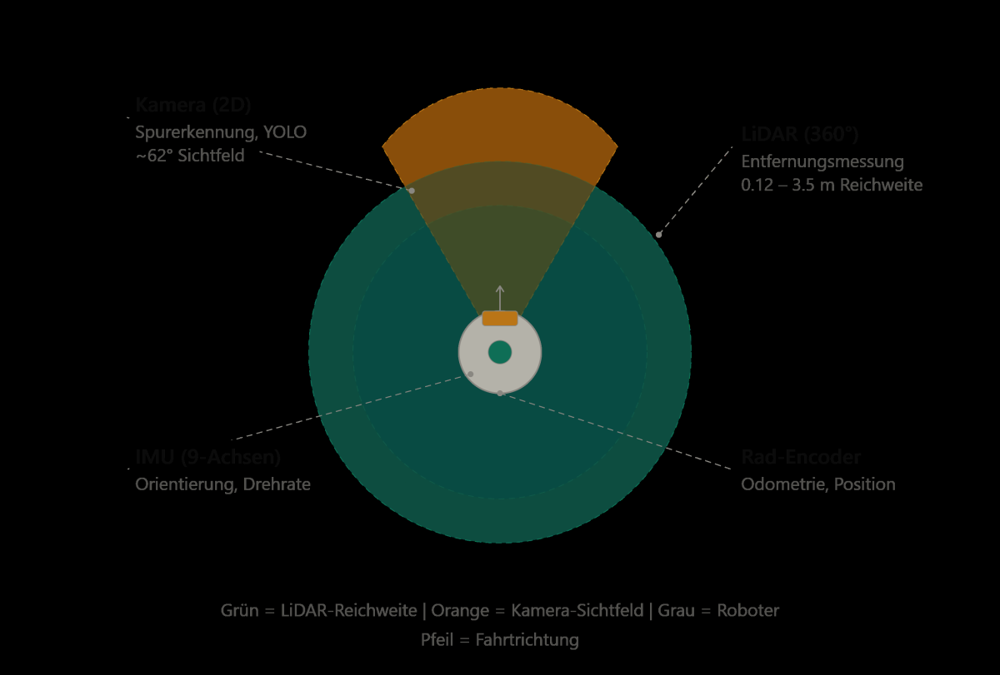
*Sensors (labels in German): front camera (~62° field of view) for lane, barrier and YOLO; 360°
LiDAR (0.12–3.5 m) for obstacles and tunnel; wheel encoders and IMU for odometry.*

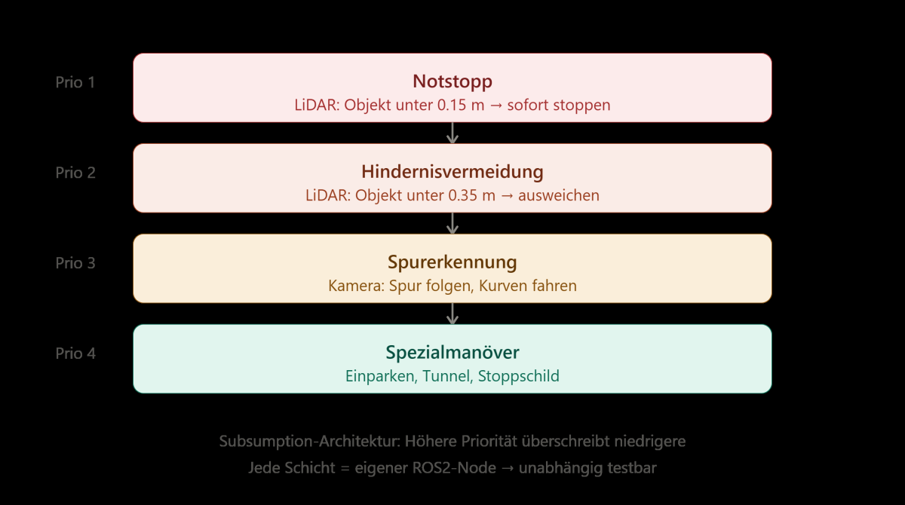
*Original concept (in German): a higher priority overrides a lower one — emergency stop, obstacle
avoidance, lane detection, special manoeuvres. Today this is implemented as the mode decision in
`switch_control`; the distances in the image are concept values, the current ones are given with
the tasks below (e.g. obstacle trigger 0.30 m).*

Camera image: 800x600, wide angle. `ingress_node_nav2` undistorts it (`/lokal/raw_image`). From
that it computes the **bird's-eye view (BEV)** with a fixed scale in cm (`/lokal/bev`, area in
`Parameter/bev.yaml`). For this, the camera's height, tilt and position were measured
(`docs/bev-tests/README.md`).

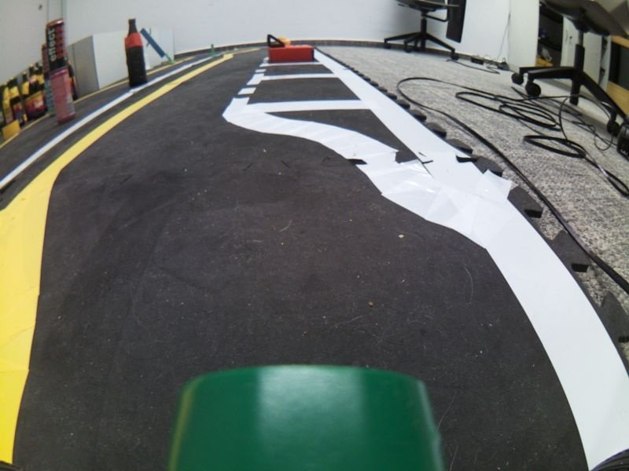
*Raw image from the bot camera (distorted). At the bottom: the bot's own magnet.*

---

## 1. Lane following (Lane)

**Goal:** drive between the yellow (left) and the white line (right).

1. **Bird's-eye view:** the lines are parallel and equally wide everywhere, distances can be measured in cm.
2. **CLAHE:** contrast equalisation on the lightness channel, so light and shadow don't shift the
   fixed colour thresholds.
3. **Colour masks in LAB** (not HSV): yellow is recognised by a high B value, white by a high L
   value with A and B close to 128. The thresholds are in `Follow_Lane_ROI_LAB.yaml`. An erosion
   then removes noise, and the bot's own magnet is masked out.
4. **Find the line edge:** in a band around the search row (`detection_row_factor`, 85 % of the
   image height) a Sobel filter looks for the edge facing the lane. For yellow that is the right edge,
   for white the left one. The median over the rows gives the point. White is only searched to the
   right of yellow + `min_lane_width`.
5. **Tracking:** the search stays near the last position so the bot doesn't jump to another line.
   Large jumps are limited. If a line is missing, the last position holds briefly, then a fallback
   column is used.
6. **Lane error:** the midpoint between the two points is compared with the image centre.
   This gives `lane_error` (-1 … 1, > 0 = lane lies to the left).
7. **PID** (`control_driving`, `Control_driving_PID.yaml`: kp 3.6 / ki 0.15 / kd 1.7): it sets the
   steering. In curves the bot slows down (`speed_curve_factor`), at most `MAX_VEL` 0.15 m/s, and the
   wheel limit is respected.

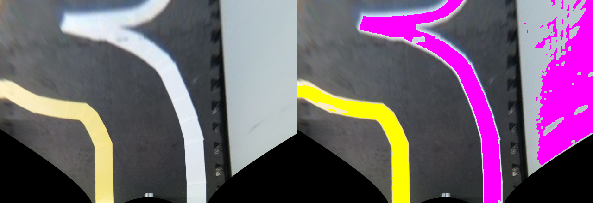
*Left the bird's-eye view, right the masks: yellow = yellow mask, pink = white mask. The bright wall
on the right partly ends up in the white mask too. That is why the search stays close to the tracked edge.*

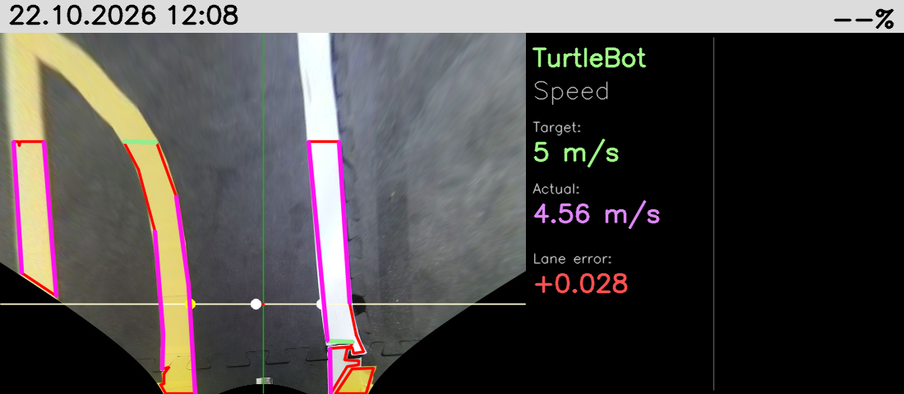
*Debug image: white horizontal line = search row, dots = detected line edges and lane centre, green
vertical = image centre, lane error on the right.*

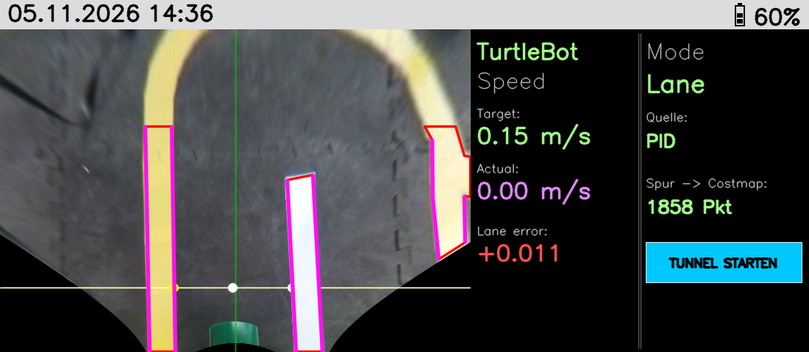
*Current debug view in Lane mode: bird's-eye view with outlined lines (pink) and search row; on the
right target/actual speed, lane error, mode, source of the drive command and the tunnel button.*
**Nodes:** `ingress_node_nav2` → `detect_lane_nav2` (`/detect/lane`) → `control_driving`.
Calibration: `docs/Kalibrierung_Checkliste.md`.

---

## 2. Barrier

**Goal:** stop in front of the closed (blue) barrier, continue once it opens.

1. **Region in the undistorted raw image** (not in the BEV — the barrier is above the ground):
   middle third of the width, 10–40 % of the image height.
2. **Blue mask:** CLAHE, then LAB thresholds for blue (`lab_*_blue_*` in `Follow_Lane_ROI_LAB.yaml`).
3. **Count pixels:** from `thresh_blue_pixel` (15000) on, the barrier counts as present (`/detect/barrier`).
4. **Debouncing in `switch_control`:** after 3 messages in a row it switches Lane → **Stop**. Once the
   barrier has been gone for 1 s, it goes back to **Lane**.

Tuning: the debug image `/detect/barrier_debug` shows the region, the blue mask and the current pixel
count. Then set the threshold in the YAML.

During Storage the barrier is ignored: the zone signs are blue as well.

*Image: none yet. Best to capture `/detect/barrier_debug` at the barrier.*

**Nodes:** `detect_lane_nav2` (`detectBarrier`) → `switch_control` → `control_driving` (zero in Stop).

---

## 3. Intersection – right before left

**Goal:** stop at the stop line, wait while a bot comes from the right, then cross straight ahead.

**Detecting the intersection** (`detect_lane_nav2`, bird's-eye view):
1. Combine the yellow and white masks; a shape filter keeps only line-shaped parts.
2. Yellow and white are followed forward as a contour, starting at the position tracked by the PID.
   If the line bends outwards (cross edge, ~90°), the intersection of the two extended edges is a
   **corner** of the intersection. Rounded corners don't change this.
3. If both corners lie about equally far ahead, it is an intersection. The line between the corners
   is the **stop line**. It is reported only after several frames in a row (`/detect/intersection`).

**Sequence** (`intersection_node`):
1. **Approach:** the PID keeps driving. The stop line is stored in odometry coordinates, so the
   distance stays correct even after it has disappeared under the bot.
2. **Stop** at `stop_distance` (15 cm) before the line, for at least `min_stop_time` (1 s).
3. **Check right of way:** YOLO boxes of class `tb` (another TurtleBot) are converted to ground
   coordinates via their **bottom edge** (where the bot touches the ground). If a foot point lies in the
   zone "rechts" (right) or "mitte" (intersection area), the bot waits. It only starts once no bot has
   been there for a while.
4. **Cross:** straight ahead at `cross_speed` (0.1 m/s), heading perpendicular to the stop line. As soon
   as a lane pair is clearly visible behind the intersection, it steers on that. Then the normal PID
   takes over again.

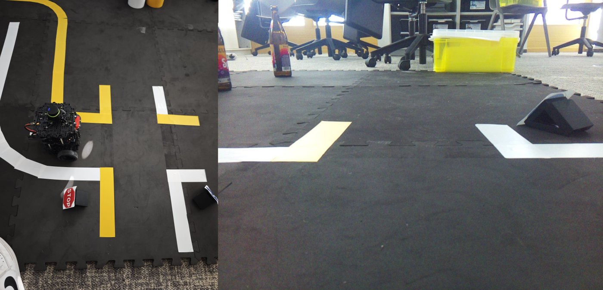
*Left the intersection from above, right roughly the view of the bot camera. The corners where the
lines bend at a right angle give the stop line.*

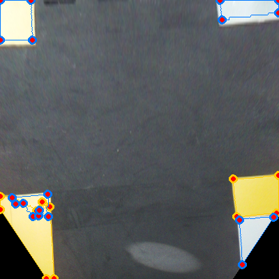
*Corner search experiment: contours of the line masks in the bird's-eye view with their corner points
(red/blue). At the bottom the two corners at the stop line, at the top the lines behind the intersection.*

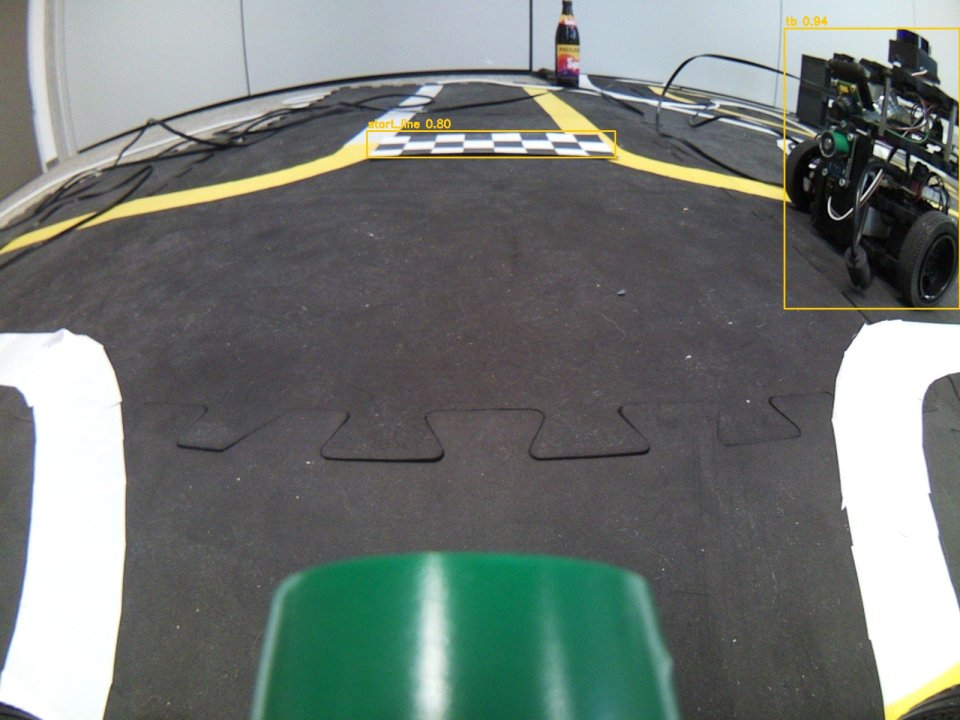
*YOLO on a camera image: `tb` = another TurtleBot (the bottom edge of the box counts for right of
way), `start_line` = start/finish line.*

**Object detection (YOLO / RF-DETR):** runs as a TensorRT engine on the laptop GPU on the raw image
(`/detect/objects`). Classes: tb, park, tunnel, stop, left, right, work, start_line, no_entry. Model
and rate are set with `detector` and `detector_rate_hz` in `Follow_Lane_ROI_LAB.yaml`; usage see
`docs/Befehle.md`.

**Start/finish line:** `start_line` boxes that cover the image centre and are close enough to the
bottom edge (`finish_stop_px`) count as the finish line. After 3 detections in a row
switch_control switches to **Stop**, the run is over.

**Nodes:** `detect_lane_nav2` (stop line, YOLO) → `intersection_node` → `switch_control`
(Lane ↔ Intersection) → `control_driving` (`/intersection/cmd_vel`).

---

## 4. Obstacles (Obstacle)

**Goal:** avoid obstacles on the lane without leaving the lane.

1. **Trigger** (`switch_control`): a LiDAR point lies in the ±45° cone ahead closer than
   `obstacle_trigger_distance` (0.30 m), **and no lane line lies in between**. An object behind a
   line doesn't belong to the bot's own lane. Lane → **Obstacle**.
2. **Lane memory** (`lane_costmap_node`): stores the yellow and white line from the camera as
   **virtual walls** in odometry coordinates, also beside and behind the bot. The lane centre is
   stored as a path.
3. **Map** (Nav2 costmaps): contains the LiDAR obstacles (`scan_correct` first corrects the LiDAR
   measurement error), the lane walls and a block behind the start point (`keepout_zone_node`).
4. **Planning and driving:** `nav2_goal_publisher` sets a goal ahead on the lane centre. NavFn plans
   the path between the walls, through the middle of the gaps. **Regulated Pure Pursuit (RPP)**
   follows it.
5. **Safety:**
   - Every new path is checked with the bot's real footprint 1 m ahead before driving.
   - In narrow passages the bot turns onto the best straight line and drives through slowly. If it
     doesn't fit, the spot is blocked and the path is replanned.
   - The **guard** in `control_driving` checks every command 0.6 s ahead against the map and sends
     zero before the bot hits anything.
   - If the bot gets stuck, it frees itself with small movements.
6. **End:** nothing closer than 0.40 m for 1 s → Lane. If the bot is then more than 15° off, it
   first turns on the spot (**Align**).

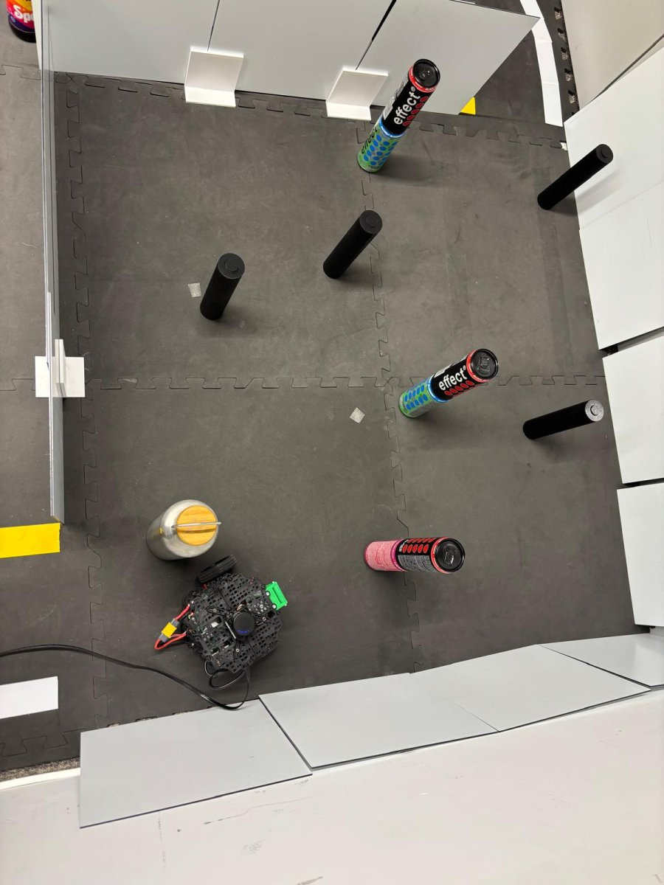
*Test setup from above: cans and tubes as obstacles, the bot at the bottom left.*

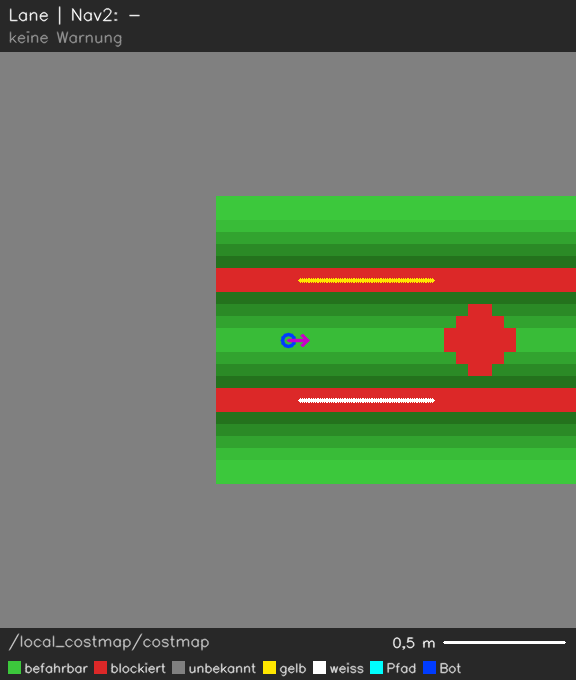
*Map (`nav2_view`): yellow and white line as walls with safety margin (red), an obstacle in the
lane, green = drivable.*

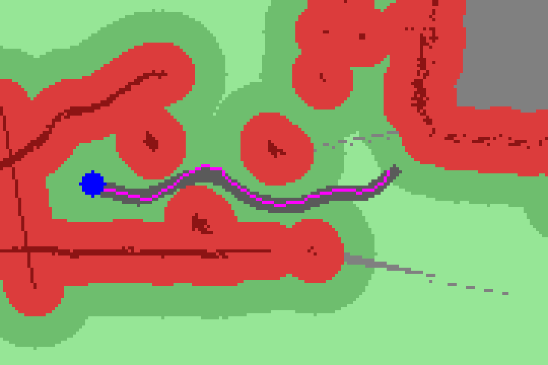
*Planned path (purple) from the bot (blue) through the gaps between obstacles. Red = blocked
(obstacle plus margin), green = drivable, darker = closer to an obstacle.*

**Nodes:** `switch_control`, `lane_costmap_node`, `scan_correct`, `keepout_zone_node`,
`nav2_goal_publisher`, Nav2 (`planner_server`, `controller_server`), `control_driving`.
Details: `docs/Nav2LocalCoastmap_Doku.md`, `docs/Nav2_Costmap_Werte.md`.

---

## 5. Tunnel

**Goal:** enter the tunnel, find the exit and drive out again. **The camera is not allowed inside
the tunnel according to the rules.**

1. **Entry (TunnelEntry):** currently triggered by the button in the debug image. The input
   `/detect/sign` for a tunnel sign exists, but nothing publishes to it yet. Up to the opening the
   PID drives with the camera, because on the 20 cm lane the bot doesn't fit between the lane walls
   for Nav2.
2. **Switch to LiDAR (Tunnel):** when both lane lines end shortly in front of the bot, the opening is
   reached. From then on the camera is off (image processing in `detect_lane` pauses too).
3. **Find the door** (`tunnel_explorer_node`): it looks for the opening in the scan and drives through
   with Nav2. Then the door is blocked (`keepout_zone_node`) so the bot doesn't drive back out.
4. **Search for the exit:** the walls form a **hull** (convex hull of the wall points). An exit can be
   where unknown space touches the wall directly. Grey deeper inside the hull is just shadow behind
   obstacles. Goals are driven to with Nav2 (as in Obstacle: path check, narrow passages, freeing).
   After 40 s only distance counts for choosing the goal.
5. **Outside:** once the bot has left the hull completely, it returns to the previous mode.
   None of this needs the tunnel's dimensions.

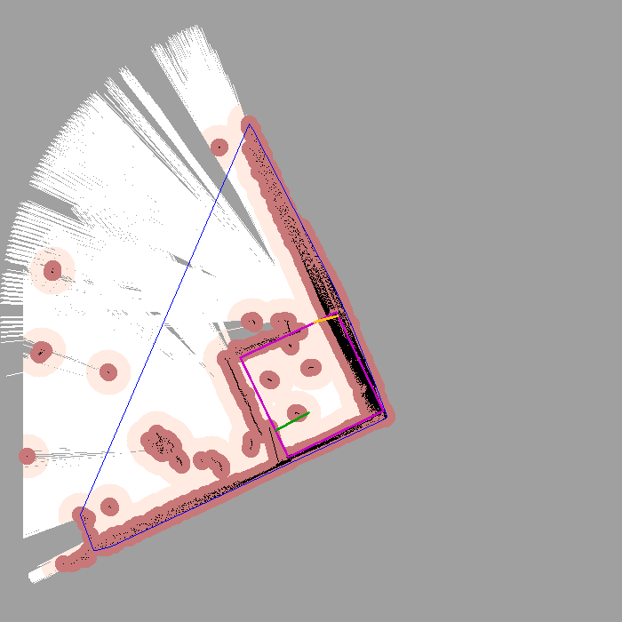
*Log image of a tunnel run (`logs/tunnel/<time>/map.png`): black = walls/obstacles, reddish = safety
margin, white = free, grey = unknown. Blue = wall hull, purple = detected tunnel box, green = door,
orange = exit.*

Open issue (13 Nov): if the bot is already standing at an angle in the entrance, the door search
sometimes picks a wrong segment (`docs/Obstacle_Tunnel_Offene_Punkte.md`, item 8).

**Nodes:** `switch_control` (TunnelEntry/Tunnel), `detect_lane_nav2` (`/detect/lines_lost`),
`tunnel_explorer_node`, `keepout_zone_node`, `nav2_goal_publisher`, Nav2, `control_driving`.

---

## 6. Storage – moving the pallet

**Goal:** fetch the pallet from its zone and put it into the target zone (given by the jury) without
crossing another zone. Pallet, support and signs are **below the LiDAR plane**, so there is **only
camera and odometry**.

1. **Start** via the STORAGE STARTEN button in the debug image. The sequence is controlled by
   `storage_sequence` (part of `switch_control`).
2. **Explore:** lane following along the zones (they lie to the right of the lane). `storage_zone_node`
   finds the **white cross lines** next to the lane in the bird's-eye view, i.e. the zone borders.
   From these it builds the **zone model** (position and width of each zone, in odometry coordinates).
3. **In front of each zone:** drive to the zone centre, turn towards the zone and read:
   - **Sign** (`storage_sign_node`): blue circle with a white digit 1–3, template matching.
   - **Fill:** is there enough between the zone lines that is neither dark floor nor white line?
     Then the pallet is there. The node learns the floor itself from the lane centre; there is no
     fixed threshold.
4. **Align** (Maneuver): the front edge of the pallet in the BEV gives distance and lateral offset.
   If offset, the bot moves parallel to the lane and turns back to the zone.
5. **Dock:** straight ahead, at the end at 3 cm/s. `pallet_node` detects contact when **the image
   above the magnet stands still** although the bot is moving forward.
6. **Grip:** magnet on, 3 cm back. If the image above the magnet stays the same (correlation
   ≥ 0.8), the pallet is attached.
7. **Transport:** reverse onto the lane, along the lane to the target zone, turn in.
8. **Drop:** go in as deep as when picking up, magnet off. **Leave:** back onto the lane, continue
   with lane following.

*Image: none yet. Useful would be one of `/detect/zone_debug` (pallet tinted red, zone borders
yellow) and one of `/detect/storage_sign_debug`.*

**Nodes:** `switch_control` + `storage_sequence`, `storage_zone_node`, `storage_sign_node`,
`pallet_node`, `control_driving` (Maneuver), magnet via `/lokal/magnet_control`.
In detail (German): `docs/Storage_Retrieval_Konzept.md`.

---

## Starting

```bash
bash scripts/tb/launchers/komplett.sh       # everything: lane, barrier, intersection, Nav2, tunnel, storage
bash scripts/tb/launchers/follow_lane.sh    # lane following only (+ barrier, intersection), without Nav2
```

More commands: `docs/Befehle.md`.

## Further reading (German)

| File | Content |
|------|---------|
| `docs/Konzept_Nav2.md` | Architecture, modes, Obstacle and Tunnel in detail |
| `docs/Nav2LocalCoastmap_Doku.md` | Nodes, parameters, Obstacle/Tunnel sequences |
| `docs/Storage_Retrieval_Konzept.md` | Storage: states, topics, decisions |
| `docs/Kalibrierung_Checkliste.md` | Camera, bird's-eye view, colour thresholds |
| `docs/bev-tests/README.md` | Camera measurement, sharpness of the bird's-eye view |
| `docs/Obstacle_Tunnel_Offene_Punkte.md` | Test observations, open issues |
