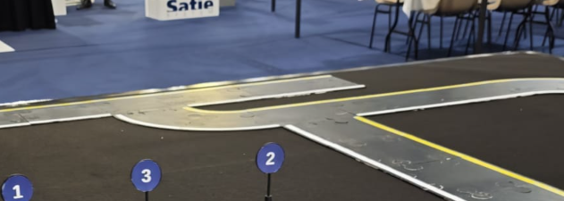

Änderungen :

Schranke vor der Kreuzung
Schilder von Paletten 
bisher zwei Zonen zugestellt mit objekten? also vllt noch auf Blau checken ob palette da ist?
SCHILDER erkennen? Stoppschild erkennen, also einfach auf rot erkennen ABER NICHT LILA 

schilder von paletten erkennen? 

Stopp schild immer nur an lane 
Einfahrt verboten schild immer nur an Kreuzung? 